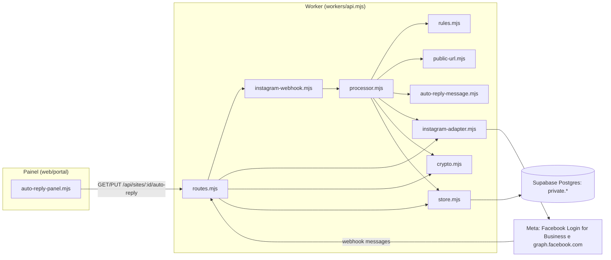
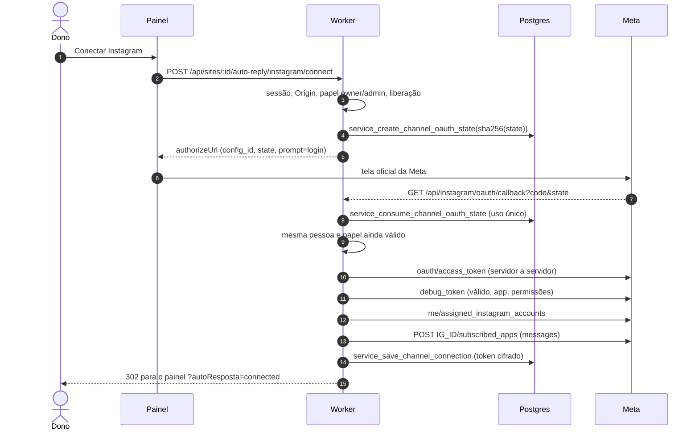
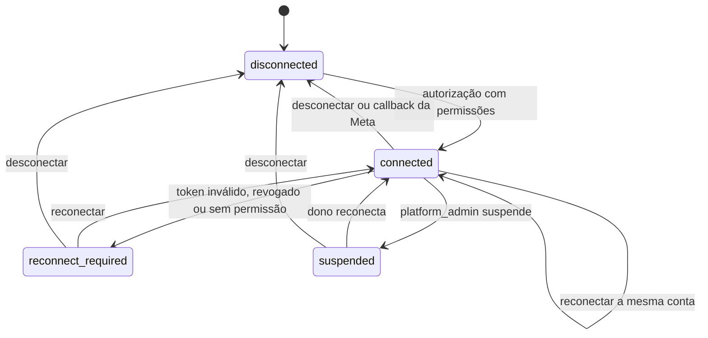
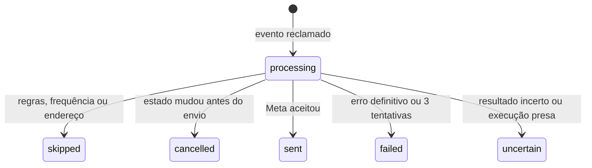

# Arquitetura da AutoResposta

Estado: implementado no repositório com a Meta simulada; sem deploy. Decisões no [ADR 0017](../../adr/0017-autoresposta-canais-sociais.md).

## Componentes



| Componente pedido | Onde |
| --- | --- |
| Conexões e credenciais | `channel_connections`, `channel_credentials`, `crypto.mjs` (AES-GCM) |
| Configurações | `auto_reply_settings`, `save_auto_reply_settings` |
| Adaptador Instagram | `instagram-adapter.mjs` |
| Receptor e validador de webhooks | `routes.mjs` (`handleWebhook`) e `instagram-webhook.mjs` |
| Elegibilidade e frequência | `rules.mjs` e `service_claim_recipient_window` |
| Resolvedor de URL | `public-url.mjs` |
| Processador de mensagens | `processor.mjs` |
| Registro de execuções | `auto_reply_deliveries` |
| Monitoramento | logs `auto_reply_*` com `correlationId` e `admin_read_auto_reply` |

## Autorização (OAuth)



## Recebimento do evento e envio

```mermaid
sequenceDiagram
  autonumber
  participant M as Meta
  participant W as Worker
  participant DB as Postgres
  M->>W: POST /api/webhooks/meta/instagram
  W->>W: tamanho, X-Hub-Signature-256, JSON, normalização
  loop até 5 eventos novos
    W->>DB: service_auto_reply_target (cache por conta)
    W->>DB: service_claim_auto_reply_event (único por mid)
  end
  W-->>M: 200 (500 se o banco falhar; 503 se sobrou evento)
  Note over W: ctx.waitUntil
  W->>W: regras (interruptores, liberação, conexão, ativação, janela)
  W->>DB: service_claim_recipient_window
  W->>W: endereço público e mensagem
  W->>DB: service_auto_reply_target (releitura)
  W->>M: POST IG_ID/messages (até 3 tentativas)
  W->>DB: service_finish_auto_reply_delivery
```

## Ciclo de vida da conexão



`disconnected` não é linha no banco: é a ausência de conexão. Em `reconnect_required` e `suspended` a resposta é desligada e só volta por ativação expressa.

## Estados operacionais de uma execução



## Modelo de dados

Diagrama e tabelas em [`specs/019-autoresposta/data-model.md`](../../../specs/019-autoresposta/data-model.md).

## Preparação para outros canais

`provider` existe nas tabelas e no adaptador. Um canal novo (WhatsApp) precisa de: migração ampliando `provider`, adaptador próprio (autorização, credencial, validação do webhook, destinatário, regras de janela e de custo, envio), rota de webhook própria e testes. `rules.mjs`, `public-url.mjs`, `auto-reply-message.mjs`, a frequência e o registro não mudam. O WhatsApp tem regras diferentes (janela de atendimento, modelos pagos fora da janela, coexistência com o app Business) que **não** devem ser escondidas atrás de uma abstração genérica; ver [`whatsapp-discovery.md`](whatsapp-discovery.md).

## Falhas e isolamento da vitrine pública

As rotas da AutoResposta não participam da renderização da vitrine pública nem do cache na borda. Falha da Meta, do banco ou do processamento afeta só a resposta automática.
