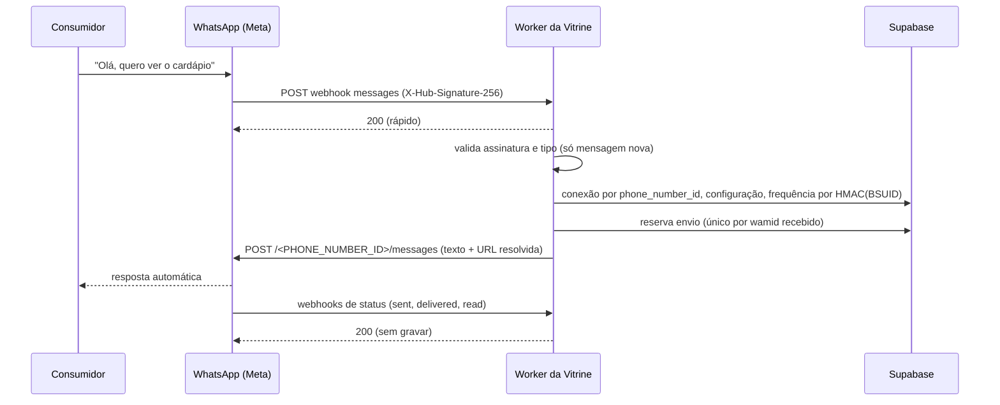

# AutoResposta no WhatsApp — discovery de viabilidade

Status: **discovery, sem implementação**. Nenhuma conta, app, número ou webhook da Meta foi
criado ou alterado. Pesquisa feita em 26/11/2026, só na documentação oficial da Meta e na
Central de Ajuda do WhatsApp (fontes no fim). Preços e regras da Meta mudam por trimestre
(calendário de preços: 1º de janeiro, abril, julho e outubro) e **devem ser reconferidos**
antes de qualquer decisão.

Escopo: Épico 10 ("Discovery WhatsApp") da AutoResposta. O MVP continua sendo o Instagram;
este documento só responde se, quando e como o WhatsApp poderia entrar, e compara com a
saudação nativa do aplicativo WhatsApp Business.

## Resumo

- **É viável tecnicamente** pela Cloud API com Embedded Signup e coexistência (o dono continua
  usando o aplicativo WhatsApp Business no mesmo número). A resposta automática a quem escreveu
  é uma mensagem de serviço (sem modelo), permitida dentro da janela de 24 horas.
- **Não é de custo zero como as ADRs 0012 e 0015 pressupõem.** Desde 1º/10/2026 a Meta cobra
  mensagens de serviço: cada número tem **1.000 grátis por mês**; a partir da 1.001ª, **R$ 0,035**
  por mensagem entregue a número do Brasil. A cobrança vai para a conta de mensagens do próprio
  negócio, que precisa cadastrar meio de pagamento na Meta.
- **O custo maior é de produto, não de dinheiro.** Para o dono, conectar o número à Cloud API
  desliga as listas de transmissão, as mensagens temporárias e de visualização única, desconecta
  os aparelhos vinculados e exige conta no Facebook ou na Meta, portfólio empresarial e cartão
  na Meta. Para a Inspira, exige virar *Tech Provider* (verificação da empresa e App Review de
  duas permissões avançadas).
- **A saudação nativa do WhatsApp Business já resolve quase todo o caso de uso**, sem custo, sem
  app Meta e sem webhook: envia um texto fixo no primeiro contato e depois de 14 dias sem
  conversa.
- **Recomendação:** no MVP, o WhatsApp entra como **saudação nativa assistida pelo painel** (texto
  pronto com a URL da vitrine, botão copiar e passo a passo). A Cloud API fica para uma fase
  posterior, com gatilhos claros, um *spike* só com conta *sandbox* e uma ADR nova.

## O que já existe no repositório

| Onde | O que diz | Relação com este discovery |
| --- | --- | --- |
| [ADR 0005](../../adr/0005-zero-cost-mvp.md) | Piloto sem "API WhatsApp paga". | Vale para a Inspira. No modelo *Tech Provider* quem paga é o negócio, mas o cartão dele na Meta passa a ser requisito. |
| [ADR 0012](../../adr/0012-pedidos-pela-mila.md) | Mila é pessoa no app WhatsApp Business; o robô na Cloud API foi descartado porque o repasse ao dono exigiria modelo pago. | Continua válido. A frase "a resposta dentro da janela de 24 horas é gratuita" ficou desatualizada em 1º/10/2026. |
| [ADR 0015](../../adr/0015-login-multiplo-whatsapp.md) e [`specs/017-login-multiplo`](../../../specs/017-login-multiplo/plan.md) | Código de login enviado como resposta de serviço pelo número da Vitrine; "custo de mensagens zero"; rota planejada `/api/whatsapp/webhook`, ainda não implementada. | Mesmo app Meta e mesma rota de webhook podem ser compartilhados. Ver o achado lateral sobre custo mais abaixo. |
| [`docs/instagram/mensagens-futuro.md`](../../instagram/mensagens-futuro.md) | Regras de janela de 24 horas e de App Review para mensagens no Instagram. | Mesma lógica de "só responder", com regras e tokens diferentes. |
| [`docs/central-de-canais.md`](../../central-de-canais.md) | WhatsApp é link direto (`wa.me`) ou modo Mila; nada envia mensagem sozinho. | A saudação nativa assistida cabe nessa central sem mudar o contrato. |
| `web/assets/metrics-source.mjs` | `utm_source=whatsapp` já é uma origem aceita nas métricas. | Permite medir visitas vindas da saudação nativa sem código novo. |
| [Issue #48](https://github.com/coletivo-inspira/vitrine/issues/48) (fechada) | App Meta "ColetivoInspira", tipo Empresa, em modo de desenvolvimento; só Instagram; webhooks, URLs públicas, testadores e App Review pendentes no checkpoint de 12/11/2026. | Não há produto WhatsApp, Embedded Signup, nem verificação da empresa registrados. Tudo do WhatsApp parte do zero. |

Não há issue aberta sobre AutoResposta no WhatsApp. As issues fechadas com "WhatsApp" no título
(#119, #125, #133) tratam de links `wa.me` e métricas, não de envio automático.

## Como funcionaria pela Cloud API

### Atores e identificadores

- **App Meta da Inspira** com o caso de uso WhatsApp e *Facebook Login for Business* (o Embedded
  Signup depende dele). É um produto de login diferente do *Instagram API with Instagram Login*
  priorizado para o Instagram: o dono precisa entrar com conta do Facebook ou da Meta, não com a
  conta do Instagram.
- **Conta de mensagens** (*Messaging account*, antiga WABA). A Meta está dividindo a WABA em
  "conta do WhatsApp" (número e identidade) e "conta de mensagens" (modelos, cobrança e
  assinatura de webhooks). O `waba_id` devolvido pelo Embedded Signup passou a identificar a
  conta de mensagens, com o mesmo valor; o recurso está em beta.
- **Phone Number ID** (`phone_number_id`): identifica o número do negócio nas chamadas de envio
  e chega em `metadata.phone_number_id` em cada webhook. É a chave natural para vincular número e
  vitrine (RN-009: uma vitrine com resposta ativa por número).
- **Business token** (*Business Integration System User access token*): token por cliente, obtido
  trocando no servidor o código devolvido pelo Embedded Signup. Serve para ações automáticas
  "sem depender de nova autenticação". Fica só no Worker, cifrado como os segredos de
  `private.quote_webhooks`.
- **BSUID** (`user_id`, `from_user_id`): identificador do consumidor por empresa. Com a chegada
  dos nomes de usuário em 2026, o telefone (`wa_id`, `from`) **pode não vir** no webhook. O
  controle de frequência deve usar HMAC do BSUID, não o telefone.

### Papel da Inspira: *Tech Provider*

Para operar números de outros negócios, a Inspira precisaria
[virar *Tech Provider*](https://developers.facebook.com/docs/whatsapp/solution-providers/get-started-for-tech-providers):

1. **Verificação da empresa** (Coletivo Inspira) na Meta.
2. **App Review** com acesso avançado a duas permissões, cada uma com texto e vídeo próprios:
   - `whatsapp_business_messaging`: enviar mensagens e receber webhooks de mensagens e status;
   - `whatsapp_business_management`: acessar a conta de mensagens do cliente e assinar webhooks.
     Sem acesso avançado, chamadas a contas de outros negócios devolvem erro `200`.
   O vídeo da segunda permissão pede a criação de um modelo de mensagem (pode ser no WhatsApp
   Manager), embora a AutoResposta nunca use modelos.
3. **Limite de entrada de clientes:** 10 contas novas por 7 dias corridos; sobe para 200 por
   semana depois de verificação da empresa, App Review e *Access Verification*. Com 200 por
   semana, conectar 1.000 vitrines leva no mínimo 5 semanas.

O caminho de *Solution Partner* (a Inspira compartilha a própria linha de crédito com os
clientes e paga as mensagens) fere a ADR 0005 e fica descartado.

### Onboarding pelo Embedded Signup

Requisitos e passos documentados para *Tech Provider*:

1. O dono clica em "Conectar WhatsApp" no painel; o SDK JavaScript da Meta abre o Embedded Signup
   (versão atual `v5`; `v2` e `v3` foram desativadas em 15/10/2026).
2. Ele entra com Facebook ou Meta, aceita os termos, escolhe ou cria portfólio empresarial e conta
   do WhatsApp, informa o número e o nome de exibição. Na `v5`, a opção de conectar um número já
   usado no app WhatsApp Business vem ligada.
3. A janela devolve `waba_id`, `phone_number_id` e um código de troca. O Worker, servidor a
   servidor:
   - troca o código pelo *business token* (`GET /oauth/access_token`);
   - assina os webhooks da conta de mensagens (`POST /<WABA_ID>/subscribed_apps`);
   - registra o número na Cloud API (`POST /<PHONE_NUMBER_ID>/register`), **exceto na
     coexistência**, em que o número já está registrado.
4. O dono **cadastra um meio de pagamento** na conta de mensagens pelo WhatsApp Manager. O guia de
   onboarding diz que só depois disso o cliente pode começar a enviar.

O dono passa a ter acesso total ao WhatsApp Manager desses ativos, e a Inspira não pode
restringir esse acesso.

### Coexistência com o aplicativo WhatsApp Business

O fluxo de [onboarding de usuários do app](https://developers.facebook.com/docs/whatsapp/embedded-signup/custom-flows/onboarding-business-app-users)
mantém o mesmo número no app e na Cloud API, com o histórico sincronizado entre os dois. Pontos
que pesam na AutoResposta:

| Tema | O que a Meta documenta | Efeito na AutoResposta |
| --- | --- | --- |
| Quem pode | Só números do **aplicativo WhatsApp Business** (versão 2.24.17 ou mais nova). A Inspira precisa já ser *Tech Provider* e usar Embedded Signup com registro de sessão. | Quem usa o WhatsApp comum não tem coexistência; migrar o número para a Cloud API tiraria o app dele. Fora de questão sem autorização expressa. |
| Recursos que o dono perde no app | Listas de transmissão desligadas (as existentes ficam só leitura); mensagens temporárias, de visualização única e localização em tempo real desligadas nas conversas individuais; aparelhos vinculados desconectados (é preciso vincular de novo; WhatsApp para Windows e WearOS não são aceitos). | Custo alto para pequenos negócios que usam listas de transmissão. Precisa de aviso claro antes de conectar. |
| Recursos que continuam no app | Saudação, ausência, respostas rápidas, etiquetas, catálogo e perfil seguem funcionando no app ("sem mudança"), mas não existem na Cloud API. | **Risco de duas saudações** (a nativa e a da Vitrine). O painel deveria pedir para desligar a saudação nativa ao ativar a AutoResposta. |
| Janela de atendimento | Só abre com mensagem recebida **depois** da conexão. Mensagens enviadas pelo app não abrem, não estendem e não afetam a janela nem a cobrança da Cloud API. | Respostas do dono pelo app continuam grátis. Mensagens anteriores à conexão não são respondidas (coerente com "não reprocessar eventos antigos"). |
| Vazão | 20 mensagens por segundo por número em coexistência. | Irrelevante para uma resposta por contato. |
| Webhooks exigidos | O guia manda assinar `account_update`, `history`, `smb_app_state_sync` e `smb_message_echoes`. | `smb_message_echoes` chega a cada mensagem que o dono envia pelo app: mais volume no Worker e um tipo de evento que precisa ser ignorado (RN-007). |
| Sincronização | Contatos e histórico de 6 meses podem ser sincronizados uma única vez, em até 24 horas depois do onboarding; o dono escolhe se compartilha o histórico. | A AutoResposta **não deve pedir** essa sincronização (RN-013: não guardar conversas). A confirmar que pular a sincronização não causa desligamento (ver dúvidas). |
| Desconexão | Não dá para descadastrar pela API. O dono desconecta no app em Configurações > Conta > Plataforma comercial; chega `account_update` com `PARTNER_REMOVED`. | RN-011 precisa tratar esse evento e explicar ao dono onde desconectar. |
| Erro esperado | Webhook `unsupported` com código `131060` na primeira mensagem de um contato ou vinda de aparelho vinculado não aceito. | Tratar como "não elegível" sem alerta. |

Se o dono já usa outra ferramenta na Cloud API no mesmo número (por exemplo um chatbot de
terceiros), todos os parceiros recebem todas as mensagens por padrão. O
[roteamento de conversas](https://developers.facebook.com/documentation/business-messaging/whatsapp/conversation-routing/overview.md)
só entra em vigor quando o próprio negócio configura um responsável por ponto de entrada; quem não
é dono da conversa não deve responder. Para evitar respostas em dobro (RN-008), a Vitrine deveria
conferir os papéis do número pela *Routing Roles API* e não responder quando não for a
responsável pelo atendimento.

### Regras de envio

- **Janela de 24 horas:** mensagem sem modelo (texto livre) só dentro da janela aberta pela última
  mensagem do consumidor; fora dela, só modelo aprovado. A AutoResposta só responde, então nunca
  usa modelo nem inicia conversa.
- **Consentimento:** a política exige consentimento para **contatar** pessoas. Responder dentro da
  janela a quem escreveu não pede consentimento extra. O negócio continua obrigado a respeitar
  pedidos de bloqueio ou de parar de receber mensagens.
- **Automação:** a
  [política de mensagens](https://business.whatsapp.com/policy) permite automação dentro da
  janela, desde que haja caminhos de escalonamento claros (atendimento humano na conversa, e-mail,
  telefone, loja etc.). Como o atendimento continua no app, basta o texto padrão deixar isso
  explícito, por exemplo: "Se preferir, continue por aqui que respondemos em seguida."
- **Uso dos dados:** dados recebidos da Meta sobre o consumidor só podem ser usados para atender
  aquela conversa. O webhook traz o texto e o nome de perfil: processar em memória e descartar.
- **Formato:** texto até 4.096 caracteres, com URL; `preview_url: true` mostra a prévia do link.
- **Limites de envio** (*messaging limits*: 250 contatos únicos por 24 horas em portfólio novo)
  valem só **fora** da janela de atendimento e não afetam respostas. Há limite de vazão (80
  mensagens por segundo por número, 20 em coexistência) e um limite por par empresa e usuário,
  que o controle de frequência já evita.
- **Qualidade:** bloqueios e denúncias reduzem a capacidade do número. Uma resposta por contato,
  com intervalo mínimo (RN-006), reduz esse risco.

### Webhooks e confiabilidade

- Uma URL de callback por app recebe os webhooks de todos os clientes; dá para sobrescrever por
  conta de mensagens ou por número. O roteamento é por `entry.id` (conta de mensagens) e
  `metadata.phone_number_id`.
- Assinatura `X-Hub-Signature-256` com o segredo do app, como no Instagram. Corpo de até 3 MB.
- A Meta reenvia por até **7 dias** quando não recebe `200`, e reenvia a todos os apps assinados,
  o que pode duplicar eventos. A idempotência pelo `wamid` recebido (RN-005) é obrigatória.
- Referência de latência da Meta: mediana até 250 ms e menos de 1% acima de 1 s. Encaixa no
  padrão "responder `200` e processar em `ctx.waitUntil`" já usado no pré-orçamento e planejado
  na spec 017.
- Alguns webhooks não chegam com o app em modo de desenvolvimento; o app da Inspira está nesse
  modo (issue #48).
- O campo `messages` traz mensagens recebidas **e** status (`sent`, `delivered`, `read`,
  `failed`) das mensagens enviadas. Só `messages[].type` de mensagem nova do consumidor é elegível;
  status, ecos (`smb_message_echoes`), edições, reações, `unsupported` e `system` são ignorados.

### Dados mínimos (proposta)

Seguindo o modelo conceitual do brief, com diferenças do WhatsApp:

- conexão: `provider = 'whatsapp'`, `waba_id`, `phone_number_id`, número exibido mascarado, nome
  de exibição, se está em coexistência (`is_on_biz_app`), situação e datas;
- credencial: *business token* cifrado (AES-GCM, chave só no Worker), nunca no navegador nem em
  log;
- frequência: `(conexão, HMAC(BSUID), último envio)`, com retenção igual ao maior intervalo
  configurado; o modo "uma vez por contato" precisa de um teto de retenção (por exemplo 12 meses)
  para não guardar pseudônimos para sempre;
- entregas: `wamid` recebido (único), `wamid` enviado, situação, código de erro e datas; sem texto,
  sem telefone, sem nome de perfil. Retenção curta (30 a 90 dias) e contadores agregados.

## Alternativa: saudação nativa do WhatsApp Business

A [mensagem de saudação](https://faq.whatsapp.com/501866148528310/) é configurada no próprio app
(Ferramentas > Mensagem de saudação). Ela é enviada automaticamente na primeira mensagem do
cliente e de novo depois de 14 dias sem conversa, para "Todos", "Todos exceto meus contatos",
"Todos exceto…" ou "Somente…". O aparelho precisa estar com internet, e a saudação é desligada
automaticamente se o Meta Business Agent estiver conectado ao número.

| Critério | Saudação nativa | AutoResposta pela Cloud API |
| --- | --- | --- |
| Custo para a Inspira | Zero | Zero em mensagens; cota do Workers Free e do Supabase Free; esforço de *Tech Provider* |
| Custo para o negócio | Zero | Zero até 1.000 respostas por mês por número; R$ 0,035 por resposta acima disso; cartão na Meta |
| O que o dono precisa | App WhatsApp Business | App WhatsApp Business (para coexistência), conta Facebook ou Meta, portfólio empresarial, cartão na Meta |
| O que o dono perde | Nada | Listas de transmissão, mensagens temporárias, de visualização única e localização em tempo real; precisa vincular os aparelhos de novo |
| Aprovação da Meta | Nenhuma | Verificação da empresa e App Review (duas permissões) |
| Gatilho | Primeira mensagem ou 14 dias sem conversa | Cada mensagem elegível, com intervalo configurável (uma vez, 24 horas, 7 dias) |
| Filtro de destinatários | Contatos salvos, lista de inclusão ou exclusão | Só frequência (filtros por contato fora do escopo) |
| URL da vitrine | Texto fixo; muda só se o dono editar | Resolvida no envio (domínio próprio, endereço padrão), sem cópia fixa |
| Vitrine despublicada | Link continua sendo enviado | Envio bloqueado (RN-001) |
| Ligar e desligar pelo painel | Não; só no app | Sim, inclusive desligamento global (RN-010, CT-030) |
| Métricas | Visitas com `?utm_source=whatsapp` | Envios, ignorados, falhas e visitas |
| Depende do celular | Sim (precisa de internet) | Não |
| Risco de conflito | Nenhum | Saudação dupla; outros parceiros no mesmo número |

A saudação nativa cobre o objetivo do produto ("responder uma vez com a URL da vitrine") com
três limitações: intervalo fixo de 14 dias, URL fixa no texto e nenhum controle pelo painel. A
segunda limitação pode ser reduzida usando no texto um endereço estável da Vitrine. Hoje o
domínio próprio redireciona para `vitrine.inspira.dev.br/<endereço>` quando perde o recurso
`custom_domain`; falta confirmar se o caminho inverso (endereço padrão levando ao domínio
próprio ativo) existe.

## Estimativa de custos

### Premissas

- Valores da tabela BRL da Meta em vigor desde 1º/10/2026, para números do Brasil: serviço
  **R$ 0,0350**, utilidade R$ 0,0350, marketing R$ 0,3217 (resto da América Latina: serviço
  R$ 0,0582). Só serviço se aplica à AutoResposta.
- 1.000 mensagens de serviço grátis por mês **por número do negócio**, sem acumular. A franquia é
  do número, então é dividida com qualquer outra ferramenta na Cloud API que responda pelo mesmo
  número.
- Modelo *Tech Provider*: a cobrança da Meta vai para a conta de mensagens de cada negócio; a
  Inspira não paga mensagens.
- Uma resposta automática por mensagem elegível, respeitando a frequência. Mensagens do dono pelo
  app não são cobradas e não contam na franquia.
- Webhooks por mês, por vitrine = mensagens de consumidores + ecos das mensagens do dono pelo app
  (coexistência) + 3 status por resposta (`sent`, `delivered`, `read`). Sem sincronização de
  histórico.
- Uma linha de entrega por resposta, cerca de 250 bytes com índices (estimativa).
- Workers Free: 100.000 requisições por dia, divididas com a vitrine pública, o painel e os
  webhooks do Instagram. Supabase Free: 500 MB de banco.

Três perfis por vitrine por mês:

| Perfil | Mensagens de consumidores | Respostas automáticas | Mensagens do dono pelo app | Webhooks recebidos |
| --- | --- | --- | --- | --- |
| Baixo | 60 | 30 | 60 | 210 |
| Médio | 400 | 150 | 400 | 1.250 |
| Alto | 2.500 | 1.100 | 2.500 | 8.300 |

**Eventos recebidos não são mensagens enviadas:** no perfil alto, cada resposta enviada gera em
média 7,5 webhooks.

### Custo da Meta (pago por cada negócio)

| Perfil | Por vitrine por mês | 10 vitrines | 100 vitrines | 1.000 vitrines |
| --- | --- | --- | --- | --- |
| Baixo (30 respostas) | R$ 0,00 | R$ 0,00 | R$ 0,00 | R$ 0,00 |
| Médio (150 respostas) | R$ 0,00 | R$ 0,00 | R$ 0,00 | R$ 0,00 |
| Alto (1.100 respostas) | R$ 3,50 (100 × R$ 0,035) | R$ 35 | R$ 350 | R$ 3.500 |

Custo da Meta para a Inspira: **R$ 0** no modelo *Tech Provider*. Se a Inspira pagasse as
mensagens (modelo *Solution Partner*), os mesmos valores cairiam na conta dela, o que a ADR 0005
proíbe.

### Infraestrutura da Inspira (planos gratuitos)

Webhooks por dia (média de 30 dias), só da AutoResposta no WhatsApp:

| Perfil | 10 vitrines | 100 vitrines | 1.000 vitrines |
| --- | --- | --- | --- |
| Baixo | 70 | 700 | 7.000 |
| Médio | 420 | 4.200 | 42.000 |
| Alto | 2.770 | 27.700 | 277.000 (acima das 100.000 do Workers Free) |

Linhas de entrega por mês no Supabase: médio com 1.000 vitrines dá 150 mil linhas (cerca de
38 MB por mês, cabe com retenção de 90 dias); alto com 1.000 vitrines dá 1,1 milhão de linhas
(cerca de 275 MB por mês, exige retenção de até 30 dias e contadores agregados).

Cada webhook custa pouca CPU (HMAC-SHA256 pelo WebCrypto e parsing de JSON) e no máximo três
subrequisições (Supabase e envio na Meta), dentro dos limites por invocação do Workers Free.
Picos importam mais que médias: a Meta entrega webhooks em paralelo e reenvia por 7 dias depois
de uma falha.

Proteções contra crescimento de custo:

1. Teto de conexões WhatsApp ativas por *feature flag* (por exemplo 10 no piloto), além do teto
   global da AutoResposta.
2. Não gravar nada em webhooks de status e de eco; responder `200` e descartar.
3. Não pedir sincronização de histórico nem de contatos.
4. Contador diário de webhooks com alerta a 50% da cota do Workers e desligamento automático da
   AutoResposta antes de afetar a vitrine pública.
5. Painel avisa o dono quando ele se aproxima das 1.000 respostas do mês, lendo o objeto
   `pricing` dos webhooks de status (`billable`, `type`, `subtype: free_tier`), sem gravar o
   conteúdo.
6. Retenção curta das entregas e do controle de frequência.

### Saudação nativa

Zero para todos e em qualquer escala: nenhum webhook, nenhuma linha no banco, nenhuma mensagem
cobrada.

## Achado lateral: custo das mensagens de serviço mudou em 1º/10/2026

A [ADR 0015](../../adr/0015-login-multiplo-whatsapp.md) (código de login como resposta de serviço)
e a [ADR 0012](../../adr/0012-pedidos-pela-mila.md) tratam a resposta dentro da janela de 24 horas
como gratuita. Pela documentação atual da Meta:

- desde 1º/10/2026, mensagens de serviço são cobradas depois das 1.000 grátis por número por mês;
- sem meio de pagamento, a Meta entrega dentro da franquia e **deixa de entregar** acima dela.

Para o login (spec 017), isso só vira custo acima de 1.000 códigos por mês no número da Vitrine,
mas a ADR 0015 e o `research.md` da spec 017 precisam registrar a franquia e o comportamento sem
cartão. A página comercial `business.whatsapp.com/products/platform-pricing` ainda dizia, em
26/11/2026, que mensagens de serviço não são cobradas. A documentação para desenvolvedores e a
tabela de preços (que já tem a coluna "Service") são as fontes mais recentes.

## Recomendação de evolução

1. **Agora (junto com o MVP do Instagram): saudação nativa assistida.** Na seção "Integrações >
   Resposta automática", o cartão do WhatsApp não conecta nada. Mostra a mensagem padrão com
   `{{vitrine.nome}}` e a URL pública resolvida (com `?utm_source=whatsapp`), botão "Copiar", passo
   a passo da Central de Ajuda, aviso da regra dos 14 dias e da opção "Todos exceto meus
   contatos". Não precisa de API, permissão, banco nem custo. Mede o interesse pelas visitas com
   origem WhatsApp.
2. **Gatilhos para estudar a Cloud API:** AutoResposta do Instagram estável em produção; pedidos
   reais de donos por controles que a saudação nativa não tem; decisão de produto aceitando cartão
   na Meta e perda das listas de transmissão; verificação da empresa Coletivo Inspira concluída
   (já necessária para o Instagram).
3. **Spike técnico só com sandbox.** Conta *sandbox* do Embedded Signup (dura 90 dias e envia
   para até 5 destinatários de teste), app em modo de desenvolvimento, sem números de clientes.
   Responde às dúvidas abaixo, mede volume de webhooks e testa coexistência num número do próprio
   Coletivo, só com autorização expressa do responsável pelo número.
4. **ADR nova antes de implementar**, decidindo: *Tech Provider* sim ou não; app Meta único para
   Instagram, WhatsApp e login (ADR 0015) ou apps separados; cartão do cliente na Meta como
   requisito; teto de conexões. Só então App Review das duas permissões e piloto com contas do
   Coletivo.
5. **Não fazer:** modelo *Solution Partner* com linha de crédito da Inspira; um número da Inspira
   respondendo em nome das vitrines; automação não oficial (WhatsApp Web, emuladores); migrar
   número de cliente para a Cloud API sem coexistência; pedir sincronização de histórico; usar
   modelos de mensagem na AutoResposta.

### Tarefas sugeridas para o Épico 10

| Tarefa | Tipo | Depende de |
| --- | --- | --- |
| Saudação nativa assistida no cartão WhatsApp da Resposta automática | Produto | Resolvedor de URL do MVP |
| Atualizar ADR 0015 e `specs/017-login-multiplo/research.md` com a cobrança de serviço desde 1º/10/2026 | Técnica | — |
| Confirmar se o endereço padrão redireciona para o domínio próprio ativo | Técnica | — |
| Spike com conta *sandbox* do Embedded Signup (`v5`, coexistência) | Técnica | Verificação da empresa; Facebook Login for Business no app |
| ADR "AutoResposta no WhatsApp" (*Tech Provider*, app Meta, cartão do cliente, teto) | Produto e técnica | Spike |
| App Review de `whatsapp_business_messaging` e `whatsapp_business_management` | Pendência externa | ADR aprovada |

## Dúvidas em aberto

1. **Cartão antes do primeiro envio?** O guia de onboarding de *Tech Provider* diz que o cliente
   precisa cadastrar meio de pagamento antes de enviar. A página de preços diz que, sem meio de
   pagamento, a Meta entrega dentro da franquia de 1.000. Só um teste confirma qual regra vale
   para um cliente novo.
2. **Pular a sincronização é aceito?** O guia de coexistência diz que, sem sincronizar em
   24 horas, o cliente "precisa ser desligado e refazer o fluxo". Não está claro se isso vale
   quando o parceiro simplesmente não pede histórico nem contatos.
3. **Assinatura obrigatória de `history`, `smb_app_state_sync` e `smb_message_echoes`?** Se for,
   o volume de webhooks inclui todas as mensagens do dono, como na estimativa acima.
4. **Situação da verificação da empresa Coletivo Inspira na Meta.** A issue #48 não registra.
5. **Um app Meta ou vários?** O app "ColetivoInspira" teria Instagram, WhatsApp de clientes e o
   número de login da spec 017 juntos. Isso divide App Review, segredo de webhook e risco de
   bloqueio.
6. **Aceitação pelo dono:** quantos donos de vitrine usam o app WhatsApp Business (e não o
   comum)? Quantos usam listas de transmissão? Aceitam cadastrar cartão na Meta?
7. **Saudação dupla:** a Vitrine deve exigir que o dono desligue a saudação nativa ao ativar a
   AutoResposta, ou só avisar?
8. **Outros parceiros no número:** com um chatbot de terceiros já conectado e sem roteamento
   configurado, a Vitrine deve recusar a conexão ou apenas não responder?

## Fontes oficiais (acessadas em 26/11/2026)

- [Preços da WhatsApp Business Platform](https://developers.facebook.com/docs/whatsapp/pricing)
  e tabela de preços BRL vigente desde 1º/10/2026 (link "BRL list rates" na mesma página)
- [Atualizações de preço para mensagens de serviço, utilidade e Meta Business Agent](https://developers.facebook.com/documentation/business-messaging/whatsapp/pricing/non-template-messages.md)
- [Become a Tech Provider](https://developers.facebook.com/docs/whatsapp/solution-providers/get-started-for-tech-providers)
- [App Review do WhatsApp](https://developers.facebook.com/documentation/business-messaging/whatsapp/solution-providers/app-review.md)
- [Permissões](https://developers.facebook.com/documentation/business-messaging/whatsapp/permissions.md)
- [Tokens de acesso](https://developers.facebook.com/documentation/business-messaging/whatsapp/access-tokens.md)
- [Embedded Signup — visão geral](https://developers.facebook.com/documentation/business-messaging/whatsapp/embedded-signup/overview.md)
  e [versões](https://developers.facebook.com/documentation/business-messaging/whatsapp/embedded-signup/versions.md)
- [Onboarding como Tech Provider](https://developers.facebook.com/documentation/business-messaging/whatsapp/embedded-signup/onboarding-customers-as-a-tech-provider.md)
- [Onboarding de usuários do app WhatsApp Business (coexistência)](https://developers.facebook.com/docs/whatsapp/embedded-signup/custom-flows/onboarding-business-app-users)
- [Limites de envio](https://developers.facebook.com/docs/whatsapp/messaging-limits)
- [Vazão](https://developers.facebook.com/documentation/business-messaging/whatsapp/throughput.md)
- [Webhooks](https://developers.facebook.com/documentation/business-messaging/whatsapp/webhooks/overview.md)
- [Business-scoped user IDs](https://developers.facebook.com/documentation/business-messaging/whatsapp/business-scoped-user-ids.md)
- [Consentimento (opt-in)](https://developers.facebook.com/documentation/business-messaging/whatsapp/getting-opt-in.md)
- [Roteamento de conversas](https://developers.facebook.com/documentation/business-messaging/whatsapp/conversation-routing/overview.md)
- [Armazenamento local](https://developers.facebook.com/documentation/business-messaging/whatsapp/local-storage.md)
  (dados em repouso por região; não é exigido para este caso)
- [Política de mensagens do WhatsApp Business](https://business.whatsapp.com/policy)
- [Central de Ajuda: como usar mensagens de saudação](https://faq.whatsapp.com/501866148528310/)
