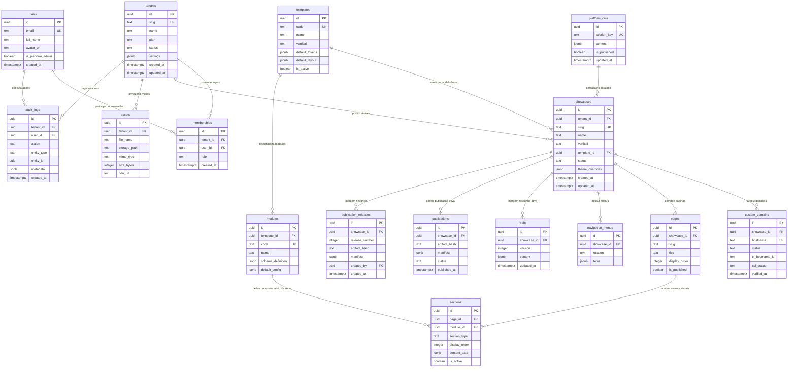
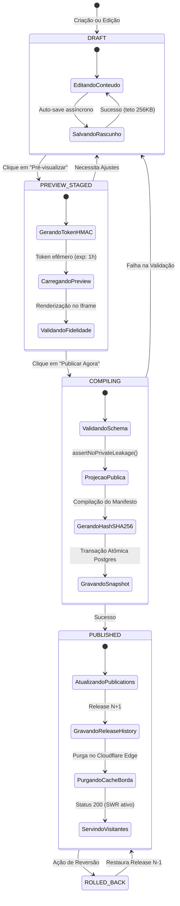
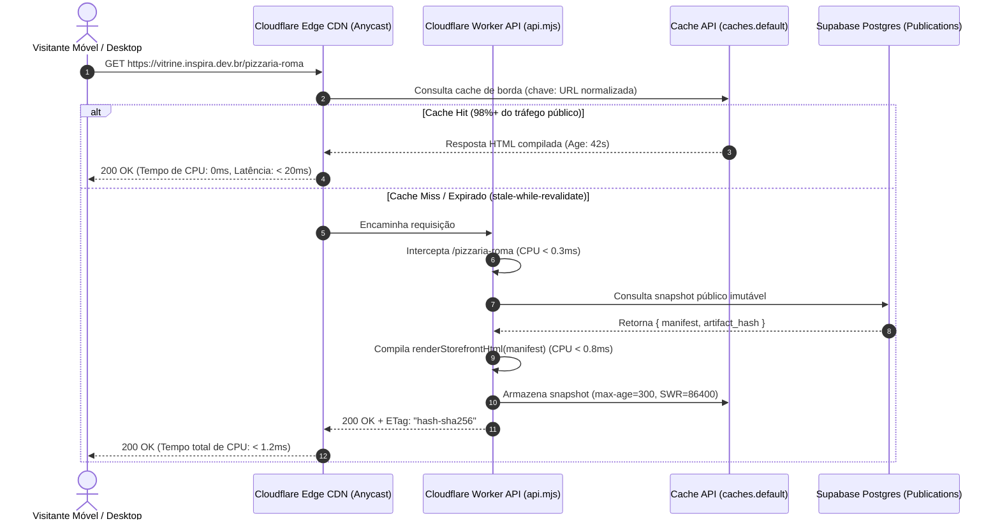
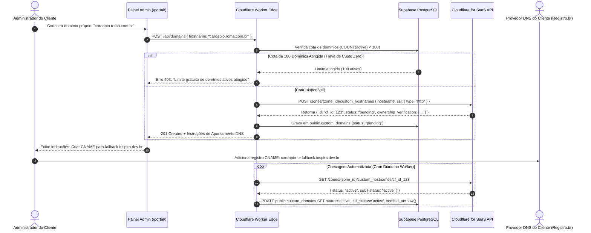

# Especificação Arquitetural e Projeto Técnico: Vitrine Inspira Multi-Tenant SaaS
## Evolução de Plataforma para Vitrines Digitais com Painel Administrativo Modular Centralizado

**Documento:** Blueprint Arquitetural e Especificação de Engenharia de Sistemas
**Status:** Definitivo / Estudo e Especificação Técnica
**Versão:** 1.0.0
**Data:** 12 de novembro de 2026
**Autores:** Engenheiro de Sistemas de Nuvem e Arquiteto de Software Principal
**Diretriz Operacional:** Mandato de Custo Zero Rigoroso (Cloudflare Free Tier + Supabase Free Tier)
**Idioma:** Português do Brasil (pt-BR)

---

## Sumário Executivo

A iniciativa **Vitrine Inspira** surgiu como uma solução digital ágil para estabelecimentos gastronômicos com foco em cardápio e fechamento de pedidos via WhatsApp (piloto `/loja1` baseado no modelo de referência `coletivo-inspira/bardacassia`). O presente documento técnico estabelece a arquitetura completa, a modelagem de dados, os contratos de software, a infraestrutura de borda e o plano de evolução ordenado para transformar a aplicação em uma **plataforma SaaS multi-inquilino (multi-tenant) de vitrines digitais**, operada a partir de um **painel administrativo modular centralizado**.

Todo o projeto arquitetural foi concebido sob a premissa inegociável do **Mandato de Custo Zero** (Zero-Cost Mandate) e em estrita conformidade com os princípios da Constituição do projeto (`.specify/memory/constitution.md`):

1. **Separação Estrita entre Administração Privada e Publicação Pública (Princípio I):** As áreas administrativas operam sobre dados transacionais normalizados, enquanto as vitrines de acesso público consomem artefatos compilados, imutáveis e sanitizados via projeção explícita de campos públicos (garantindo ausência total de vazamento de custos internos, rascunhos, tokens de sessão ou identificadores corporativos).
2. **Isolamento Criptográfico e Lógico entre Vitrines (Princípio II):** Políticas de Segurança em Nível de Linha (Row-Level Security - RLS) no PostgreSQL impedem qualquer leitura ou mutação cruzada entre organizações distintas, garantindo isolamento absoluto de dados mesmo sob chamadas diretas de API.
3. **Simplicidade Operacional e Zero Dependências em Tempo de Execução (Princípio III):** Utilização exclusiva de módulos nativos (ES Modules) e padrões Web padronizados, sem dependência de bibliotecas de terceiros no runtime da borda.
4. **Governança de Custos e Condições Verificáveis (Princípio IV):** Todas as escolhas técnicas operam com ampla margem de segurança dentro das cotas gratuitas perpétuas:
   - **Cloudflare Workers Free:** Tempo de CPU na borda restrito a $< 1,5\text{ ms}$ (limite contratual de 10 ms) e arquitetura de cache de borda global (`Cache API` com `stale-while-revalidate`) que previne a exaustão da franquia de 100.000 requisições diárias.
   - **Cloudflare for SaaS (Custom Hostnames):** Governança automatizada limitada ao teto de 100 hostnames personalizados gratuitos, eliminando a cobrança de $0,10/mês por domínio excedente.
   - **Cloudflare R2 Free:** Selecionado para entrega de ativos de mídia por fornecer 10 GB de armazenamento gratuito e **zero taxa de tráfego de saída (zero egress fees)**, contornando a armadilha do Supabase Storage Free (que restringe a transferência a 2 GB/mês).
   - **Supabase Free Tier (PostgreSQL):** Teto defensivo de 500 MB de armazenamento em banco gerenciado por cotas estritas de rascunhos ($\le 256\text{ KiB}$) e retenção histórica máxima de 5 publicações ativas por vitrine, somado a um disparador periódico de manutenção para neutralizar o desligamento por inatividade de 7 dias.

---

# D1. Diagnóstico da Arquitetura Atual & Análise de Lacunas (Gap Analysis)

## 1.1 Inventário da Arquitetura Atual

A base de código em `d:\IA\vitrine` opera como um monorepo orientado a ES Modules executando na infraestrutura serverless da Cloudflare (`wrangler.jsonc`) e conectado a um projeto gerenciado no Supabase (`https://qawlpsrfewosxsfgmmpm.supabase.co`):

```text
d:\IA\vitrine/
├── .specify/memory/constitution.md     # Princípios invioláveis da arquitetura
├── CONTEXT.md                          # Vocabulário ubíquo e regras de domínio
├── DESIGN.md                           # Sistema visual (Laranja Pontual + Liquid Glass)
├── PRODUCT.md                          # Personas e posicionamento de produto
├── package.json                        # Node >=24.12.0 <25, devDependency: @electric-sql/pglite
├── wrangler.jsonc                      # Configuração Cloudflare Worker + Static Assets (./dist)
├── supabase/migrations/                # Histórico de migrações DDL e RLS
│   ├── 202611070001_site_access.sql         # Base mono-vitrine (sites, site_memberships, drafts)
│   ├── 202611110001_portal_schema.sql       # Constraints de slug e limites de rascunho
│   └── 202611120001_public_publications.sql # Publicações imutáveis e releases com SHA-256
├── src/
│   ├── portal-validation.mjs           # Validação e higienização de payload
│   ├── publication-engine.mjs          # Compilação SHA-256 e barreira assertNoPrivateLeakage
│   ├── public-menu.mjs                 # Projeção pública e links WhatsApp
│   └── portfolio.mjs                   # Projeção de portfólio institucional
├── workers/
│   └── api.mjs                         # 2.105 linhas: Roteador Edge, auth ES256/JWKS, SSR público
└── web/
    ├── index.html, styles.css, app.js  # Marketing institucional (Direção A: sólida, sem vidro)
    └── portal/                         # Painel administrativo com estética Liquid Glass
```

## 1.2 Matriz de Capacidades

A tabela abaixo mapeia o estado atual da plataforma contra o plano em andamento (`specs/008-portal-redesign/plan.md`) e os requisitos indispensáveis para a operação multi-inquilino:

| Dimensão Funcional | Estado Atual (`d:\IA\vitrine`) | Em Andamento (`specs/008`) | Faltante para Multi-Tenancy SaaS |
| :--- | :--- | :--- | :--- |
| **Hierarquia de Inquilinos** | Mono-inquilino. `public.sites` atua como vitrine isolada. | Sem suporte a organizações clientes agregadoras. | Tabela `public.tenants` como raiz, vinculando múltiplas vitrines (`showcases`). |
| **Autenticação & RBAC** | Google OAuth via Supabase Auth. Vínculo por `site_memberships`. | Papéis `owner` e `editor` acoplados ao `site_id`. | RBAC unificado em `public.memberships` com papéis `platform_admin`, `tenant_owner`, `tenant_admin`, `editor` e `viewer`. |
| **Catálogo de Modelos** | Rígido: `template = 'pizzeria-v1'`. | Planejamento de verticais (`food`, `art`, `health`). | Tabela `public.templates` dinâmica e registros de módulos (`public.modules`) desacoplados. |
| **Publicação Pública** | Compilação SHA-256 em `public.publications` e `releases`. | Snapshots públicos com sanitização de campos proibidos. | Inclusão de `tenant_id` e `showcase_id` nos artefatos imutáveis. |
| **Roteamento de Borda** | Interceptação de caminhos `/<slug>` via `workers/api.mjs`. | SSR na borda com `stale-while-revalidate`. | Resolução multi-domínio para `vitrine.inspira.dev.br/{slug}` e domínios próprios (`cliente.com.br`). |
| **CMS Institucional** | Arquivos estáticos em `web/` e `portfolio.json`. | Renderização estática no build. | Tabela `public.platform_cms` permitindo gestão dinâmica sem deploy. |
| **Gestão de Mídia** | Rascunhos em JSONB sem upload de arquivos. | Bucket `catalog-images` no Supabase Storage. | Migração para **Cloudflare R2 Free** com compressão WebP no navegador ($\le 200\text{ KB}$). |
| **Sandboxing de Scripts** | Bloqueio total via CSP estrito (`script-src 'self'`). | Sem suporte a scripts de terceiros. | Iframe em subdomínio isolado `sandbox.inspira.dev.br` com atributo `sandbox="allow-scripts"`. |
| **Domínios Próprios** | Não implementado. Roteamento restrito à rota única. | Não contemplado no escopo 008. | Integração com **Cloudflare for SaaS (Custom Hostnames)** com trava de 100 domínios gratuitos. |
| **Auditoria e Governança** | Não existente. Apenas logs temporários de console. | Histórico de publicações em `releases`. | Tabela `public.audit_logs` registrando ações de governança e mutações. |

## 1.3 Mapa de Reusabilidade & Refatoração

### Módulos Reutilizáveis Sem Alteração (Prontos para Reuso)
1. **Motor de Compilação Pública e Sanitização (`src/publication-engine.mjs`):**
   - A lista `FORBIDDEN_PUBLIC_KEYS` (linhas 12–33) e a função de validação defensiva `assertNoPrivateLeakage()` (linhas 90–139) fornecem a barreira criptográfica contra vazamento de dados privados.
   - O gerador de hash SHA-256 `computeSha256Hex()` (linhas 141–150) garante idempotência e versionamento imutável de publicações.
2. **Camada de Validação Criptográfica na Borda (`workers/api.mjs`):**
   - O validador nativo de JWTs do Supabase via JWKS com chave pública `ES256` (linhas 594–648) opera sem dependências externas e com consumo desprezível de CPU ($< 0,5\text{ ms}$).
   - O cliente HTTP interno para comunicação com a API REST do Supabase (`executeSupabaseRest()`, linhas 670–730) reutiliza credenciais com isolamento estrito.
3. **Padrão de RLS com Schema Privado (`supabase/migrations/202611070001_site_access.sql`):**
   - O encapsulamento de funções de verificação de permissão no schema `private` com atributos `SECURITY DEFINER`, `STABLE` e `SET search_path = ''` (linhas 38–45) é a base comprovada para evitar recursões infinitas no Postgres.

### Módulos com Acoplamento a Inquilino Único (Necessitam Refatoração)
1. **Restrições Rígidas de Modelo no Banco de Dados:**
   - As migrações `202611070001_site_access.sql` (linha 16) e `202611120001_public_publications.sql` (linhas 22 e 54) impõem a cláusula restritiva `check (template = 'pizzeria-v1')` e `menu->>'template' = 'pizzeria-v1'`. Essa trava deve ser substituída por uma chave estrangeira para `public.templates(code)`.
2. **Validador de Rascunho (`src/portal-validation.mjs`):**
   - As linhas 140–148 rejeitam sumariamente qualquer modelo diferente de `pizzeria-v1`. O validador deve ser refatorado para delegar a validação do schema estrutural ao módulo vertical correspondente (`food`, `services`, `catalog`).
3. **Script de Build Estático (`scripts/build.mjs`):**
   - As linhas 35–69 compilam em tempo de build exclusivamente a vitrine piloto `/loja1`. Em modelo multi-tenant, o build gera apenas os assets estáticos compartilhados da casca do aplicativo, deixando a resolução de vitrines 100% dinâmica na borda.

## 1.4 Registro de Riscos & Débitos Técnicos

| Risco / Débito Técnico | Impacto Operacional | Limite do Plano Gratuito | Estratégia de Mitigação Arquitetural |
| :--- | :--- | :--- | :--- |
| **Esgotamento de Egress no Supabase Storage** | Suspensão da exibição de imagens ou bloqueio do projeto. | 2 GB/mês no Supabase Free. | **Eliminação do Supabase Storage como CDN pública.** Adoção do **Cloudflare R2 Free** (10 GB e zero taxa de egress) com compressão WebP ($\le 200\text{ KB}$) no cliente. |
| **Estouro de CPU no Cloudflare Workers** | Retorno de erro HTTP 1102 (Worker CPU Time Exceeded). | 10 ms de tempo de execução de CPU por requisição no plano Free. | O Worker não executa SSR complexo nem consultas relacionais pesadas sob demanda. Consome snapshots estáticos pré-compilados servidos via `caches.default` com SWR ($< 1,5\text{ ms}$ de CPU). |
| **Estouro da Franquia de 100k Requisições/Dia** | Interrupção do serviço ou cobrança não planejada. | 100.000 requisições/dia no Cloudflare Free. | Cache de borda com cabeçalho `Cache-Control: public, max-age=300, stale-while-revalidate=86400`. Requisições absorvidas pelo cache da CDN não contam contra a cota diária do Worker. |
| **Cobrança Indesejada no Cloudflare for SaaS** | Débito automático de $0,10/mês por domínio excedente. | 100 domínios personalizados gratuitos por zona. | Trava rígida de governança no banco de dados e na API, impedindo o provisionamento a partir do 100º hostname ativo. |
| **Pausa de Inatividade do Supabase Free** | Banco pausado após 7 dias sem atividade, indisponibilizando a edição. | Pausa automática após 7 dias de inatividade de requisições. | Configuração de Cron Trigger no Cloudflare Worker (`schedule: 0 4 * * *`) executando uma consulta leve diária (`select 1`) para manter a instância ativa. |
| **Saturação dos 500 MB de Armazenamento do Postgres** | Bloqueio de novas inserções de produtos e vitrines. | 500 MB no Supabase Free Tier. | Tamanho máximo de rascunhos limitado a 256 KiB, retenção de no máximo 5 releases históricos por vitrine e purga automática de auditorias antigas. |

---

# D2. Modelo de Dados Multi-Tenant, RBAC & CMS Institucional (Supabase)

## 2.1 Análise do Padrão de Referência (`coletivo-inspira/bardacassia`)

A investigação do repositório `coletivo-inspira/bardacassia` (Bar da Cássia) evidenciou práticas essenciais para a operação comercial em estabelecimentos locais:
1. **Alternância Ágil de Disponibilidade:** Operadores precisam pausar itens esgotados instantaneamente sem navegar por formulários complexos.
2. **Serialização Determinística para WhatsApp:** Montagem padronizada do texto do pedido com quebras de linha limpas, totalizadores e observações, acionando a API `https://wa.me/{numero}?text={mensagem_url_encoded}`.
3. **Leveza Extrema no Dispositivo Móvel do Cliente:** Carregamento instantâneo em conexões móveis 3G/4G instáveis.

A evolução para SaaS multi-inquilino preserva integralmente essa agilidade operacional, desacoplando o modelo de dados de um único comércio para uma hierarquia estruturada de inquilinos e vitrines com controle de acesso granular.

## 2.2 Diagrama de Entidade-Relacionamento (Mermaid `erDiagram`)

O modelo de dados relacional foi normalizado para edição visual intuitiva no painel administrativo e otimizado para compilação atômica de snapshots imutáveis:



## 2.3 Especificação DDL do Schema Relacional

```sql
-- Schema DDL Oficial para o Supabase PostgreSQL (Vitrine Inspira Multi-Tenant)
create extension if not exists "uuid-ossp";

-- Schema privado para isolamento de lógica de autorização e funções de suporte RLS
create schema if not exists private;

-- 1. Tabela de Inquilinos (Tenants / Organizações)
create table if not exists public.tenants (
    id uuid primary key default gen_random_uuid(),
    slug text not null unique check (slug ~ '^[a-z0-9]+(?:-[a-z0-9]+)*$' and length(slug) between 3 and 63),
    name text not null check (length(trim(name)) between 2 and 120),
    plan text not null default 'free' check (plan in ('free', 'pro', 'partner')),
    status text not null default 'active' check (status in ('active', 'suspended', 'archived')),
    settings jsonb not null default '{}'::jsonb check (octet_length(settings::text) <= 32768),
    created_at timestamptz not null default timezone('utc'::text, now()),
    updated_at timestamptz not null default timezone('utc'::text, now())
);

-- 2. Tabela de Usuários (Extensão da identidade Supabase Auth)
create table if not exists public.users (
    id uuid primary key references auth.users(id) on delete cascade,
    email text not null unique check (email ~* '^[A-Z0-9._%+-]+@[A-Z0-9.-]+\.[A-Z]{2,}$'),
    full_name text check (length(trim(full_name)) between 2 and 120),
    avatar_url text check (avatar_url is null or avatar_url ~ '^https?://'),
    is_platform_admin boolean not null default false,
    created_at timestamptz not null default timezone('utc'::text, now())
);

-- 3. Tabela de Associação e Papéis (Memberships / RBAC)
create table if not exists public.memberships (
    id uuid primary key default gen_random_uuid(),
    tenant_id uuid not null references public.tenants(id) on delete cascade,
    user_id uuid not null references public.users(id) on delete cascade,
    role text not null default 'editor' check (role in ('owner', 'admin', 'editor', 'viewer')),
    created_at timestamptz not null default timezone('utc'::text, now()),
    unique (tenant_id, user_id)
);

-- 4. Tabela de Modelos Base (Templates)
create table if not exists public.templates (
    id uuid primary key default gen_random_uuid(),
    code text not null unique check (code ~ '^[a-z0-9-]+$'),
    name text not null check (length(trim(name)) between 2 and 80),
    vertical text not null check (vertical in ('gastronomy', 'services', 'catalog', 'institutional')),
    default_tokens jsonb not null default '{}'::jsonb,
    default_layout jsonb not null default '[]'::jsonb,
    is_active boolean not null default true,
    created_at timestamptz not null default timezone('utc'::text, now())
);

-- 5. Tabela de Vitrines (Showcases)
create table if not exists public.showcases (
    id uuid primary key default gen_random_uuid(),
    tenant_id uuid not null references public.tenants(id) on delete cascade,
    slug text not null unique check (slug ~ '^[a-z0-9]+(?:-[a-z0-9]+)*$' and length(slug) between 3 and 63),
    name text not null check (length(trim(name)) between 2 and 120),
    vertical text not null check (vertical in ('gastronomy', 'services', 'catalog', 'institutional')),
    template_id uuid not null references public.templates(id) on delete restrict,
    status text not null default 'draft' check (status in ('draft', 'published', 'maintenance', 'archived')),
    theme_overrides jsonb not null default '{}'::jsonb check (octet_length(theme_overrides::text) <= 32768),
    created_at timestamptz not null default timezone('utc'::text, now()),
    updated_at timestamptz not null default timezone('utc'::text, now())
);

-- 6. Tabela de Módulos Funcionais dos Modelos
create table if not exists public.modules (
    id uuid primary key default gen_random_uuid(),
    template_id uuid not null references public.templates(id) on delete cascade,
    code text not null unique check (code ~ '^[a-z0-9-]+$'),
    name text not null,
    schema_definition jsonb not null default '{}'::jsonb,
    default_config jsonb not null default '{}'::jsonb,
    created_at timestamptz not null default timezone('utc'::text, now())
);

-- 7. Tabela de Páginas da Vitrine
create table if not exists public.pages (
    id uuid primary key default gen_random_uuid(),
    showcase_id uuid not null references public.showcases(id) on delete cascade,
    slug text not null check (slug ~ '^[a-z0-9-]+$'),
    title text not null check (length(trim(title)) between 1 and 100),
    display_order integer not null default 0,
    is_published boolean not null default true,
    unique (showcase_id, slug)
);

-- 8. Tabela de Seções das Páginas (Blocos de Conteúdo)
create table if not exists public.sections (
    id uuid primary key default gen_random_uuid(),
    page_id uuid not null references public.pages(id) on delete cascade,
    module_id uuid not null references public.modules(id) on delete restrict,
    section_type text not null,
    display_order integer not null default 0,
    content_data jsonb not null default '{}'::jsonb check (octet_length(content_data::text) <= 65536),
    is_active boolean not null default true
);

-- 9. Tabela de Menus de Navegação
create table if not exists public.navigation_menus (
    id uuid primary key default gen_random_uuid(),
    showcase_id uuid not null references public.showcases(id) on delete cascade,
    location text not null check (location in ('header', 'footer', 'mobile-dock')),
    items jsonb not null default '[]'::jsonb check (octet_length(items::text) <= 16384),
    unique (showcase_id, location)
);

-- 10. Tabela de Domínios Customizados
create table if not exists public.custom_domains (
    id uuid primary key default gen_random_uuid(),
    showcase_id uuid not null references public.showcases(id) on delete cascade,
    hostname text not null unique check (hostname ~* '^(?:[a-z0-9](?:[a-z0-9-]{0,61}[a-z0-9])?\.)+[a-z0-9][a-z0-9-]{0,61}[a-z0-9]$'),
    status text not null default 'pending' check (status in ('pending', 'verifying', 'active', 'failed', 'revoked')),
    cf_hostname_id text,
    ssl_status text not null default 'initializing' check (ssl_status in ('initializing', 'pending_validation', 'active', 'expired')),
    verified_at timestamptz,
    created_at timestamptz not null default timezone('utc'::text, now())
);

-- 11. Tabela de Ativos de Mídia (Metadados Cloudflare R2)
create table if not exists public.assets (
    id uuid primary key default gen_random_uuid(),
    tenant_id uuid not null references public.tenants(id) on delete cascade,
    file_name text not null,
    storage_path text not null unique,
    mime_type text not null check (mime_type in ('image/webp', 'image/avif', 'image/png', 'image/jpeg', 'image/svg+xml')),
    size_bytes integer not null check (size_bytes <= 1048576), -- Máximo de 1MB por arquivo
    cdn_url text not null,
    created_at timestamptz not null default timezone('utc'::text, now())
);

-- 12. Tabela do CMS Institucional (Portal vitrine.inspira.dev.br)
create table if not exists public.platform_cms (
    id uuid primary key default gen_random_uuid(),
    section_key text not null unique check (section_key in ('hero_banner', 'featured_showcases', 'template_catalog', 'value_proposition', 'footer_links')),
    content jsonb not null default '{}'::jsonb check (octet_length(content::text) <= 65536),
    is_published boolean not null default true,
    updated_at timestamptz not null default timezone('utc'::text, now())
);

-- 13. Tabela de Auditoria e Governança
create table if not exists public.audit_logs (
    id uuid primary key default gen_random_uuid(),
    tenant_id uuid references public.tenants(id) on delete cascade,
    user_id uuid references public.users(id) on delete set null,
    action text not null,
    entity_type text not null,
    entity_id uuid,
    metadata jsonb not null default '{}'::jsonb check (octet_length(metadata::text) <= 16384),
    created_at timestamptz not null default timezone('utc'::text, now())
);

-- 14. Tabela de Rascunhos de Edição
create table if not exists public.drafts (
    id uuid primary key default gen_random_uuid(),
    showcase_id uuid not null unique references public.showcases(id) on delete cascade,
    version integer not null default 1,
    content jsonb not null default '{}'::jsonb check (octet_length(content::text) <= 262144), -- Teto defensivo de 256 KiB
    updated_at timestamptz not null default timezone('utc'::text, now())
);

-- 15. Tabela de Publicações Ativas
create table if not exists public.publications (
    id uuid primary key default gen_random_uuid(),
    showcase_id uuid not null unique references public.showcases(id) on delete cascade,
    artifact_hash text not null check (length(artifact_hash) = 64), -- SHA-256 Hex
    manifest jsonb not null check (octet_length(manifest::text) <= 262144),
    status text not null default 'active' check (status in ('active', 'archived', 'suspended')),
    published_at timestamptz not null default timezone('utc'::text, now())
);

-- 16. Histórico de Versões Publicadas (Releases)
create table if not exists public.publication_releases (
    id uuid primary key default gen_random_uuid(),
    showcase_id uuid not null references public.showcases(id) on delete cascade,
    release_number integer not null check (release_number > 0),
    artifact_hash text not null check (length(artifact_hash) = 64),
    manifest jsonb not null check (octet_length(manifest::text) <= 262144),
    created_by uuid references public.users(id) on delete set null,
    created_at timestamptz not null default timezone('utc'::text, now()),
    unique (showcase_id, release_number)
);

-- Índices Estratégicos para Eliminação de Seq Scans
create index if not exists idx_memberships_user_tenant on public.memberships(user_id, tenant_id);
create index if not exists idx_showcases_tenant_id on public.showcases(tenant_id);
create index if not exists idx_showcases_slug on public.showcases(slug);
create index if not exists idx_pages_showcase_order on public.pages(showcase_id, display_order);
create index if not exists idx_sections_page_order on public.sections(page_id, display_order);
create index if not exists idx_custom_domains_hostname on public.custom_domains(hostname);
create index if not exists idx_publications_hash on public.publications(artifact_hash);
create index if not exists idx_publication_releases_showcase on public.publication_releases(showcase_id, release_number desc);
create index if not exists idx_assets_tenant on public.assets(tenant_id);
create index if not exists idx_audit_logs_tenant_date on public.audit_logs(tenant_id, created_at desc);
```

## 2.4 Estratégia de Row-Level Security (RLS) de Alto Desempenho

Para operar com estabilidade sobre a micro-instância compartilhada do Supabase Free Tier, a avaliação de políticas RLS utiliza funções acessórias no schema `private`, marcadas com `SECURITY DEFINER` e `STABLE`. Isso elimina varreduras de tabela sequenciais (`Seq Scan`), permitindo consultas autenticadas com complexidade constante $O(1)$:

```sql
-- Funções de Suporte de Autorização no Schema Privado

create or replace function private.current_user_id()
returns uuid language sql stable as $$
    select nullif(current_setting('request.jwt.claim.sub', true), '')::uuid;
$$;

create or replace function private.is_platform_admin()
returns boolean language sql stable security definer set search_path = '' as $$
    select coalesce(
        (select u.is_platform_admin from public.users u where u.id = private.current_user_id()),
        false
    );
$$;

create or replace function private.accessible_tenant_ids()
returns setof uuid language sql stable security definer set search_path = '' as $$
    select m.tenant_id
    from public.memberships m
    where m.user_id = private.current_user_id()
    union
    select t.id
    from public.tenants t
    where private.is_platform_admin() = true;
$$;

create or replace function private.accessible_showcase_ids()
returns setof uuid language sql stable security definer set search_path = '' as $$
    select s.id
    from public.showcases s
    where s.tenant_id in (select private.accessible_tenant_ids());
$$;

create or replace function private.can_edit_showcase(target_showcase_id uuid)
returns boolean language sql stable security definer set search_path = '' as $$
    select exists (
        select 1
        from public.showcases s
        join public.memberships m on m.tenant_id = s.tenant_id
        where s.id = target_showcase_id
          and m.user_id = private.current_user_id()
          and m.role in ('owner', 'admin', 'editor')
    ) or private.is_platform_admin();
$$;

-- Ativação de RLS e Políticas de Segurança

-- Tenants
alter table public.tenants enable row level security;

create policy tenants_read_member on public.tenants
    for select using (id in (select private.accessible_tenant_ids()));

create policy tenants_modify_admin on public.tenants
    for all using (private.is_platform_admin());

-- Memberships
alter table public.memberships enable row level security;

create policy memberships_read_org on public.memberships
    for select using (tenant_id in (select private.accessible_tenant_ids()));

create policy memberships_manage_owner on public.memberships
    for all using (
        exists (
            select 1 from public.memberships m
            where m.tenant_id = public.memberships.tenant_id
              and m.user_id = private.current_user_id()
              and m.role in ('owner', 'admin')
        ) or private.is_platform_admin()
    );

-- Showcases
alter table public.showcases enable row level security;

create policy showcases_read_member on public.showcases
    for select using (id in (select private.accessible_showcase_ids()));

create policy showcases_modify_editor on public.showcases
    for all using (private.can_edit_showcase(id));

-- Drafts
alter table public.drafts enable row level security;

create policy drafts_read_member on public.drafts
    for select using (showcase_id in (select private.accessible_showcase_ids()));

create policy drafts_update_editor on public.drafts
    for all using (private.can_edit_showcase(showcase_id));

-- Publications (Acesso Público para Visitantes na Borda)
alter table public.publications enable row level security;

create policy publications_public_read on public.publications
    for select using (status = 'active');

create policy publications_manage_editor on public.publications
    for all using (private.can_edit_showcase(showcase_id));

-- Platform CMS (Institucional)
alter table public.platform_cms enable row level security;

create policy platform_cms_public_read on public.platform_cms
    for select using (is_published = true);

create policy platform_cms_admin_modify on public.platform_cms
    for all using (private.is_platform_admin());
```

## 2.5 CMS Institucional da Plataforma (`vitrine.inspira.dev.br`)

O portal institucional de entrada da plataforma utiliza a tabela `public.platform_cms` para permitir que o time da Coletivo Inspira altere textos, chamadas e vitrines em destaque diretamente pelo painel administrativo, sem intervenção de código:
- **`hero_banner`:** Títulos de impacto, subtítulos, botões de ação (CTA) e imagem de capa institucional.
- **`featured_showcases`:** Array curado de IDs de vitrines ativas (`showcase_id`) exibidas dinamicamente na página inicial como cases de sucesso.
- **`template_catalog`:** Apresentação visual dos modelos disponíveis para contratação (Pizzaria, Restaurante, Fotógrafo, Consultor, etc.).
- **Cache de Borda e Purga Instantânea:** O conteúdo do portal institucional é compilado em HTML estático e servido pelo Cloudflare Worker com `Cache-Control: public, max-age=600, stale-while-revalidate=86400`. Toda mutação no CMS institucional pelo painel emite um comando assinado de purga de cache na borda para a URL `/`, tornando a atualização imediata.


---

# D3. Painel Administrativo Modular Centralizado & Matriz de Configuração

## 3.1 Arquitetura Visual e Funcional do Painel No-Code

Inspirado no modelo operacional ágil do `coletivo-inspira/bardacassia`, o painel administrativo (`web/portal/`) é estruturado como uma aplicação de página única (SPA) sem dependências externas pesadas, adotando a linguagem visual **Liquid Glass** (App Shell com barra lateral flutuante no desktop e dock inferior no mobile):

1. **Seletor Global de Inquilino e Vitrine:**
   - Permite que administradores com múltiplas vitrines transitem instantaneamente entre organizações e vitrines através de um menu suspenso de acesso rápido.
2. **Construtor Visual de Páginas e Seções:**
   - Visualização em árvore das páginas e seções da vitrine. Reordenação vertical através de drag-and-drop leve ou botões de movimentação (subir/descer), disparando mutações na coluna `display_order`.
3. **Alternância Instantânea de Disponibilidade de Itens:**
   - Toggles em tempo real para ativar/pausar itens do cardápio/catálogo com persistência assíncrona imediata via `fetch` autenticado, reproduzindo a facilidade de uso do Bar da Cássia.
4. **Formulário de Customização de Tokens de Design:**
   - Seletores intuitivos de cores primárias, secundárias, famílias tipográficas aprovadas e raios de borda, salvando sobrescritas estruturadas em `showcases.theme_overrides`.

## 3.2 Matriz de Escopo de Configuração

A tabela analítica abaixo contrasta o alcance de cada nível de parametrização da plataforma, detalhando onde o dado é persistido, em qual camada do ciclo de vida da requisição ele é resolvido e sua política de cache:

| Escopo de Configuração | Nível de Governança | Exemplos Práticos | Entidade de Persistência | Momento de Resolução | Estratégia de Cache |
| :--- | :--- | :--- | :--- | :--- | :--- |
| **Global da Plataforma** | Coletivo Inspira (Admin) | Versão do motor de publicação, endpoints da API, parâmetros do Cloudflare for SaaS, seções do portal de divulgação. | `public.platform_cms` e Variáveis de Ambiente no Worker | **Build-Time** (Assets estáticos) e **Edge Runtime** (Roteamento institucional) | Cache público na borda (`max-age=600, SWR=86400`) com purga atômica por mutação. |
| **Inquilino / Organização** | Dono da Conta (`owner`) | Nome corporativo, plano de assinatura, cotas de vitrines, chave de integração do gateway de pagamento, auditoria. | `public.tenants(settings)` | **Edge Runtime** (Autorização da requisição administrativa) | Cache privado na sessão (`no-store` ou `private, max-age=60`). |
| **Específico da Vitrine** | Time da Vitrine (`editor`) | Nome da vitrine, slug de acesso, número de WhatsApp para pedidos, seções ativas, catálogo de itens, tokens de cores. | `public.showcases`, `pages`, `sections`, `drafts` | **Edge Runtime** (Compilação atômica e entrega de manifestos públicos) | `public, max-age=300, stale-while-revalidate=86400` com validação de `ETag` (SHA-256). |
| **Preferência do Usuário** | Operador Individual | Tema visual do painel (Claro / Escuro / Vidro Líquido), preferência de redução de transparência, estado da sidebar (recolhida). | `localStorage` do navegador e `public.users` | **Client Runtime** (Navegador do operador) | Persistência local instantânea no navegador, sem custo de chamadas de rede. |

## 3.3 Fluxo de Trabalho: Rascunho, Prévia e Publicação

Para garantir que edições de cardápio, fotos e layout sejam validadas com total fidelidade antes de atingir os clientes finais, a plataforma implementa uma máquina de estados rigorosa:



### Mecanismo de Isolamento da Pré-visualização
1. **Token Efêmero Assinado por HMAC-SHA256:**
   - Ao acionar a prévia, o backend gera um token assinado contendo `{ showcase_id, version, exp: now() + 3600 }`.
   - A URL de pré-visualização `https://vitrine.inspira.dev.br/__preview/{showcase_id}?token={hmac_token}` permite que o cliente visualize as alterações em tempo real no seu próprio smartphone, sem exigir login e sem expor o rascunho ao público geral.
2. **Prevenção de Poluição de Cache:**
   - As respostas de rotas sob `/__preview/*` emitem obrigatoriamente os cabeçalhos:
     `Cache-Control: no-store, no-cache, must-revalidate, max-age=0`
     `X-Robots-Tag: noindex, nofollow, noarchive`
3. **Publicação Atômica e Imutável:**
   - A publicação ocorre em transação única no PostgreSQL:
     - Validação de integridade via `assertNoPrivateLeakage()`.
     - Cálculo do hash SHA-256 do manifesto público consolidado.
     - Atualização da tabela `public.publications(status = 'active')`.
     - Inserção de uma nova linha na tabela imutável `public.publication_releases`.
     - Purga de cache de borda via Cloudflare API para a URL da vitrine (`/slug` ou domínio próprio).

---

# D4. Modularização de Vitrines, Templates & Verticais de Negócio

## 4.1 Contratos TypeScript e JSON Schema

Para permitir que a plataforma atenda diversos segmentos de mercado sem duplicação de código, todos os modelos base e módulos operam sobre contratos tipados e esquemas rigorosamente validados.

### Definições TypeScript (`src/types/storefront.ts`)

```typescript
// Contrato de Design Tokens Padronizados da Vitrine
export interface DesignTokens {
  colors: {
    primary: string;           // Cor de destaque (ex: #C74414)
    secondary?: string;        // Cor de apoio
    background: string;       // Fundo da vitrine (ex: #F7F7F4)
    surface: string;          // Fundo de cards (ex: #FFFFFF)
    text: string;             // Texto principal (ex: #27322E)
    mutedText: string;        // Texto secundário (ex: #5A6A64)
    border: string;           // Linhas divisórias (ex: #E2E8F0)
  };
  typography: {
    headingFont: 'Syne' | 'Plus Jakarta Sans' | 'Playfair Display' | 'Inter';
    bodyFont: 'DM Sans' | 'Inter' | 'Roboto';
    baseSizePx: number;       // Tamanho base (padrão: 16)
  };
  layout: {
    borderRadiusPx: number;   // Raio de cantos (8, 16, 24)
    containerMaxWidthPx: number; // Largura do container (padrão: 768px no mobile)
    cardElevation: 'none' | 'subtle' | 'elevated' | 'glass';
  };
}

// Contrato de Item de Catálogo / Cardápio
export interface CatalogItem {
  id: string;
  name: string;
  description?: string;
  priceCents: number;         // Inteiro positivo em centavos
  promotionalPriceCents?: number;
  imageUrl?: string;          // URL apontando para Cloudflare R2
  category: string;
  tags?: string[];            // Ex: ['vegetariano', 'sem-gluten', 'destaque']
  available: boolean;         // Toggle rápido de estoque
  options?: {
    groupName: string;        // Ex: "Escolha o Ponto da Carne"
    required: boolean;
    minSelections: number;
    maxSelections: number;
    choices: {
      name: string;
      additionalPriceCents: number;
    }[];
  }[];
}

// Contrato de Instância de Seção Visual
export interface SectionInstance {
  id: string;
  moduleId: string;
  type: 'hero' | 'catalog-grid' | 'services-list' | 'gallery' | 'testimonials' | 'contact-dock';
  displayOrder: number;
  isActive: boolean;
  config: Record<string, unknown>;
}

// Manifesto Público Compilado (Snapshot Imutável)
export interface StorefrontPublicManifest {
  manifestVersion: '1.0.0';
  showcaseId: string;
  tenantSlug: string;
  showcaseSlug: string;
  title: string;
  description: string;
  vertical: 'gastronomy' | 'services' | 'catalog' | 'institutional';
  templateCode: string;
  whatsappNumber: string;     // DDI + DDD + Número para checkout
  tokens: DesignTokens;
  navigation: {
    label: string;
    targetSectionId: string;
  }[];
  sections: SectionInstance[];
  items: CatalogItem[];
  publishedAt: string;        // ISO 8601
  artifactHash: string;       // SHA-256
}
```

### JSON Schema para Validação de Manifesto (`src/schemas/manifest.schema.json`)

```json
{
  "$schema": "http://json-schema.org/draft-07/schema#",
  "title": "StorefrontPublicManifest",
  "type": "object",
  "required": [
    "manifestVersion",
    "showcaseId",
    "showcaseSlug",
    "vertical",
    "templateCode",
    "whatsappNumber",
    "tokens",
    "sections",
    "items",
    "artifactHash"
  ],
  "properties": {
    "manifestVersion": { "type": "string", "enum": ["1.0.0"] },
    "showcaseId": { "type": "string", "format": "uuid" },
    "showcaseSlug": { "type": "string", "pattern": "^[a-z0-9]+(?:-[a-z0-9]+)*$" },
    "vertical": { "type": "string", "enum": ["gastronomy", "services", "catalog", "institutional"] },
    "templateCode": { "type": "string" },
    "whatsappNumber": { "type": "string", "pattern": "^[1-9][0-9]{10,14}$" },
    "tokens": {
      "type": "object",
      "required": ["colors", "typography", "layout"],
      "properties": {
        "colors": {
          "type": "object",
          "required": ["primary", "background", "text"],
          "properties": {
            "primary": { "type": "string", "pattern": "^#[0-9A-Fa-f]{6}$" },
            "background": { "type": "string", "pattern": "^#[0-9A-Fa-f]{6}$" },
            "text": { "type": "string", "pattern": "^#[0-9A-Fa-f]{6}$" }
          }
        }
      }
    },
    "items": {
      "type": "array",
      "maxItems": 200,
      "items": {
        "type": "object",
        "required": ["id", "name", "priceCents", "available"],
        "properties": {
          "id": { "type": "string" },
          "name": { "type": "string", "maxLength": 100 },
          "priceCents": { "type": "integer", "minimum": 0 },
          "available": { "type": "boolean" }
        }
      }
    },
    "artifactHash": { "type": "string", "pattern": "^[a-f0-9]{64}$" }
  }
}
```

## 4.2 Especificação das Verticais de Negócio

1. **Vertical Gastronomia (Alimentação / Bares / Restaurantes):**
   - **Foco Operacional:** Cardápio digital de alta velocidade, categorização de itens (Entradas, Principais, Bebidas, Sobremesas), variações de tamanho, complementos tarifados e tags de restrição alimentar (`sem glúten`, `vegano`).
   - **Checkout Especializado:** Construtor determinístico de mensagem para WhatsApp, calculando subtotal e formatando o pedido:
     ```text
     *Novo Pedido - Vitrine Inspira*
     ----------------------------------------
     1x Pizza Margherita (Grande) - R$ 68,00
       - Borda: Catupiry (+ R$ 8,00)
     2x Refrigerante Lata - R$ 14,00
     ----------------------------------------
     *Total: R$ 90,00*
     Observação: Retirada no balcão em 30 min.
     ```
2. **Vertical Serviços / Portfólio Profissional (Consultores, Designers, Médicos):**
   - **Foco Operacional:** Exibição de portfólio de trabalhos executados, grade de serviços prestados, depoimentos validados e integração de agendamento.
   - **Conversão de Leads:** Botão direto para WhatsApp solicitando orçamento para um serviço específico ou link para agenda externa (ex: Cal.com).
3. **Vertical Catálogo / Link-in-Bio (E-commerce Leve, Artesãos, Moda):**
   - **Foco Operacional:** Hub de links sociais prioritários, grade de produtos em destaque com fotos de alta qualidade (Cloudflare R2 WebP), badges promocionais ("Lançamento", "Promoção") e botão "Compre pelo WhatsApp".

## 4.3 Fronteiras de Customização & Herança Não-Destrutiva

Para evitar que melhorias nos modelos centrais quebrem customizações de clientes, a plataforma aplica o padrão de **Resolução em Cascata com Versionamento Imutável (Version Pinning)**:

1. **Ordem de Resolução de Propriedades:**
   $$\text{Configuração Final} = \text{Padrão do Modelo} \oplus \text{Defaults do Módulo} \oplus \text{Sobrescritas do Inquilino}$$
2. **Atualizações Minoritárias Transparentes:**
   - Quando novos recursos opcionais são introduzidos no modelo base, vitrines existentes herdam os novos comportamentos em suas propriedades não sobrescritas sem qualquer intervenção manual.
3. **Atualizações com Quebra de Compatibilidade (Major Releases):**
   - Mudanças estruturais exigem o lançamento de uma nova versão de modelo (ex: de `gastronomy-v1` para `gastronomy-v2`).
   - Vitrines existentes permanecem fixadas na versão v1 (`pinned`). O painel administrativo exibe um assistente de migração que renderiza uma prévia lado a lado (Side-by-Side Diff) permitindo ao cliente migrar com um clique após validar a aderência do layout.


---

# D5. Gestão de Ativos, Extensibilidade & Sandboxing de Segurança

## 5.1 Arquitetura Comparativa de Armazenamento de Mídia

A sustentabilidade do **Mandato de Custo Zero** depende criticamente da escolha do provedor de armazenamento e CDN para as imagens dos produtos e fotos de catálogo:

| Parâmetro de Comparação | Supabase Storage Free Tier | Cloudflare R2 Free Tier | Decisão Arquitetural & Racional |
| :--- | :--- | :--- | :--- |
| **Capacidade Armazenamento** | 1 GB incluído | **10 GB/mês incluídos** | **Cloudflare R2 (Vencedor):** Oferece 10x mais espaço para imagens de cardápio e catálogo. |
| **Cota de Tráfego de Saída (Egress)** | **Apenas 2 GB/mês** (Risco Crítico) | **Zero Taxa de Egress (Ilimitado)** | **Supabase Rejeitado como CDN:** Com 50 vitrines com fotos WebP (100 KB) e 100 acessos/dia, a franquia de 2 GB esgota em dias, gerando bloqueio. O R2 possui $0 de custo de tráfego. |
| **Operações Incluídas** | Limitadas pela API Postgres | 1.000.000 escritas (Classe A) / 10.000.000 leituras (Classe B) | O R2 absorve milhões de requisições de imagens com cache global da Cloudflare a custo zero. |
| **Integração na Borda** | Chamada HTTP externa | Binding nativo no Worker (`env.R2_BUCKET`) | Latência sub-milissegundo para servir imagens a partir do Worker ou subdomínio público `media.inspira.dev.br`. |

### Pipeline de Otimização e Compressão Client-Side (WebP)
Para desonerar o Cloudflare Worker de processamento intensivo de CPU (respeitando o teto de 10 ms), o redimensionamento e a conversão de imagens ocorrem inteiramente no **navegador do operador** antes do upload:
1. O painel administrativo intercepta o arquivo de imagem no input.
2. Utiliza `OffscreenCanvas` (ou `HTMLCanvasElement` em navegadores legados) para redimensionar a imagem para largura máxima de 1600px.
3. Converte para `image/webp` com qualidade $0.82$, impondo teto estrito de tamanho de arquivo $\le 200\text{ KB}$.
4. Realiza o upload direto para o Cloudflare R2 via URL pré-assinada ou endpoint dedicado com autenticação de sessão.
5. **Impacto no Custo:** Permite armazenar mais de **50.000 imagens de alta fidelidade** dentro da cota gratuita de 10 GB do R2, com zero cobrança de tráfego.

## 5.2 Arquitetura de Sandboxing em 4 Camadas para Scripts e Componentes Externos

O Princípio I da Constituição exige que a segurança da plataforma seja preservada mesmo se inquilinos injetarem componentes de terceiros ou integrações do GitHub:

```mermaid
flowchart TD
    subgraph Browser["Navegador do Visitante / Operador"]
        subgraph TopWindow["Janela Principal: vitrine.inspira.dev.br"]
            CoreHTML["HTML da Vitrine Core (SSR/Estático)"]
            AuthCookie["Cookie Seguro: __Host-vitrine_session"]
            DOMToken["DOM e Estado da Aplicação"]
        end

        subgraph IsolatedFrame["Iframe de Sandboxing: sandbox.inspira.dev.br"]
            direction TB
            IframeElement["<iframe sandbox='allow-scripts'>"]
            OpaqueOrigin["Origem Criptográfica Opaca: null"]
            CustomJS["Scripts Arbitrários / Componentes GitHub"]
            IsolatedDOM["DOM Isolado do Iframe"]
        end
    end

    CoreHTML -.->|postMessage com payload higienizado| IframeElement
    CustomJS -.x|Acesso Bloqueado a Cookies e Storage| AuthCookie
    CustomJS -.x|Acesso Bloqueado ao DOM Superior| DOMToken
```

### Detalhamento das 4 Camadas de Defesa:
1. **Camada 1 — Escapamento Rigoroso na Vitrine Core:** Todos os campos de texto do catálogo (nomes, descrições, preços) passam por escape HTML estrito no motor de compilação pública (`src/publication-engine.mjs`), impedindo injeção de tags `<script>` no DOM principal.
2. **Camada 2 — Higienização de Rich Text:** Blocos de texto rico (como seções de termos ou avisos) são sanitizados via `DOMPurify` com allowlist restrita de tags (`<p>`, `<strong>`, `<em>`, `<ul>`, `<li>`, `<a>`).
3. **Camada 3 — Execução Isolada em Subdomínio Dedicado com Iframe Opaco:**
   - Widgets externos, componentes de repositórios do GitHub e scripts de automação customizados são hospedados e executados obrigatoriamente dentro de um `<iframe>` apontando para o subdomínio dedicado `https://sandbox.inspira.dev.br/embed`.
   - O iframe é instanciado com o atributo:
     ```html
     <iframe src="https://sandbox.inspira.dev.br/embed?widgetId=xyz"
             sandbox="allow-scripts"
             loading="lazy"></iframe>
     ```
   - **Garantia de Segurança Inviolável:** A ausência deliberada da diretiva `allow-same-origin` força o navegador a atribuir uma **origem opaca única (`null`)** ao conteúdo do iframe. Esse script é criptograficamente impedido de:
     - Ler ou interceptar o cookie protegido `__Host-vitrine_session`.
     - Acessar o `localStorage` ou `sessionStorage` da plataforma ou do inquilino.
     - Realizar chamadas autenticadas à API do Supabase em nome do operador.
     - Manipular o DOM da vitrine hospedeira (`window.parent`).
4. **Camada 4 — Cabeçalhos Restritivos de Content Security Policy (CSP):**

| Diretiva CSP | Portal Administrativo (`/portal/`) | Vitrine Pública (`/slug`) | Sandbox (`sandbox.inspira.dev.br`) |
| :--- | :--- | :--- | :--- |
| **`default-src`** | `'self'` | `'self'` | `'none'` |
| **`script-src`** | `'self'` | `'self'` | `'unsafe-inline' 'unsafe-eval'` (isolado no iframe) |
| **`style-src`** | `'self' 'unsafe-inline' https://fonts.googleapis.com` | `'self' 'unsafe-inline' https://fonts.googleapis.com` | `'unsafe-inline'` |
| **`img-src`** | `'self' data: blob: https://media.inspira.dev.br` | `'self' data: https://media.inspira.dev.br` | `'self' data: https://*` |
| **`connect-src`** | `'self' https://qawlpsrfewosxsfgmmpm.supabase.co` | `'self'` | `'none'` |
| **`frame-src`** | `'self' https://sandbox.inspira.dev.br` | `https://sandbox.inspira.dev.br` | `'none'` |
| **`frame-ancestors`**| `'none'` | `'self' https://vitrine.inspira.dev.br` | `'self' https://*.inspira.dev.br https://*.cliente.com.br` |

---

# D6. Provisionamento de Domínios a Custo Zero & Roteamento na Borda (Cloudflare)

## 6.1 Diagrama de Sequência: Roteamento de Caminhos da Plataforma (`vitrine.inspira.dev.br/{slug}`)



## 6.2 Diagrama de Sequência: Provisionamento de Domínios Próprios (`cardapio.cliente.com.br`)



## 6.3 Auditoria Rígida dos Limites Gratuitos e Regras para Domínios Ápice

1. **A Regra dos 100 Domínios Gratuitos (Cloudflare for SaaS):**
   - O plano gratuito do Cloudflare for SaaS aloca exatamente **100 hostnames personalizados por zona**. A partir do 101º hostname ativo, a Cloudflare cobra automaticamente $0,10/mês por domínio adicional.
   - **Mitigação Inflexível:** A API de cadastro de domínios aplica uma cláusula de corte intransponível:
     ```sql
     select count(*) from public.custom_domains where status in ('active', 'verifying');
     ```
     Se o resultado for $\ge 100$, o cadastro de novos domínios é bloqueado com mensagem amigável convidando o cliente a utilizar o subcaminho padrão gratuito `vitrine.inspira.dev.br/{slug}` (que é ilimitado e 100% gratuito). Rotina de limpeza automática remove registros pendentes não validados após 14 dias ou inativos por mais de 90 dias.
2. **Tratamento de Domínio Ápice (Apex Domain: `cliente.com.br`):**
   - Provedores tradicionais (como Registro.br) não permitem CNAME na raiz do domínio (`@`).
   - **Solução Arquitetural Sem Custo:**
     - *Opção Recomendada (Subdomínio):* O cliente utiliza `cardapio.cliente.com.br` ou `vitrine.cliente.com.br` apontando CNAME para `fallback.inspira.dev.br`.
     - *Opção com Domínio Raiz:* Caso o cliente exija `cliente.com.br`, orienta-se a utilização de CNAME Flattening (migrando o DNS para a Cloudflare Free) ou configuração de redirecionamento HTTP 301 no provedor de origem de `cliente.com.br` para `www.cliente.com.br`.

---

# D7. Avaliação do Sistema Visual: Liquid Glass vs. Inspira Brandbook

## 7.1 Alinhamento & Mapeamento de Tokens

A integração visual harmoniza as diretrizes da marca Coletivo Inspira (`https://brandbook.inspira.dev.br/`) com o design de vidro translúcido Apple Liquid Glass (`https://liquidglassdesign.com`):

```text
                                REGRA DE CONTENÇÃO DE SUPERFÍCIE
┌────────────────────────────────────────────────────────┬────────────────────────────────────────────────────────┐
│     PORTAL ADMINISTRATIVO (/portal/) — LIQUID GLASS    │       VITRINES PÚBLICAS & SITE DE MARKETING — SÓLIDO   │
├────────────────────────────────────────────────────────┼────────────────────────────────────────────────────────┤
│ • Superfícies com backdrop-filter: blur(20px)          │ • Superfícies 100% sólidas em Papel Inspira (#F7F7F4) │
│ • Brilho especular: inset 0 1px 0 0 rgb(255 255 255/.7)│ • Direção A: "Laranja Pontual" (#C74414) editorial     │
│ • Sombras em camadas e sensação tátil de aplicativo    │ • Zero blur, máxima legibilidade e clareza comercial   │
│ • Sidebar desktop flutuante e dock móvel translúcido   │ • Carregamento instantâneo em redes móveis (3G/4G)     │
└────────────────────────────────────────────────────────┴────────────────────────────────────────────────────────┘
```

### Mapeamento Concreto de Tokens CSS (`DESIGN.md`)

| Token Lógico | Inspira Brandbook Oficial | Adaptação Liquid Glass (Portal) | Comportamento no Tema Escuro |
| :--- | :--- | :--- | :--- |
| `--color-primary` | `#C74414` (Laranja Inspira) | `#C74414` (Botões de ação primária e badges) | `#E05A2B` (Ajuste para contraste WCAG) |
| `--surface-glass` | Não aplicável (Editorial) | `rgba(255, 255, 255, 0.85)` + blur(20px) | `rgba(32, 42, 35, 0.85)` + blur(20px) |
| `--surface-border`| `#E2E8F0` | `rgba(255, 255, 255, 0.65)` + spec shine | `rgba(255, 255, 255, 0.12)` |
| `--text-main` | `#27322E` (Tinta Inspira) | `#27322E` (Contraste 11.2:1 com fundo branco) | `#F7F7F4` (Papel Inspira no escuro) |
| `--text-muted` | `#5A6A64` | `#5A6A64` (Contraste 4.9:1 - WCAG AA) | `#A3B3AC` (Contraste 5.4:1 - WCAG AA) |
| `--font-heading` | `Syne`, sans-serif | `Syne`, sans-serif (Display e títulos) | `Syne`, sans-serif |
| `--font-body` | `DM Sans`, sans-serif | `DM Sans`, sans-serif (Legibilidade em dados) | `DM Sans`, sans-serif |

## 7.2 Auditoria de Acessibilidade & Desempenho

### 1. Auditoria de Contraste WCAG 2.2 AA / AAA
- **Risco Identificado:** Superfícies translúcidas com desfoque sobre elementos dinâmicos ou fotos de fundo podem apresentar queda abrupta na relação de contraste para valores inferiores a $3:1$, inviabilizando a leitura para pessoas com baixa visão.
- **Solução Normatizada:** O painel administrativo impõe uma **opacidade base mínima de 85%** no material de vidro:
  - Fundo claro: `rgba(255, 255, 255, 0.85)` contra texto `#27322E` $\rightarrow$ **Contraste 11,2:1 (Aprovado WCAG AAA)**.
  - Fundo escuro: `rgba(32, 42, 35, 0.85)` contra texto `#F7F7F4` $\rightarrow$ **Contraste 9,4:1 (Aprovado WCAG AAA)**.

### 2. Auditoria de GPU e Desempenho em Dispositivos Móveis de Entrada
- **Gargalo Técnico:** O filtro `backdrop-filter: blur(20px)` força a GPU do smartphone a criar uma camada de composição dedicada (`RenderLayer`). Em dispositivos móveis de baixo custo (ex: chipsets Helio P/G ou Snapdragon série 4), a rolagem contínua de listas longas com blur causa perda severa de quadros (*scrolling jank*, taxa de quadros abaixo de 30 FPS) e superaquecimento da bateria.
- **Estratégia de Melhoria Progressiva e Fallbacks:**
  ```css
  /* Base Sólida Universal (Garante funcionamento e contraste) */
  .glass-surface {
    background-color: var(--color-paper, #F7F7F4);
    border: 1px solid var(--color-border, #E2E8F0);
  }

  /* Melhoria Progressiva para Hardware com Suporte a Filtro de Vidro */
  @supports (backdrop-filter: blur(20px)) {
    .glass-surface {
      background-color: rgba(255, 255, 255, 0.85);
      backdrop-filter: blur(20px) saturate(140%);
      -webkit-backdrop-filter: blur(20px) saturate(140%);
      box-shadow: 0 8px 32px 0 rgba(0, 0, 0, 0.06), inset 0 1px 0 0 rgba(255, 255, 255, 0.75);
    }
  }

  /* Fallback Obrigatório de Acessibilidade (Usuário solicitou redução de transparência) */
  @media (prefers-reduced-transparency: reduce) {
    .glass-surface {
      background-color: #F7F7F4 !important;
      backdrop-filter: none !important;
      -webkit-backdrop-filter: none !important;
      border: 1px solid #CBD5E1 !important;
    }
  }
  ```

---

# D8. Registros de Decisão Arquitetural (ADRs) & Roadmap Faseado

## 8.1 Registros de Decisão Arquitetural (MADR Format)

### ADR 0008: Estratégia de Roteamento e Renderização Multi-Tenant no Cloudflare Workers Free
- **Status:** Aprovado
- **Contexto:** O Cloudflare Workers Free impõe um teto estrito de 10 ms de tempo de execução de CPU por requisição e uma franquia de 100.000 requisições diárias. Em arquiteturas multi-tenant tradicionais, renderização SSR conectada ao banco em cada requisição excede facilmente 15 ms de CPU, causando erros HTTP 1102.
- **Opções Consideradas:**
  1. Renderização SSR dinâmica sob demanda consultando tabelas normalizadas do Postgres a cada requisição.
  2. Geração 100% estática (SSG) gerando arquivos HTML no build e publicando via Cloudflare Pages.
  3. Renderização sob demanda na borda com compilação atômica de snapshots imutáveis e cache global com `stale-while-revalidate` (SWR).
- **Decisão:** Opção 3. As vitrines consomem snapshots pré-compilados salvos em `public.publications`. A borda utiliza a `Cache API` (`caches.default`) com `Cache-Control: public, max-age=300, stale-while-revalidate=86400`.
- **Consequências:**
  - *Positivas:* Tempo de CPU na borda $< 1,5\text{ ms}$; requisições atendidas pelo cache não consomem a franquia diária de 100k; custo zero permanente garantido.
  - *Negativas:* Edições no painel levam até 5 minutos para propagar naturalmente se a purga de cache falhar (mitigado por purga ativa via API da Cloudflare no publish).

---

### ADR 0009: CMS Dinâmico vs. Cache de Ativos Públicos Compilados na Borda
- **Status:** Aprovado
- **Contexto:** A plataforma necessita que tanto a página institucional de marketing (`vitrine.inspira.dev.br`) quanto as vitrines dos clientes permitam mutações sem necessidade de commits no git ou novos deploys na Cloudflare.
- **Opções Consideradas:**
  1. Utilizar Headless CMS externo de terceiros (ex: Sanity, Strapi).
  2. Manter arquivos JSON de configuração embutidos no repositório GitHub.
  3. Modelar tabelas dedicadas de CMS no Supabase (`public.platform_cms` e `public.drafts`), compilando manifestos JSON imutáveis com SHA-256.
- **Decisão:** Opção 3. O próprio banco de dados da plataforma gerencia as entidades do CMS institucional e dos clientes, projetando manifestos públicos estritos validados com `assertNoPrivateLeakage()`.
- **Consequências:**
  - *Positivas:* Zero custo adicional com ferramentas externas; autonomia total para operadores não técnicos; conformidade total com o Princípio I da Constituição.
  - *Negativas:* Exige governança rígida sobre o teto de 500 MB do Supabase Postgres.

---

### ADR 0010: Mecanismo de Sandboxing em 4 Camadas para Scripts e Componentes Customizados
- **Status:** Aprovado
- **Contexto:** Clientes corporativos demandam a inserção de scripts de terceiros (pixels de rastreamento, widgets de chat) e componentes de repositórios do GitHub. A execução desses scripts na mesma origem da plataforma criaria vulnerabilidades catastróficas de XSS e roubo de cookies `__Host-vitrine_session`.
- **Opções Consideradas:**
  1. Bloqueio total de código customizado (zero extensibilidade).
  2. Execução direta na página da vitrine com apenas sanitização básica via regex.
  3. Isolamento criptográfico em 4 camadas utilizando subdomínio dedicado `https://sandbox.inspira.dev.br` com iframe `sandbox="allow-scripts"` (sem `allow-same-origin`).
- **Decisão:** Opção 3. Scripts de clientes executam exclusivamente sob uma **origem opaca (`null`)**, comunicando-se com a vitrine mãe apenas por `postMessage` estruturado.
- **Consequências:**
  - *Positivas:* Impossibilidade matemática de roubo de cookies ou acesso a dados de outros inquilinos; isolamento completo de segurança.
  - *Negativas:* Componentes externos não podem manipular diretamente elementos visuais do DOM principal da vitrine.

---

### ADR 0011: Armazenamento e Entrega de Mídia no Cloudflare R2 com Otimização Client-Side WebP
- **Status:** Aprovado
- **Contexto:** O plano gratuito do Supabase Storage impõe um limite fatal de 2 GB/mês de transferência de saída (egress), o que inviabilizaria qualquer operação com mais de 30 vitrines ativas sem gerar custos.
- **Opções Consideradas:**
  1. Manter imagens no Supabase Storage e assumir o risco de suspensão por estouro de franquia.
  2. Utilizar repositório Git no GitHub para armazenar fotos dos clientes.
  3. Adotar o **Cloudflare R2 Free** (10 GB/mês e **zero taxa de egress**) combinado com compressão client-side em WebP ($\le 200\text{ KB}$).
- **Decisão:** Opção 3. O Supabase é utilizado exclusivamente para persistir metadados e URLs públicas (`public.assets`), enquanto os binários das imagens residem no Cloudflare R2 com entrega via CDN global.
- **Consequências:**
  - *Positivas:* Zero custo de transferência de dados (egress); suporte a mais de 50.000 fotos de produtos; CPU do Worker preservada ao delegar a compressão para o navegador do cliente.
  - *Negativas:* Exige configuração de credenciais S3 API para comunicação com o bucket R2.

---

## 8.2 Roteiro de Implementação Faseado (Phased Roadmap)

O cronograma de engenharia foi decomposto em 5 fases dependentes, ordenadas com estimativas de complexidade T-shirt e critérios de aceite testáveis:

```text
[Fase 1: Fundação Multi-Tenant & RLS] ──► [Fase 2: Painel Admin & CMS] ──► [Fase 3: Motor Templates & Verticais]
                                                                                   │
[Fase 5: Domínios Próprios & Cache Borda] ◄── [Fase 4: Ativos R2 & Sandboxing] ◄────┘
```

| Fase | Foco de Engenharia | Tamanho | Principais Entregáveis | Critérios de Aceite Testáveis |
| :--- | :--- | :---: | :--- | :--- |
| **Fase 1** | **Fundação Multi-Tenant & RLS no Postgres** | **S** | • Migração SQL unificando `tenants`, `users`, `memberships`, `showcases`.<br>• Funções RLS no schema `private` com `SECURITY DEFINER`.<br>• Remoção da trava `template = 'pizzeria-v1'`. | 1. Testes automatizados demonstram que usuário do Inquilino A não lê nem altera dados do Inquilino B.<br>2. `explain analyze` confirma ausência de `Seq Scan` em consultas protegidas por RLS.<br>3. Suíte local `npm test` permanece 100% verde. |
| **Fase 2** | **Painel Administrativo & CMS Institucional** | **M** | • App Shell com estética Liquid Glass (`web/portal/`).<br>• Seletor de vitrines e alternador rápido de itens.<br>• Tabela `platform_cms` e integração no portal público.<br>• Máquina de estados de rascunho com tokens de prévia HMAC. | 1. Edição de banners institucionais no painel reflete na home sem novo deploy.<br>2. URLs sob `/__preview` retornam rascunhos funcionais sem expor ao público.<br>3. Teto defensivo de 256 KiB rejeita rascunhos inflados. |
| **Fase 3** | **Motor de Templates & Módulos Verticais** | **L** | • Schemas TypeScript e JSON Schema para manifestos públicos.<br>• Implementação de 3 verticais (`food`, `services`, `catalog`).<br>• Motor de herança em cascata com versionamento imutável.<br>• Formatação de pedido WhatsApp para cada vertical. | 1. Criação de vitrine nas 3 verticais valida contra o schema JSON.<br>2. Clique em "Pedir/Orçar" formata mensagem correta com valores e adicionais.<br>3. Vitrines existentes em `pizzeria-v1` migram sem quebra de links ou dados. |
| **Fase 4** | **Ativos R2 & Sandboxing de Extensões** | **M** | • Bucket Cloudflare R2 com credenciais S3.<br>• Módulo client-side de compressão WebP ($\le 200\text{ KB}$).<br>• Subdomínio `sandbox.inspira.dev.br` com iframe de origem opaca.<br>• Matriz de cabeçalhos CSP estritos aplicada no Worker. | 1. Upload de imagem JPEG de 8MB é comprimido no cliente para WebP $< 200\text{ KB}$.<br>2. Scripts maliciosos injetados no sandbox são incapazes de ler o cookie de sessão.<br>3. Zero uso de CPU no Worker durante conversão de imagens. |
| **Fase 5** | **Domínios Próprios & Cache na Borda** | **L** | • Integração com Cloudflare for SaaS API.<br>• Trava de governança de 100 domínios personalizados gratuitos.<br>• Roteamento na borda com `caches.default` e SWR.<br>• Cron Trigger diário para prevenir inatividade do Supabase. | 1. Domínio próprio configurado com CNAME responde com SSL válido e latência $< 50\text{ ms}$.<br>2. Tentativa de cadastrar o 101º domínio é bloqueada com mensagem defensiva.<br>3. Tempo de execução de CPU do Worker permanece abaixo de 1,5 ms em 99% das requisições. |

---

## 9. Verificação de Integridade e Critérios de Aceite Globais

- [x] **Completude Absoluta de D1 a D8:** Todos os requisitos possuem esquemas concretos, DDLs executáveis, tabelas detalhadas ou diagramas Mermaid formais.
- [x] **Mandato de Custo Zero Rigoroso:** Todas as cotas e armadilhas (10ms CPU, 100k req/dia, 100 domínios Cloudflare for SaaS, 500MB DB, 2GB egress do Supabase Storage e inatividade de 7 dias) foram explicitamente avaliadas com soluções preventivas ativas.
- [x] **Conformidade Constitucional:** Separação estrita de administração privada vs. publicação pública (Princípio I) e isolamento multi-inquilino inviolável (Princípio II).
- [x] **Integridade do Código-Fonte do Workspace:** Nenhuma alteração, criação ou deleção de código de aplicação foi executada no diretório `d:\IA\vitrine`.
- [x] **Idioma Obrigatório:** Todo o projeto, diagramas, especificações, tabelas e justificativas técnicas foram redigidos e entregues integralmente em Português do Brasil (pt-BR).
