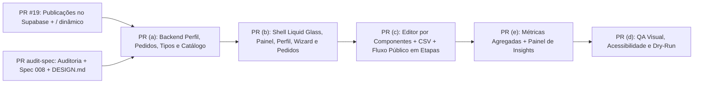

---

description: "Task list for feature 008-portal-redesign organized by sequential PRs with explicit file ownership"
---

# Tasks: Repaginação do Portal em Liquid Glass, Catálogo por Componentes, Planilha CSV, Fluxo Público em Etapas e Painel de Insights (`008-portal-redesign`)

**Input**: Design documents from `/specs/008-portal-redesign/` (`spec.md`, `plan.md`, `data-model.md`, `contracts/portal-redesign-api.md`, `contracts/catalog-csv-contract.md`, `checklists/requirements.md`) e `/docs/portal-redesign-audit.md`

**Prerequisites**: Merge da PR #19 (`supabase/migrations/202611120001_public_publications.sql` e publicação persistida em `publications` / `publication_releases` com roteamento dinâmico `/<slug>` no Worker).

**Organization**: As tarefas estão estruturadas exatamente na sequência de PRs aprovada no plano, com **propriedade explícita de arquivos por PR** para evitar conflitos de merge e respeitar o isolamento do repositório:
- **Phase 1 — PR `audit-spec` (Esta PR)**: Auditoria de todas as telas, especificação Spec Kit `008`, seção `Portal` no `DESIGN.md` e atualização do `AGENTS.md`.
- **Phase 2 — PR (a) `backend`**: Migração `202611120002_portal_profiles.sql`, validações de domínio, rotas no Worker (`/api/profile`, `/api/customization-requests`, `POST /api/sites` estendido, CSP `img-src`), integração com `publications` / `publication_releases` e testes de backend.
- **Phase 3 — PR (b) `shell-dashboard` + `wizard-requests`**: Shell Liquid Glass (sidebar desktop + bottom nav mobile), correção da logo duplicada (`AUD-001`), painel inicial, perfil + interesses, assistente de nova vitrine em 3 passos, tela de pedidos de customização e ajustes em `web/404.html` (`AUD-008`).
- **Phase 4 — PR (c) `editor` + `catalog-components` + `storefront-flow`**: Reorganização do editor (barra de ações fixa, abas, prévia responsiva), catálogo por componentes (`products`, `booking`, `quote`), upload de fotos WebP para Supabase Storage, importação/exportação de cardápio por planilha CSV (`modelo-produtos.csv`, `modelo-servicos.csv`, parser cliente sem dependências, prévia de erros e upsert), fluxo público em etapas compartilhando renderizador com a prévia e migração de `pizzeria-v1`.
- **Phase 5 — PR (e) `metrics-insights`**: Migração `202611120003_site_metrics_daily.sql`, rota pública `POST /api/events` (lote `sendBeacon`, filtro de bots, validação contra publicação ativa), rota autenticada `GET /api/sites/:id/insights?period=7d|30d|90d`, aba **Insights** no portal com gráficos em SVG/CSS próprios e frases automáticas, card de destaque no painel inicial e aviso de privacidade na vitrine pública.
- **Phase 6 — PR (d) `qa`**: QA visual desktop/celular claro/escuro, validação de acessibilidade WCAG AA / teclado / transparência e movimento reduzidos, testes integrados e `wrangler deploy --dry-run`.

## Format: `[ID] [P?] [Story] Description`

- **[P]**: Pode ser executada em paralelo dentro da mesma PR (arquivos distintos)
- **[Story]**: História de usuário associada (`US1` a `US7`)

---

## Phase 1: PR `audit-spec` — Auditoria de Design/Usabilidade, Spec Kit 008 e Seção Portal no DESIGN.md

**File Ownership**: `docs/portal-redesign-audit.md`, `specs/008-portal-redesign/**`, `.specify/feature.json`, `DESIGN.md`, `AGENTS.md` (NÃO toca em `workers/`, `supabase/`, `web/`, `src/`, `package.json` ou `package-lock.json`).

- [x] T001 Executar `npm run build` e `npm run preview`, capturar screenshots desktop (`1440×900`) e mobile (`390×844`) nos temas claro e escuro de `/portal/` (login, painel, editor), `/`, `/404.html` e `/loja1`, e documentar achados com severidade e PR dona em `docs/portal-redesign-audit.md`
- [x] T002 [P] Redigir a especificação completa (`008-US1` a `008-US7`, `FR-001` a `FR-015`, `SC-001` a `SC-006`) em `specs/008-portal-redesign/spec.md` e validar em `specs/008-portal-redesign/checklists/requirements.md`
- [x] T003 [P] Documentar o modelo de dados (`202611120002_portal_profiles.sql`, `202611120003_site_metrics_daily.sql`, catálogo por componentes e migração `pizzeria-v1`) em `specs/008-portal-redesign/data-model.md` e contratos em `specs/008-portal-redesign/contracts/portal-redesign-api.md` e `specs/008-portal-redesign/contracts/catalog-csv-contract.md`
- [x] T004 [P] Documentar o plano técnico e a decomposição de tarefas por PR em `specs/008-portal-redesign/plan.md` e `specs/008-portal-redesign/tasks.md`
- [x] T005 Adicionar a seção normativa **"Portal"** com os tokens Liquid Glass e a regra explícita de preservação "no glass" para o site de divulgação em `DESIGN.md`, e atualizar os ponteiros do Spec Kit para `008-portal-redesign` em `AGENTS.md` e `.specify/feature.json`

---

## Phase 2: PR (a) — Backend: Migração de Perfis/Pedidos/Catálogo, Validação, Rotas no Worker e Testes

**Goal**: Entregar toda a fundação de banco de dados e API para perfis, interesses, pedidos de customização, `storefront_type`, novos modelos de vitrine e esquema de catálogo por componentes sobre o modelo de publicações em tabelas (`publications` e `publication_releases` da PR #19).

**File Ownership (PR a)**:
- `supabase/migrations/202611120002_portal_profiles.sql`
- `supabase/README.md`
- `src/portal-validation.mjs`
- `src/publication-engine.mjs` (suporte de projeção e migração de dados de `pizzeria-v1` para o formato por componentes)
- `workers/api.mjs`
- `test/portal-redesign-backend.test.mjs`

**Independent Test**: Executar `npm test` validando a migração `202611120002_portal_profiles.sql` no PGlite (após `202611070001`, `202611110001` e `202611120001`), testar isolamento RLS entre usuários para `profiles`, `profile_interests` e `customization_requests`, e testar `GET/PUT /api/profile`, `GET/POST /api/customization-requests` e `POST /api/sites` com `storefrontType` e `template` (incluindo checagens de sessão, `Origin` e `Content-Type: application/json`).

- [ ] T006 [US2] [US3] [US4] Criar a migração append-only `supabase/migrations/202611120002_portal_profiles.sql` com as tabelas `public.profiles`, `public.profile_interests` e `public.customization_requests` (status `novo`, `em_analise`, `respondido`, `encerrado`), adição de `public.sites.storefront_type`, expansão das constraints de `template` e `drafts.content` (`pizzeria-v1`, `products-v1`, `booking-v1`, `quote-v1` + `catalogType`, `components`, `orderFields`, `messages`), compatibilidade com `public.publications` / `public.publication_releases`, configuração do bucket `catalog-images` e políticas RLS apenas para o dono/membro
- [ ] T007 [P] [US2] [US3] [US4] [US6] Estender `src/portal-validation.mjs` com `validateProfileInput`, `validateCustomizationRequestInput`, validação de `storefrontType` (`food`, `art`, `photo`, `health`, `tech`), validação de `catalogType` (`products`, `booking`, `quote`), `components`, `orderFields`, `messages` (com variáveis `{itens}`, `{total}`, `{data}`, `{horario}`, `{endereco}`, `{nome}`) e função `migrateLegacyDraftContent` para migrar rascunhos `pizzeria-v1` sem perda de dados
- [ ] T008 [US4] [US6] Atualizar `src/publication-engine.mjs` para projetar com segurança os campos públicos do catálogo por componentes (`catalogType`, `storefrontType`, `components`, `orderFields`, `messages`, `imageUrl`, `minQuantity`, `durationMinutes`) mantendo `assertNoPrivateLeakage` e retrocompatibilidade com `pizzeria-v1`
- [ ] T009 [US2] [US3] [US4] Implementar em `workers/api.mjs` e `scripts/serve.mjs` as rotas `GET /api/profile`, `PUT /api/profile`, `GET /api/customization-requests`, `POST /api/customization-requests` e o suporte a `storefrontType`/`template` em `POST /api/sites` sobre o store Supabase (`publications`/`publication_releases`) e memória, exigindo sessão válida (`401`), `Origin` igual (`403`) e `Content-Type: application/json` (`415`), além de atualizar a CSP `img-src` para o domínio do Supabase Storage
- [ ] T010 [US2] [US3] [US4] [US6] Criar a suíte `test/portal-redesign-backend.test.mjs` cobrindo constraints e RLS da migração `202611120002_portal_profiles.sql` no PGlite, isolamento entre contas, validações de `Origin`/JSON, contratos HTTP de perfil/pedidos/sites e migração de rascunhos `pizzeria-v1`

---

## Phase 3: PR (b) — Portal Shell Liquid Glass, Painel Inicial, Perfil, Assistente 3 Passos e Pedidos

**Goal**: Repaginar a estrutura visual do portal (`/portal/`) com Liquid Glass (`AUD-001`, `AUD-002`, `AUD-003`, `AUD-006`, `AUD-008`), entregando o shell responsivo, o painel inicial, a tela de perfil e interesses, o assistente de nova vitrine em 3 passos e a tela de pedidos de customização com link opcional para WhatsApp.

**File Ownership (PR b)**:
- `web/portal/index.html`
- `web/portal/portal.css`
- `web/portal/portal.js`
- `web/404.html`
- `test/portal-shell-wizard.test.mjs`

**Independent Test**: Abrir `/portal/` em desktop e celular nos temas claro e escuro, confirmar correção da logo duplicada (`AUD-001`), navegar pela barra lateral de vidro (desktop) e barra inferior (celular), testar o Painel Inicial, salvar Perfil e Interesses, criar vitrine pelo Assistente de 3 Passos, registrar um Pedido de Customização verificando o link opcional para WhatsApp, e conferir `web/404.html` com tema escuro.

- [ ] T011 [US1] Implementar em `web/portal/portal.css` os tokens Liquid Glass da seção `Portal` do `DESIGN.md` (`background: rgb(var(--glass) / .55)`, `backdrop-filter: blur(20px) saturate(140%)`, fallbacks sólidos para `@supports not (backdrop-filter)` e `prefers-reduced-transparency: reduce`, gradientes radiais discretos em floresta e grafite, raios de `20–28px`, botões em pílula, alvos de `44px`, remoção do azul Google e banners acessíveis no escuro) e corrigir os seletores `.brand .brand-logo-dark` / `[data-theme="dark"] .brand .brand-logo-light` (`AUD-001`)
- [ ] T012 [US1] Reestruturar `web/portal/index.html` com o App Shell (barra superior com marca, tema, indicador único de modo local e conta; barra lateral de vidro no desktop; barra inferior com ícones no celular) e os contêineres de visão para **Início**, **Minhas vitrines**, **Perfil e interesses**, **Pedidos de customização**, **Assistente de nova vitrine** e **Editor**
- [ ] T013 [US1] [US2] Implementar em `web/portal/portal.js` o roteamento de seções do App Shell, a renderização dos cards do **Painel Inicial** (vitrines, status de publicação, último pedido, completude do perfil e atalhos no estilo do hub `inspira.dev.br`) e o formulário de **Perfil e Interesses** (nome de exibição, negócio, cidade, WhatsApp e chips multi-seleção sincronizados com `GET/PUT /api/profile` e modo local)
- [ ] T014 [US3] Implementar em `web/portal/portal.js` e `web/portal/index.html` o **Assistente de Nova Vitrine em 3 passos** (Passo 1: Alimentação, Arte & design, Fotografia & mídia, Saúde, Tecnologia; Passo 2: escolha de modelo disponível ou "sob customização" abrindo pedido pré-preenchido; Passo 3: nome e slug com validação em tempo real) e a tela de **Pedidos de Customização** (formulário + listagem com status `novo`, `em_analise`, `respondido`, `encerrado` + link opcional para continuar no WhatsApp)
- [ ] T015 [P] [US1] Atualizar `web/404.html` (`AUD-008`) para carregar `theme.js`, usar a marca oficial (`vitrine.svg` / `vitrine-inverse.svg` e `vitrine-icon.svg`) mantendo a superfície sólida sem vidro da divulgação, e adicionar testes de shell/wizard em `test/portal-shell-wizard.test.mjs`

---

## Phase 4: PR (c) — Editor por Componentes, Planilha CSV e Fluxo Público em Etapas

**Goal**: Reorganizar o editor com barra de ações fixa e abas (`AUD-004`, `AUD-005`, `AUD-007`), implementar o catálogo por componentes (`products`, `booking`, `quote`) com fotos WebP no Supabase Storage, adicionar importação e exportação por planilha CSV no navegador sem novas rotas no Worker, e implementar o fluxo público em etapas compartilhando o renderizador com a prévia do editor (`AUD-009`).

**File Ownership (PR c)**:
- `src/storefront-renderer.mjs`
- `src/publication-engine.mjs`
- `scripts/build.mjs` (copiar `storefront-renderer.mjs` para `dist/assets/` se necessário para compartilhamento entre `/portal/` e `/vitrine/`)
- `web/portal/index.html`
- `web/portal/portal.css`
- `web/portal/editor.js`
- `web/portal/csv-catalog.js`
- `web/portal/modelo-produtos.csv`
- `web/portal/modelo-servicos.csv`
- `web/vitrine/index.html`
- `web/vitrine/vitrine.css`
- `web/vitrine/vitrine.js`
- `test/csv-catalog.test.mjs`
- `test/storefront-staged-flow.test.mjs`

**Independent Test**: Testar o parser e exportador CSV com todas as fixtures (`test/csv-catalog.test.mjs`), abrir o editor no portal para configurar componentes de item, campos do pedido, textos/variáveis do WhatsApp e fotos WebP, importar e exportar planilhas CSV (testando prévia de erros e modos adicionar vs. substituir), e percorrer as 3 etapas do fluxo público tanto na prévia do editor quanto na vitrine publicada (`/loja1` e vitrines dinâmicas `/<slug>`).

- [ ] T016 [P] [US5] Criar os modelos estáticos `web/portal/modelo-produtos.csv` (`categoria;nome;descricao;preco;quantidade_minima;ativo`) e `web/portal/modelo-servicos.csv` (`categoria;nome;descricao;preco;duracao_min;ativo`) em UTF-8 com BOM (`\uFEFF`), separador `;`, decimais com vírgula e 2 linhas de exemplo
- [ ] T017 [P] [US5] Implementar `web/portal/csv-catalog.js` com parser e serializador CSV próprios no cliente (sem dependências novas), suporte a BOM, campos entre aspas, separadores `;` e `,`, validação detalhada por linha e coluna, cálculo de prévia e aplicação em modo **Adicionar ao cardápio** (upsert por `categoria + nome` preservando `imageUrl` e criando categorias novas) ou **Substituir cardápio**, respeitando os limites de 20 ativos, 100 totais e 256 KiB
- [ ] T018 [P] [US6] Criar `src/storefront-renderer.mjs` com o renderizador compartilhado em etapas (Etapa 1: escolher produtos/serviços/itens de orçamento; Etapa 2: preencher campos opcionais configurados — data, horário, endereço/retirada, nome, observação; Etapa 3: revisar resumo e acionar `wa.me` com interpolação de `{itens}`, `{total}`, `{data}`, `{horario}`, `{endereco}`, `{nome}`), usando os tokens da Vitrine sem scripts inline nem emojis
- [ ] T019 [US4] [US5] Reorganizar `web/portal/index.html`, `web/portal/portal.css` e `web/portal/editor.js` com barra de ações em Liquid Glass fixa (voltar, revisão, status, medidores compactos, salvar, publicar e abrir vitrine), abas (**Configurações**, **Categorias**, **Itens**, **Pedido & Mensagem**), controles acessíveis (`<label>`, alvos `>= 44px`), seletores de componentes do item e campos do pedido, redimensionamento cliente de fotos para WebP (`<= 200 KB`) rumo ao bucket `catalog-images`, modal/painel de importação e botão **Exportar cardápio**, e prévia ao vivo usando `src/storefront-renderer.mjs` (lado a lado no desktop e em aba no celular)
- [ ] T020 [US6] Atualizar `web/vitrine/index.html`, `web/vitrine/vitrine.css`, `web/vitrine/vitrine.js`, `src/publication-engine.mjs` e `scripts/build.mjs` para usar `src/storefront-renderer.mjs` no fluxo público em etapas e migrar automaticamente vitrines `pizzeria-v1` sem perda de dados
- [ ] T021 [P] [US5] [US6] Criar `test/csv-catalog.test.mjs` (fixtures cobrindo BOM, aspas, `;` e `,`, decimal com vírgula, linhas vazias, colunas faltando, upsert sem duplicar e excesso de itens) e `test/storefront-staged-flow.test.mjs` (testando os 3 tipos de catálogo, interpolação de variáveis do WhatsApp e migração `pizzeria-v1`)

---

## Phase 5: PR (e) — Métricas Agregadas sem Dados Pessoais e Painel de Insights

**Goal**: Adicionar coleta de eventos em lote (`POST /api/events` via `navigator.sendBeacon`) armazenando apenas contadores diários/horários agregados em `site_metrics_daily` (sem IP, cookie ou dado pessoal, retenção de 13 meses), aviso de privacidade no rodapé da vitrine pública, rota `GET /api/sites/:id/insights?period=7d|30d|90d` para membros da vitrine, aba **Insights** no portal e card de destaque da semana no painel inicial.

**File Ownership (PR e)**:
- `supabase/migrations/202611120003_site_metrics_daily.sql`
- `supabase/README.md`
- `src/portal-validation.mjs`
- `src/publication-engine.mjs`
- `workers/api.mjs`
- `web/vitrine/index.html`
- `web/vitrine/vitrine.js`
- `web/portal/index.html`
- `web/portal/portal.css`
- `web/portal/portal.js`
- `test/site-metrics-insights.test.mjs`

**Independent Test**: Executar `npm test` validando a migração `202611120003_site_metrics_daily.sql` no PGlite, testar `POST /api/events` (aceitação de lotes válidos para vitrines publicadas, filtro de User-Agent de robôs, rejeição de vitrines não publicadas, itens inexistentes, payloads não-JSON e lotes acima do limite), testar `GET /api/sites/:id/insights?period=7d|30d|90d` (isolamento por membro da vitrine, cálculos de conversão, rankings, séries por dia/hora e frases automáticas) e verificar a aba **Insights**, o card no painel inicial e o aviso de privacidade na vitrine pública.

- [ ] T022 [US7] Criar a migração append-only `supabase/migrations/202611120003_site_metrics_daily.sql` com a tabela `public.site_metrics_daily` (`site_id`, `metric_date`, `metric_hour`, `item_key`, `metric_name`, `count_value`, `estimated_cents`), política RLS de leitura apenas para membros da vitrine (`private.accessible_site_ids()`) e função `private.record_site_metric_batch` (`SECURITY DEFINER`) com expurgo automático acima de 13 meses e upsert atômico
- [ ] T023 [US7] Implementar em `src/portal-validation.mjs` e `workers/api.mjs` a validação de lote de eventos e as rotas `POST /api/events` (JSON-only, filtro de bots, limite de tamanho de lote, verificação contra a publicação ativa em `publications` e seus itens, sem persistir IP/cookie) e `GET /api/sites/:id/insights?period=7d|30d|90d` (restrita a membros da vitrine, calculando resumo comparativo, rankings de itens/categorias, séries por dia e hora e frases automáticas de variação semanal)
- [ ] T024 [P] [US7] Adicionar em `web/vitrine/vitrine.js`, `web/vitrine/index.html` e `src/publication-engine.mjs` o coletor em lote com `navigator.sendBeacon` (visita, visualização de item, seleção de item e envio de pedido ao WhatsApp com valor estimado) e o aviso de privacidade no rodapé da vitrine pública
- [ ] T025 [US1] [US7] Implementar em `web/portal/index.html`, `web/portal/portal.css` e `web/portal/portal.js` a aba **Insights** na navegação do portal (seletor `7d` / `30d` / `90d`, cards de resumo de visitas, pedidos, conversão e valor estimado, ranking de itens e categorias, gráficos por dia e por horário em SVG e CSS próprios, e frases automáticas) e o card de destaque da semana no Painel Inicial
- [ ] T026 [US7] Criar a suíte `test/site-metrics-insights.test.mjs` testando `202611120003_site_metrics_daily.sql` no PGlite, retenção de 13 meses, proteção contra bots/itens inválidos/vitrines não publicadas em `POST /api/events`, isolamento entre vitrines em `GET /api/sites/:id/insights` e geração de frases automáticas sem divisão por zero

---

## Phase 6: PR (d) — QA Visual, Acessibilidade, Testes Integrados e Dry-Run

**Goal**: Validar de ponta a ponta todas as superfícies em desktop e celular, claro e escuro, acessibilidade WCAG AA, navegação por teclado, fallbacks `@supports` / `prefers-reduced-transparency` / `prefers-reduced-motion`, `npm test`, `npm run build` e `npx --yes wrangler@4.158.0 deploy --dry-run`.

**File Ownership (PR d)**:
- `test/portal-redesign-qa.test.mjs`
- `docs/portal-redesign-audit.md` (registro de fechamento e evidências finais de verificação)

**Independent Test**: Executar `npm test`, `npm run build`, `npx --yes wrangler@4.158.0 deploy --dry-run` e capturar screenshots finais desktop/mobile claro/escuro comprovando resolução de `AUD-001` a `AUD-010`.

- [ ] T027 [US1] [US2] [US3] [US4] [US5] [US6] [US7] Criar `test/portal-redesign-qa.test.mjs` verificando contratos de CSS (tokens Liquid Glass e fallbacks `@supports` / `prefers-reduced-transparency` em `web/portal/portal.css`, ausência de `backdrop-filter` em `web/styles.css`, seletores de logo claro/escuro, alvos `>= 44px`), presença dos modelos CSV com UTF-8 BOM e integridade do build estático
- [ ] T028 Executar `npm run build`, `npm test`, `npx --yes wrangler@4.158.0 deploy --dry-run` e capturar evidências visuais desktop (`1440×900`) e celular (`390×844`) nos temas claro e escuro de todas as telas do portal, divulgação, `404.html` e vitrine pública, atualizando o status de verificação em `docs/portal-redesign-audit.md`

---

## Dependencies & Execution Order

### Sequential PR Summary & File Ownership Matrix

| Ordem | Identificador da PR | Escopo Funcional | Arquivos Exclusivos / Tocados na PR |
| --- | --- | --- | --- |
| **0** | **PR `audit-spec`** *(atual)* | Auditoria de todas as telas + Spec Kit `008` + Seção `Portal` em `DESIGN.md` + Ponteiros `AGENTS.md` | `docs/portal-redesign-audit.md`, `specs/008-portal-redesign/**`, `.specify/feature.json`, `DESIGN.md`, `AGENTS.md` |
| **1** | **PR (a)** `backend` | Migração `202611120002`, RLS, rotas `/api/profile`, `/api/customization-requests`, `POST /api/sites` estendido, validação de catálogo e migração `pizzeria-v1` sobre `publications`/`publication_releases` | `supabase/migrations/202611120002_portal_profiles.sql`, `supabase/README.md`, `src/portal-validation.mjs`, `src/publication-engine.mjs`, `workers/api.mjs`, `scripts/serve.mjs`, `test/portal-redesign-backend.test.mjs` |
| **2** | **PR (b)** `shell-dashboard` + `wizard-requests` | Shell Liquid Glass (sidebar desktop, bottom nav mobile), correção da logo duplicada, painel inicial, perfil + interesses, assistente 3 passos, pedidos de customização e `404.html` | `web/portal/index.html`, `web/portal/portal.css`, `web/portal/portal.js`, `web/404.html`, `test/portal-shell-wizard.test.mjs` |
| **3** | **PR (c)** `editor` + `catalog-components` + `storefront-flow` | Editor com barra fixa e abas, catálogo por componentes (`products`, `booking`, `quote`), fotos WebP no Supabase Storage, importação/exportação CSV no cliente e fluxo público em etapas compartilhando renderizador | `src/storefront-renderer.mjs`, `src/publication-engine.mjs`, `scripts/build.mjs`, `web/portal/editor.js`, `web/portal/csv-catalog.js`, `web/portal/modelo-produtos.csv`, `web/portal/modelo-servicos.csv`, `web/portal/index.html`, `web/portal/portal.css`, `web/vitrine/**`, `test/csv-catalog.test.mjs`, `test/storefront-staged-flow.test.mjs` |
| **4** | **PR (e)** `metrics-insights` | Migração `202611120003`, `POST /api/events` (`sendBeacon`), `site_metrics_daily` (sem PII, 13 meses), `GET /api/sites/:id/insights`, aba **Insights** (SVG/CSS + frases automáticas), card no painel inicial e aviso de privacidade | `supabase/migrations/202611120003_site_metrics_daily.sql`, `supabase/README.md`, `src/portal-validation.mjs`, `src/publication-engine.mjs`, `workers/api.mjs`, `web/vitrine/index.html`, `web/vitrine/vitrine.js`, `web/portal/index.html`, `web/portal/portal.css`, `web/portal/portal.js`, `test/site-metrics-insights.test.mjs` |
| **5** | **PR (d)** `qa` | QA visual desktop/mobile claro/escuro, acessibilidade WCAG AA, testes integrados de regressão e `wrangler deploy --dry-run` | `test/portal-redesign-qa.test.mjs`, `docs/portal-redesign-audit.md` |
