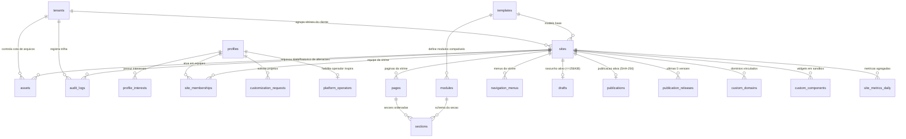

# Modelo de Dados (Phase 1): Plataforma Multi-Inquilino, Painel Modular, CMS Institucional e Domínios (`009-modular-admin-platform`)

**Feature**: `009-modular-admin-platform`
**Date**: 2026-11-12
**Spec**: [spec.md](spec.md) | **Plan**: [plan.md](plan.md) | **Research**: [research.md](research.md)

---

## 1. Princípios de Modelagem e Compatibilidade Append-Only

1. **Evolução sem quebra sobre a base existente (`001` a `008`)**: As migrações existentes (`202611070001_site_access.sql`, `202611110001_portal_schema.sql`, `202611120001_public_publications.sql` e as migrações planejadas na feature `008`) permanecem imutáveis. A evolução multi-inquilino e modular adiciona novas migrações append-only na pasta `supabase/migrations/`.
2. **Isolamento por Vitrine preservado (ADR 0002)**: A tabela `public.tenants` organiza os clientes comercialmente e controla franquias, mas o acesso operacional às vitrines (`public.sites` / `showcases`) continua verificado individualmente por vitrine em `private.accessible_site_ids()` e `private.has_site_role(site_id, roles[])`, evitando acesso cruzado implícito.
3. **Operadores da Plataforma separados (`private.is_platform_admin()`)**: O privilégio de administrar a plataforma (`platform_cms`, catálogo de `templates`/`modules`, aprovação de `custom_components` e governança de `custom_domains`) é verificado no servidor por tabela/função protegida no banco (`public.platform_operators` / `private.is_platform_admin()`), nunca por campo editável pelo próprio cliente.

---

## 2. Diagrama Entidade-Relacionamento (`erDiagram`)

---

## 3. Especificação das Tabelas e Políticas RLS

### 3.1. `public.tenants` e `public.platform_operators` (Fase 1)

| Tabela | Colunas Principais | Restrições e Índices | Política RLS |
| :--- | :--- | :--- | :--- |
| `public.tenants` | `id uuid PK`, `owner_user_id uuid NOT NULL`, `slug text UNIQUE NOT NULL`, `name text NOT NULL`, `plan text NOT NULL DEFAULT 'free'`, `status text NOT NULL DEFAULT 'active'`, `settings jsonb NOT NULL DEFAULT '{}'::jsonb`, `created_at timestamptz`, `updated_at timestamptz` | `plan IN ('free', 'custom_domain', 'bespoke')`, `status IN ('active', 'suspended')`, índice em `owner_user_id` | Leitura para `owner_user_id = (SELECT auth.uid())` ou `private.is_platform_admin()`. Escrita de `plan` e `status` restrita a `private.is_platform_admin()`. |
| `public.platform_operators` | `user_id uuid PK REFERENCES auth.users(id) ON DELETE CASCADE`, `role text NOT NULL DEFAULT 'platform_admin'`, `created_at timestamptz` | `role IN ('platform_admin', 'support_operator')` | Somente leitura para o próprio operador; mutação exclusiva via migração/administração de servidor (`REVOKE INSERT, UPDATE, DELETE FROM authenticated, anon`). |

### 3.2. `public.sites` (Vitrines) e `public.site_memberships` (Papéis Expandidos — Fase 1)

- `public.sites` recebe:
  - `tenant_id uuid NULL REFERENCES public.tenants(id) ON DELETE SET NULL`
  - `storefront_type text NOT NULL DEFAULT 'food' CHECK (storefront_type IN ('food', 'art', 'photo', 'health', 'tech'))`
  - `theme_overrides jsonb NOT NULL DEFAULT '{}'::jsonb CHECK (jsonb_typeof(theme_overrides) = 'object' AND octet_length(theme_overrides::text) <= 16384)`
  - `template text NOT NULL` validado contra o catálogo de modelos (`'pizzeria-v1'`, `'products-v1'`, `'booking-v1'`, `'quote-v1'`, `'catalog-bio-v1'`, `'portfolio-v1'`).
- `public.site_memberships`:
  - Papéis suportados: `'owner'`, `'admin'`, `'editor'`, `'viewer'`.
  - Função auxiliar `private.has_site_role(target_site_id uuid, allowed_roles text[]) RETURNS boolean STABLE SECURITY DEFINER SET search_path = ''`:
    - `'owner'` e `'admin'`: gerenciam configurações da vitrine, rascunhos, publicações, reversões e membros (`'owner'` é único por vitrine e protegido por trigger).
    - `'editor'`: edita rascunhos, páginas, seções, itens e ativos, e gera prévia, mas não remove a vitrine nem altera proprietário/domínio.
    - `'viewer'`: apenas leitura de rascunho, prévia e métricas (`Insights`).

### 3.3. `public.templates`, `public.modules`, `public.pages`, `public.sections` e `public.navigation_menus` (Fase 2 e Fase 3)

| Tabela | Colunas Principais | Finalidade e Regras de Validação |
| :--- | :--- | :--- |
| `public.templates` | `code text PK`, `name text NOT NULL`, `storefront_type text NOT NULL`, `catalog_type text NOT NULL`, `schema_version int NOT NULL DEFAULT 1`, `default_tokens jsonb NOT NULL`, `default_sections jsonb NOT NULL`, `is_custom_only boolean NOT NULL DEFAULT false`, `active boolean NOT NULL DEFAULT true` | Catálogo central de modelos reutilizáveis administrado pelos Operadores Inspira. Leitura para usuários autenticados; escrita restrita a `private.is_platform_admin()`. |
| `public.modules` | `code text PK`, `name text NOT NULL`, `category text NOT NULL`, `config_schema jsonb NOT NULL`, `default_config jsonb NOT NULL`, `active boolean NOT NULL DEFAULT true` | Registro declarativo dos módulos de seção (`hero`, `catalog_grid`, `service_booking`, `quote_request`, `about_story`, `testimonials`, `faq`, `hours_location`, `links_bio`, `custom_sandbox`). |
| `public.pages` | `id uuid PK`, `site_id uuid NOT NULL REFERENCES public.sites(id) ON DELETE CASCADE`, `slug text NOT NULL`, `title text NOT NULL`, `display_order int NOT NULL DEFAULT 0`, `active boolean NOT NULL DEFAULT true` | Permite página principal (`slug = 'home'`) e até 5 páginas adicionais por vitrine no plano gratuito (`UNIQUE (site_id, slug)`). RLS por `private.accessible_site_ids()`. |
| `public.sections` | `id uuid PK`, `site_id uuid NOT NULL REFERENCES public.sites(id) ON DELETE CASCADE`, `page_id uuid NOT NULL REFERENCES public.pages(id) ON DELETE CASCADE`, `module_code text NOT NULL REFERENCES public.modules(code)`, `display_order int NOT NULL DEFAULT 0`, `config jsonb NOT NULL DEFAULT '{}'::jsonb`, `active boolean NOT NULL DEFAULT true` | Seções reordenáveis de cada página (máx. 15 seções por página). |
| `public.navigation_menus` | `id uuid PK`, `site_id uuid NOT NULL REFERENCES public.sites(id) ON DELETE CASCADE`, `location text NOT NULL CHECK (location IN ('header', 'footer', 'quick_links'))`, `items jsonb NOT NULL DEFAULT '[]'::jsonb` | Menus de navegação configuráveis por vitrine (`UNIQUE (site_id, location)`), máximo de 10 links validados por menu. |

### 3.4. `public.platform_cms` e `public.audit_logs` (Fase 2)

| Tabela | Colunas Principais | Regras de Segurança e Retenção |
| :--- | :--- | :--- |
| `public.platform_cms` | `section_key text PK`, `draft_content jsonb NOT NULL`, `published_content jsonb NOT NULL`, `artifact_hash text NOT NULL`, `visible boolean NOT NULL DEFAULT true`, `display_order int NOT NULL DEFAULT 0`, `updated_by uuid NULL`, `updated_at timestamptz NOT NULL DEFAULT now()`, `published_at timestamptz NULL` | Gerencia as seções da página principal da plataforma (`hero`, `value_props`, `areas_showcase`, `templates_catalog`, `featured_cases`, `commercial_offer`, `faq`, `announcements`, `header_nav`, `footer`). Escrita exclusiva para `private.is_platform_admin()`. Projeção pública validada por `assertNoPrivateLeakage()`. |
| `public.audit_logs` | `id uuid PK DEFAULT gen_random_uuid()`, `site_id uuid NULL REFERENCES public.sites(id) ON DELETE CASCADE`, `actor_user_id uuid NOT NULL`, `action text NOT NULL`, `entity_type text NOT NULL`, `entity_id text NOT NULL`, `summary jsonb NOT NULL DEFAULT '{}'::jsonb`, `created_at timestamptz NOT NULL DEFAULT now()` | Trilha imutável (`REVOKE UPDATE, DELETE`). Leitura para membros de `site_id` (escopo da vitrine) ou `private.is_platform_admin()` (escopo global). Expurgo automático de registros com mais de 180 dias para preservar os 500 MB do banco. |

### 3.5. `public.assets` e `public.custom_components` (Fase 4)

| Tabela | Colunas Principais | Regras de Cota e Sandboxing |
| :--- | :--- | :--- |
| `public.assets` | `id uuid PK`, `site_id uuid NOT NULL REFERENCES public.sites(id) ON DELETE CASCADE`, `storage_provider text NOT NULL DEFAULT 'supabase' CHECK (storage_provider IN ('supabase', 'r2'))`, `object_key text UNIQUE NOT NULL`, `public_url text NOT NULL`, `mime_type text NOT NULL CHECK (mime_type IN ('image/webp', 'image/svg+xml', 'application/pdf'))`, `byte_size int NOT NULL CHECK (byte_size > 0 AND byte_size <= 262144)`, `sha256_hex text NOT NULL`, `created_at timestamptz NOT NULL DEFAULT now()` | Máximo de 100 ativos (ou 20 MB totais) por vitrine no plano gratuito. Imagens de catálogo exigem `image/webp` $\le 200\text{ KB}$. |
| `public.custom_components` | `id uuid PK`, `site_id uuid NOT NULL REFERENCES public.sites(id) ON DELETE CASCADE`, `slug text NOT NULL`, `name text NOT NULL`, `source_type text NOT NULL CHECK (source_type IN ('inline_bundle', 'github_release'))`, `source_repo text NULL`, `version_tag text NOT NULL`, `bundle_hash_sha256 text NOT NULL`, `sandbox_url text NOT NULL`, `allowed_events jsonb NOT NULL DEFAULT '["resize"]'::jsonb`, `approved_by uuid NOT NULL`, `active boolean NOT NULL DEFAULT true` | Registro de componentes personalizados que rodam exclusivamente em `<iframe sandbox="allow-scripts">` sob `sandbox.inspira.dev.br`. Registro e aprovação exigem `private.is_platform_admin()`. |

### 3.6. `public.custom_domains` e Retenção de `public.publication_releases` (Fase 5)

| Tabela | Colunas Principais | Regras de Domínio e Custo Zero |
| :--- | :--- | :--- |
| `public.custom_domains` | `id uuid PK`, `site_id uuid NOT NULL REFERENCES public.sites(id) ON DELETE CASCADE`, `hostname text UNIQUE NOT NULL`, `is_apex boolean NOT NULL DEFAULT false`, `status text NOT NULL DEFAULT 'pending_dns' CHECK (status IN ('pending_dns', 'verifying', 'active', 'failed', 'suspended'))`, `verification_txt_name text NOT NULL`, `verification_txt_value text NOT NULL`, `cname_target text NOT NULL DEFAULT 'vitrine.inspira.dev.br'`, `cf_hostname_id text NULL`, `ssl_status text NOT NULL DEFAULT 'pending'`, `verified_at timestamptz NULL`, `created_at timestamptz NOT NULL DEFAULT now()` | Hostname em minúsculas validado por regex RFC 1123 (bloqueando `*.inspira.dev.br` reservados). Trigger no banco impede ativar mais de **95 hostnames** simultâneos (`status IN ('verifying', 'active')`) para nunca exceder a cota gratuita de 100 domínios do Cloudflare for SaaS. |
| `public.publication_releases` | *(Existente em `202611120001_public_publications.sql`)* | Adição de trigger/função de retenção que mantém as **5 últimas revisões publicadas** por `site_id`, permitindo *rollback* instantâneo em 1 clique sem inflar o limite de 500 MB do Supabase Postgres Free. |
