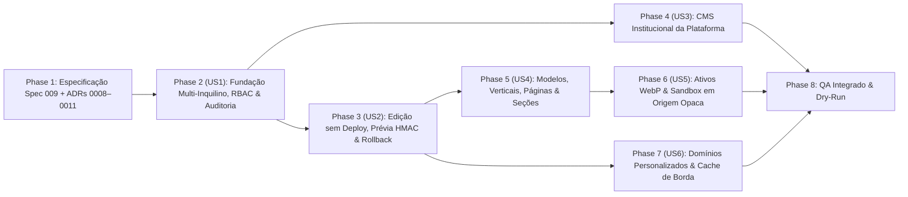

---

description: "Lista de tarefas ordenada por dependências para a feature 009-modular-admin-platform"
---

# Tasks: Plataforma SaaS Multi-Inquilino e Painel Administrativo Modular e Configurável (`009-modular-admin-platform`)

**Input**: Documentos de projeto em `/specs/009-modular-admin-platform/` (`spec.md`, `plan.md`, `research.md`, `data-model.md`, `quickstart.md`, `contracts/modular-admin-api.md`, `contracts/module-manifest-schema.md`), `/docs/modular-admin-architecture.md` e ADRs `0008` a `0011` em `/docs/adr/`.

**Prerequisites**: Fundação existente (`202611070001_site_access.sql`, `202611110001_portal_schema.sql`, `202611120001_public_publications.sql`) e integração incremental com `specs/008-portal-redesign`.

**Tests**: Todas as fases incluem suítes de testes automatizados (`node --test` com PGlite embarcado) cobrindo isolamento multi-inquilino, RBAC, projeção pública sem vazamento (`assertNoPrivateLeakage`), prévia assinada, reversão de versões, sandboxing em origem opaca e travas de cota gratuita.

**Organization**: As tarefas seguem as fases do Roadmap arquitetural mapeadas para as histórias de usuário (`US1` a `US6`), permitindo implementação e verificação independentes a cada incremento.

## Format: `[ID] [P?] [Story] Description`

- **[P]**: Pode ser executada em paralelo (arquivos distintos, sem dependências de tarefas incompletas)
- **[Story]**: História de usuário associada (`US1` a `US6`)

---

## Phase 1: Setup & Documentação Arquitetural (Estudo e Especificação)

**Purpose**: Consolidar o diagnóstico arquitetural, os 4 novos ADRs (`0008` a `0011`), o vocabulário de domínio e a especificação Spec Kit `009`.

- [x] T001 Consolidar o estudo arquitetural completo (D1 a D8) em `docs/modular-admin-architecture.md`
- [x] T002 [P] Registrar os ADRs de roteamento multi-inquilino, CMS dinâmico, sandboxing em origem opaca e armazenamento de mídia a custo zero em `docs/adr/0008-multi-tenant-edge-routing.md`, `docs/adr/0009-dynamic-cms-immutable-snapshots.md`, `docs/adr/0010-opaque-sandbox-custom-components.md` e `docs/adr/0011-zero-cost-media-storage.md`
- [x] T003 [P] Redigir a especificação funcional, modelo de dados, contratos e guia rápido em `specs/009-modular-admin-platform/spec.md`, `specs/009-modular-admin-platform/research.md`, `specs/009-modular-admin-platform/data-model.md`, `specs/009-modular-admin-platform/contracts/modular-admin-api.md`, `specs/009-modular-admin-platform/contracts/module-manifest-schema.md`, `specs/009-modular-admin-platform/quickstart.md` e `specs/009-modular-admin-platform/checklists/requirements.md`
- [x] T004 [P] Atualizar o vocabulário ubíquo, arquitetura, roadmap e ponteiros do Spec Kit em `CONTEXT.md`, `docs/architecture.md`, `docs/roadmap.md`, `AGENTS.md` e `.specify/feature.json`

---

## Phase 2: Foundational — Fundação Multi-Inquilino, RBAC por Vitrine e Auditoria (`009-US1`) (Priority: P1) 🎯 MVP

**Goal**: Entregar a camada de persistência e autorização multi-inquilino (`tenants`, `platform_operators`, papéis `owner`, `admin`, `editor`, `viewer` em `site_memberships` e trilha imutável em `audit_logs`), garantindo isolamento estrito entre vitrines e separação entre Administração da Plataforma e Administração da Vitrine.

**Independent Test**: Executar `npm test` validando a migração `202611120005_multi_tenant_rbac_audit.sql` no PGlite e os contratos de API de membros e auditoria em `test/multi-tenant-rbac-audit.test.mjs`, comprovando que nenhum cliente lê ou modifica dados de outra vitrine e que apenas `platform_admin` acessa rotas `/api/admin/*`.

### Tests for User Story 1

- [ ] T005 [P] [US1] Criar a suíte de testes de banco (PGlite) e API para isolamento entre `tenants`, papéis `owner`/`admin`/`editor`/`viewer`, proteção de `platform_operators` e gravação de `audit_logs` em `test/multi-tenant-rbac-audit.test.mjs`

### Implementation for User Story 1

- [X] T006 [US1] Criar a migração append-only `supabase/migrations/202611120005_multi_tenant_rbac_audit.sql` com as tabelas `public.tenants`, `public.platform_operators` e `public.audit_logs`, extensão de `public.sites` (`tenant_id`, `theme_overrides`) e `public.site_memberships` (`owner`, `admin`, `editor`, `viewer`), além das funções `private.is_platform_admin()` e `private.has_site_role(uuid, text[])` (`SECURITY DEFINER`, `STABLE`, `search_path = ''`)
- [ ] T007 [P] [US1] Adicionar validadores de papéis de equipe (`validateMembershipInput`), configurações de inquilino e filtros de auditoria em `src/portal-validation.mjs`
- [X] T008 [US1] Implementar em `workers/api.mjs` as rotas de gestão de equipe da vitrine (`GET/POST/DELETE /api/sites/:siteId/members`), consulta de histórico (`GET /api/sites/:siteId/audit-logs`), guarda de autorização por papel e gravação automática em `public.audit_logs`
- [ ] T009 [US1] Adicionar no painel administrativo (`web/portal/index.html`, `web/portal/portal.css` e `web/portal/portal.js`) o seletor rápido de vitrines no cabeçalho/barra lateral, a seção de **Equipe e Permissões da Vitrine** e a visualização do **Histórico de Alterações**

**Checkpoint**: Isolamento multi-inquilino, equipes por vitrine e trilha de auditoria funcionando e testados independentemente.

---

## Phase 3: User Story 2 - Administração sem Deploy, Pré-Visualização Assinada e Rollback (`009-US2`) (Priority: P1)

**Goal**: Permitir alterações operacionais instantâneas (incluindo chaveamento rápido de disponibilidade de itens/seções inspirado no Bar da Cássia), pré-visualização autenticada por token HMAC (`X-Robots-Tag: noindex, nofollow`) e reversão (*rollback*) em 1 clique entre as últimas 5 versões publicadas sem necessidade de deploy.

**Independent Test**: Executar `test/cms-preview-rollback.test.mjs` validando geração/expiração de tokens HMAC em `/__preview/:siteId`, cabeçalho `noindex`, chaveamento rápido `PATCH /api/sites/:siteId/quick-toggle`, retenção máxima de 5 releases em `public.publication_releases` e restauração imediata via `POST /api/sites/:siteId/rollback`.

### Tests for User Story 2

- [X] T010 [P] [US2] Criar os testes automatizados de token HMAC de prévia, `quick-toggle`, retenção de 5 versões e rollback de publicação em `test/cms-preview-rollback.test.mjs`

### Implementation for User Story 2

- [X] T011 [P] [US2] Implementar o gerador e verificador de tokens efêmeros `HMAC-SHA256` (`signPreviewToken`, `verifyPreviewToken`) via Web Crypto API nativa em `src/preview-token.mjs`
- [X] T012 [US2] Criar a migração `supabase/migrations/202611120006_cms_pages_sections_releases.sql` adicionando a política de retenção automática das 5 últimas versões por vitrine em `public.publication_releases` e suporte transacional para restauração de versão
- [ ] T013 [US2] Implementar em `workers/api.mjs` as rotas `PATCH /api/sites/:siteId/quick-toggle`, `POST /api/sites/:siteId/preview-token`, `GET /__preview/:siteId` (com `Cache-Control: no-store` e `X-Robots-Tag: noindex, nofollow`), `GET /api/sites/:siteId/releases` e `POST /api/sites/:siteId/rollback` (com purga imediata de `caches.default`)
- [X] T014 [US2] Atualizar `web/portal/editor.js` e `web/portal/index.html` com os controles de alternância rápida de disponibilidade, botão de **Abrir Prévia Segura** e painel de **Versões e Restauração (Rollback)**

**Checkpoint**: Ciclo completo Rascunho → Prévia Assinada → Publicação sem Deploy → Rollback de 5 versões validado.

---

## Phase 4: User Story 3 - Administração do Portal Institucional (CMS da Plataforma) (`009-US3`) (Priority: P1)

**Goal**: Entregar aos Operadores Inspira (`platform_admin`) o módulo de CMS Institucional (`public.platform_cms`) e o painel de **Administração da Plataforma** para gerenciar banners, textos comerciais, ordem e visibilidade de seções, modelos disponíveis, cases em destaque, comunicados, rodapé e pedidos de customização sem novo deploy.

**Independent Test**: Testar em `test/cms-preview-rollback.test.mjs` que usuários comuns recebem `403` em `/api/admin/*`, que um `platform_admin` edita e publica seções em `public.platform_cms` (validadas por `assertNoPrivateLeakage`), e que a página inicial pública reflete o conteúdo publicado com fallback seguro para `content/portfolio.json`.

### Implementation for User Story 3

- [X] T015 [US3] Incluir na migração `supabase/migrations/202611120006_cms_pages_sections_releases.sql` a tabela `public.platform_cms` com dados iniciais das seções institucionais (`hero`, `value_props`, `areas_showcase`, `templates_catalog`, `featured_cases`, `commercial_offer`, `faq`, `announcements`, `header_nav`, `footer`) e RLS restrita a `private.is_platform_admin()`
- [ ] T016 [P] [US3] Adicionar em `src/portal-validation.mjs` e `src/publication-engine.mjs` a validação e projeção pública (`compilePlatformCmsManifest`) das seções institucionais aplicando `assertNoPrivateLeakage()`
- [ ] T017 [US3] Implementar em `workers/api.mjs` as rotas `GET /api/admin/overview`, `GET /api/admin/cms`, `PUT /api/admin/cms/:sectionKey`, `POST /api/admin/cms/publish`, `PATCH /api/admin/customization-requests/:id`, `GET /api/admin/audit-logs` e `GET /api/public/platform-cms` (com cache SWR na borda)
- [ ] T018 [US3] Implementar em `web/portal/index.html`, `web/portal/portal.js` e `web/app.js` a visão exclusiva **Administração da Plataforma** (visível apenas para `platform_admin`) e o consumo dinâmico com fallback estático na página institucional (`web/index.html`)

**Checkpoint**: Página institucional e operação central da plataforma 100% administráveis sem deploy pelos Operadores Inspira.

---

## Phase 5: User Story 4 - Modularização por Verticais, Modelos Reutilizáveis e Páginas/Seções (`009-US4`) (Priority: P2)

**Goal**: Arquitetar o catálogo de modelos (`public.templates`), módulos de seção (`public.modules`), páginas (`public.pages`), seções ordenáveis (`public.sections`) e menus (`public.navigation_menus`) com herança em cascata (*Defaults do Modelo* → *Defaults da Vertical* → *Overrides da Vitrine*).

**Independent Test**: Executar `test/template-inheritance-modules.test.mjs` verificando que a resolução em cascata preserva customizações do cliente quando o modelo base é atualizado, que seções podem ser incluídas, ocultadas e reordenadas, e que vitrines `pizzeria-v1` continuam 100% compatíveis.

### Tests for User Story 4

- [ ] T019 [P] [US4] Criar a suíte `test/template-inheritance-modules.test.mjs` validando herança em cascata de tokens/seções, troca de modelo sem perda de itens, validação de páginas/menus e retrocompatibilidade com `pizzeria-v1`

### Implementation for User Story 4

- [ ] T020 [US4] Incluir na migração `supabase/migrations/202611120006_cms_pages_sections_releases.sql` as tabelas `public.templates`, `public.modules`, `public.pages`, `public.sections` e `public.navigation_menus` com os modelos iniciais das verticais (Cardápio/Produtos, Agendamento de Serviços, Portfólio/Orçamento, Catálogo/Link-in-Bio)
- [ ] T021 [P] [US4] Implementar em `src/publication-engine.mjs` e `src/portal-validation.mjs` o resolvedor em cascata (`resolveShowcaseManifest`) combinando `templates.default_tokens`, módulos da vertical e `sites.theme_overrides` / `pages` / `sections` / `navigation_menus`
- [ ] T022 [US4] Atualizar `src/storefront-renderer.mjs`, `web/vitrine/vitrine.js` e `web/vitrine/vitrine.css` para renderizar páginas, menus configuráveis, tokens de tema herdados e seções modulares ordenadas (`hero`, `catalog_grid`, `about_story`, `testimonials`, `faq`, `hours_location`, `links_bio`)
- [ ] T023 [US4] Adicionar em `web/portal/editor.js` o gerenciador visual de **Identidade Visual (Tema/Cores/Fontes)**, **Menus de Navegação** e **Páginas e Seções** (incluir, ativar/desativar e reordenar seções com atualização instantânea na prévia)

**Checkpoint**: Vitrines modulares multi-vertical com páginas, seções e temas personalizáveis sem quebra em atualizações do modelo central.

---

## Phase 6: User Story 5 - Gestão de Ativos WebP e Componentes Personalizados em Sandbox (`009-US5`) (Priority: P2)

**Goal**: Centralizar a biblioteca de ativos otimizados por vitrine (conversão WebP `<= 200 KB` no navegador, controle de cota em `public.assets`, cache imutável na borda sobre Supabase Storage Free e adaptador plugável para Cloudflare R2 Free) e confinar componentes personalizados (HTML/CSS/JS ou pacotes de repositórios GitHub externos) a `<iframe sandbox="allow-scripts" referrerpolicy="no-referrer">` em origem opaca (`null`).

**Independent Test**: Executar `test/assets-opaque-sandbox.test.mjs` comprovando validação de tamanho/MIME WebP, respeito à cota por vitrine, funcionamento do adaptador `StorageProvider` (`supabase` e `r2`), renderização de iframe sem `allow-same-origin`, CSP restritiva e validação de mensagens `postMessage`.

### Tests for User Story 5

- [ ] T024 [P] [US5] Criar a suíte `test/assets-opaque-sandbox.test.mjs` testando limites de ativos WebP, abstração `StorageProvider`, atributos de isolamento do iframe de sandbox (`sandbox="allow-scripts"` sem `allow-same-origin`), cabeçalhos CSP e filtro de eventos `postMessage`

### Implementation for User Story 5

- [X] T025 [US5] Criar a migração `supabase/migrations/202611120007_assets_sandbox_domains.sql` com as tabelas `public.assets` (limite de 100 ativos / 20 MB por vitrine) e `public.custom_components` (registro e aprovação de widgets em sandbox por `platform_admin`)
- [X] T026 [P] [US5] Criar `src/storage-adapter.mjs` implementando a interface `StorageProvider` com o provedor padrão sem cartão (`SupabaseStorageProvider` + cabeçalhos `Cache-Control: public, max-age=31536000, immutable`) e o adaptador plugável `R2StorageProvider` (`env.R2_BUCKET`)
- [ ] T027 [US5] Implementar em `workers/api.mjs` e `src/storefront-renderer.mjs` as rotas de ativos (`GET/POST/DELETE /api/sites/:siteId/assets`), a rota isolada de entrega de sandbox (`/embed/:widgetId` / `sandbox.inspira.dev.br` com CSP `default-src 'none'; script-src 'unsafe-inline'; connect-src 'none'`) e o listener seguro de `postMessage`
- [ ] T028 [US5] Adicionar em `web/portal/editor.js` a **Biblioteca de Arquivos da Vitrine** (com compressor cliente `OffscreenCanvas` para WebP `<= 200 KB` e indicador de cota) e a seleção de **Componentes Personalizados** aprovados para a vitrine

**Checkpoint**: Upload otimizado a custo zero e execução de componentes externos em sandbox de origem opaca (`null`) verificados.

---

## Phase 7: User Story 6 - Domínios Personalizados e Roteamento de Borda a Custo Zero (`009-US6`) (Priority: P3)

**Goal**: Permitir que clientes utilizem o endereço básico (`vitrine.inspira.dev.br/<slug>`), subdomínios ou domínios próprios (`cardapio.cliente.com.br` / `cliente.com.br`) com fluxo guiado de verificação DNS (`CNAME`/`TXT`), status de SSL, resolução dinâmica pelo cabeçalho `Host` no Cloudflare Worker com `Cache API` (`stale-while-revalidate`, CPU `< 1,5 ms`) e trava programática em **95 domínios ativos** para garantir custo fixo zero.

**Independent Test**: Executar `test/custom-domains-edge-cache.test.mjs` testando cadastro de domínio, detecção de domínio ápice, geração de desafio DNS, bloqueio automático ao atingir 95 domínios ativos (`DOMAIN_QUOTA_REACHED`), resolução da vitrine por cabeçalho `Host` com `caches.default` (SWR) e retorno seguro ao endereço básico quando um domínio é removido.

### Tests for User Story 6

- [X] T029 [P] [US6] Criar a suíte `test/custom-domains-edge-cache.test.mjs` cobrindo validação de hostname RFC 1123, trava de 95 domínios ativos no banco e na API, fluxo de verificação DNS/SSL, roteamento por cabeçalho `Host` e cache SWR na borda

### Implementation for User Story 6

- [X] T030 [US6] Incluir na migração `supabase/migrations/202611120007_assets_sandbox_domains.sql` a tabela `public.custom_domains` e a função/trigger `private.enforce_free_custom_domain_quota()` que bloqueia mais de 95 domínios em status `'verifying'` ou `'active'`
- [ ] T031 [US6] Implementar em `workers/api.mjs` as rotas `GET/POST/DELETE /api/sites/:siteId/domains` e `POST /api/sites/:siteId/domains/:domainId/verify`, a resolução pública de vitrines por cabeçalho `Host` via `caches.default` (`Cache-Control: public, max-age=300, stale-while-revalidate=86400`) e o handler `scheduled` (Cron diário) para verificação de domínios pendentes e prevenção de pausa por inatividade de 7 dias do Supabase Free
- [X] T032 [US6] Implementar em `web/portal/portal.js` e `web/portal/index.html` a tela de **Domínios e Publicação** exibindo o endereço gratuito ativo, o formulário de vínculo de subdomínio/domínio próprio, as instruções de apontamento DNS (`CNAME` e `TXT`), orientações para domínio raiz e status de verificação e HTTPS/SSL

**Checkpoint**: Fluxo completo de domínios personalizados e cache de borda operando com custo zero garantido.

---

## Phase 8: Polish & Cross-Cutting Concerns (QA Integrado e Verificação Final)

**Purpose**: Validação integrada de acessibilidade WCAG AA/AAA, contenção visual do *Liquid Glass*, performance e empacotamento Cloudflare Worker.

- [ ] T033 [P] Atualizar `supabase/README.md` e `docs/operations-guide.md` com o guia operacional das migrações `202611120004` a `202611120006`, governança da trava de 95 domínios e chaveamento opcional do adaptador Cloudflare R2
- [ ] T034 Executar `npm test`, `npm run build` e `npx --yes wrangler@4.158.0 deploy --dry-run` validando 100% dos testes, integridade do pacote estático e orçamento do Worker (`< 100 KiB` comprimido)

---

## Dependencies & Execution Order

### Parallel Opportunities

- Após concluir a **Phase 2 (`US1` — Fundação Multi-Inquilino e RBAC)**, as frentes **Phase 3 (`US2` — Prévia e Rollback)** e **Phase 4 (`US3` — CMS Institucional)** podem avançar em paralelo.
- Após concluir a **Phase 3 (`US2`)**, a **Phase 5 (`US4` — Modelos e Seções)** e a **Phase 7 (`US6` — Domínios Personalizados)** podem ser desenvolvidas em paralelo.
- Dentro de cada fase, tarefas marcadas com `[P]` (testes, validadores puros em `src/` e migrações SQL) podem ser elaboradas de forma independente antes da integração em `workers/api.mjs` e `web/portal/`.

### Implementation Strategy (Incremental Delivery)

1. **Incremento 1 (MVP de Governança — `US1` + `US2`)**: Isolamento multi-inquilino, papéis por vitrine, trilha de auditoria, chaveamento rápido estilo Bar da Cássia, pré-visualização assinada e reversão de versões sem deploy.
2. **Incremento 2 (Autonomia do Coletivo Inspira — `US3`)**: Painel de Administração da Plataforma e CMS Institucional dinâmico para a página principal.
3. **Incremento 3 (Modularização e Extensibilidade Segura — `US4` + `US5`)**: Modelos por vertical, páginas/seções reordenáveis, upload WebP com cache na borda e componentes personalizados em sandbox opaco.
4. **Incremento 4 (Escala e Marca Própria — `US6` + `Phase 8`)**: Domínios personalizados com verificação DNS/SSL, roteamento por `Host` com SWR e trava de 95 domínios gratuitos.
