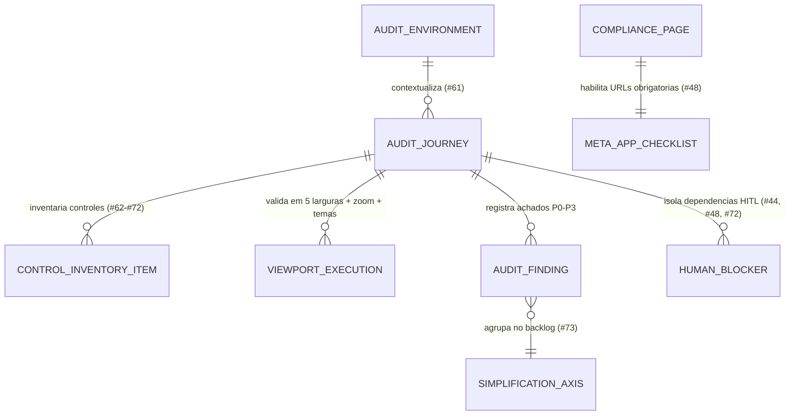

# Modelo de Dados e Artefatos (Phase 1): Auditoria UX e Prontidão Meta/Instagram (`010-ux-audit-meta-readiness`)

**Feature**: `010-ux-audit-meta-readiness`
**Date**: 2026-11-12
**Spec**: [spec.md](spec.md) | **Plan**: [plan.md](plan.md) | **Research**: [research.md](research.md)

---

## 1. Visão Geral

Esta funcionalidade não introduz novas tabelas pagas nem altera as migrações existentes (`202611070001` a `202611120009`). Ela modela:
1. O **esquema documental canônico** da Matriz Central de Auditoria UX (`docs/auditoria-ux/matriz-central.md`) e do Relatório Consolidado (`docs/auditoria-ux/relatorio-consolidado.md`) para as issues `#61` a `#73`;
2. As **entidades de páginas institucionais de conformidade** (`web/privacidade/index.html` e `web/termos/index.html`) necessárias para o cumprimento técnico da issue `#48`;
3. O **modelo de estado futuro planejado** para o vínculo de conta Instagram por vitrine (`docs/instagram/`), mantendo a implementação de banco/API do Instagram isolada para a fase pós-desbloqueio HITL na Meta.

---

## 2. Diagrama de Entidades e Artefatos

---

## 3. Especificação das Entidades

### 3.1. `AuditEnvironment` (Identificação de Versão e Ambientes — Issue `#61`)

| Campo | Tipo | Restrições / Valores Permitidos | Descrição |
| :--- | :--- | :--- | :--- |
| `environment_id` | `string` | `'local_preview'` \| `'prod_vitrine'` \| `'prod_painel'` \| `'prod_sandbox'` | Identificador do ambiente avaliado. |
| `base_url` | `string (URL)` | `http://127.0.0.1:4173`, `https://vitrine.inspira.dev.br`, `https://painel.inspira.dev.br` | Endereço base inspecionado. |
| `commit_sha` | `string (hex)` | SHA do commit em `main` | Versão exata auditada no repositório. |
| `migrations_range` | `string` | `202611070001` .. `202611120009` | Faixa de migrações SQL verificadas em PGlite. |
| `availability_status` | `enum` | `'verificado_local'` \| `'bloqueado_dns_deploy'` \| `'bloqueado_hitl'` | Estado real sem presumir deploy remoto não confirmado. |

### 3.2. `ControlInventoryItem` (Inventário de Controles por Tela — Issues `#62` a `#72`)

| Campo | Tipo | Restrições / Valores Permitidos | Descrição |
| :--- | :--- | :--- | :--- |
| `journey_issue` | `int` | `62` .. `72` | Número da issue da jornada correspondente. |
| `surface_path` | `string` | Ex.: `/`, `/como-funciona/`, `/portal/#inicio`, `/portal/#editor`, `/loja1` | Caminho ou seção da interface. |
| `control_id` | `string` | Seletor ou identificador semântico (`#google-login-btn`, `.site-header`, etc.) | Controle auditado (botão, link, campo, aba, menu, ícone). |
| `control_type` | `enum` | `'button'` \| `'link'` \| `'input'` \| `'select'` \| `'tab'` \| `'menu'` \| `'icon'` \| `'toggle'` | Tipo do elemento interativo. |
| `states_verified` | `string[]` | `['default', 'hover', 'focus-visible', 'active', 'disabled', 'loading', 'error', 'empty']` | Estados inspecionados no controle. |
| `viewports_verified` | `string[]` | `['360px', '390px', '768px', '1024px', '1440px', 'landscape-844x390', 'zoom-200%']` | Larguras e modos de visualização verificados. |
| `purpose` | `string` | Texto conciso em pt-BR | Finalidade do controle para a pessoa usuária. |
| `expected_behavior` | `string` | Texto conciso em pt-BR | Resultado esperado ao acionar/focar. |
| `observed_behavior` | `string` | Texto conciso em pt-BR | Resultado efetivamente observado no código/preview. |
| `feedback_mechanism` | `string` | Banner, `aria-live`, mudança de rótulo, foco ou estado visual | Como o sistema comunica o resultado à pessoa usuária. |

### 3.3. `AuditFinding` (Achado e Recomendação — Issues `#62` a `#73`)

| Campo | Tipo | Restrições / Valores Permitidos | Descrição |
| :--- | :--- | :--- | :--- |
| `finding_id` | `string` | Padrão `UX-NNN` (ex.: `UX-001`) | Identificador único do achado na matriz central. |
| `issue_number` | `int` | `61` .. `73` | Issue de origem onde o achado foi registrado. |
| `severity` | `enum` | `'P0'` \| `'P1'` \| `'P2'` \| `'P3'` | Prioridade (`P0` bloqueante, `P1` alto impacto/WCAG AA, `P2` médio, `P3` baixo). |
| `classification` | `enum` | `'problema_confirmado'` \| `'risco_codigo'` \| `'critica_ux'` \| `'nao_verificado'` | Distinção obrigatória exigida nos critérios de aceite. |
| `simplification_axis` | `enum` | `'navegacao'` \| `'conta_tema'` \| `'formularios'` \| `'feedback'` \| `'movimento'` | Eixo de simplificação para a consolidação na `#73`. |
| `evidence` | `string` | Caminho de arquivo/linha ou captura de tela | Evidência verificável do achado. |
| `acceptance_criteria` | `string` | Condição testável de resolução | Critério objetivo para considerar o achado resolvido. |

### 3.4. `CompliancePage` (Páginas Públicas para Conformidade Meta — Issue `#48`)

| Rota Pública | Arquivo Fonte | Destino no Build (`dist/`) | Seções Obrigatórias |
| :--- | :--- | :--- | :--- |
| `/privacidade` | `web/privacidade/index.html` | `dist/privacidade/index.html` | 1. Coleta mínima na vitrine pública (métricas agregadas sem IP/cookies); 2. Autenticação Google OAuth no painel; 3. Leitura autorizada de perfil e mídias do Instagram (`instagram_business_basic`); 4. Seção âncora `#exclusao-dados` explicando a desconexão imediata no painel e a solicitação de exclusão total. |
| `/termos` | `web/termos/index.html` | `dist/termos/index.html` | 1. Objeto da plataforma Vitrine Inspira; 2. Responsabilidade do proprietário sobre itens, imagens e mensagens da vitrine; 3. Condições do plano básico gratuito (ADR 0005) e serviços opcionais sob orçamento (ADR 0007); 4. Regras de autorização e revogação de integrações. |

### 3.5. `HumanBlocker` (Bloqueios Dependentes de Ação Humana — Issues `#48`, `#44` e `#72`)

| Código | Issue | Responsável | O que já está decidido / pronto | O que depende de ação humana (Lino / terceiros) |
| :--- | :--- | :--- | :--- | :--- |
| `BLK-META-01` | `#48` | Proprietário Ganja (`@ganjastudio.br`) + Lino | Escopo `instagram_business_basic`, fluxo OAuth por vitrine e arquitetura de sincronização documentados em `docs/instagram/`. | Confirmar no app do Instagram se `@ganjastudio.br` já opera como conta Profissional (Empresa ou Criador). |
| `BLK-META-02` | `#48` | Lino (Administrador Meta) | Mapa de URLs HTTPS, política de segredos e especificação das páginas `/privacidade` e `/termos`. | Criar o aplicativo no console Meta for Developers, convidar *Instagram Tester*, guardar `INSTAGRAM_APP_ID` e `INSTAGRAM_APP_SECRET` no cofre do Worker e submeter *App Review* / *Business Verification*. |
| `BLK-CLOUD-01` | `#44` | Lino (Administrador Cloudflare) | Código completo de domínios personalizados, trava de 95 domínios, cache SWR e suíte `test/custom-domains-edge-cache.test.mjs`. | Configurar zona DNS `inspira.dev.br`, fallback origin do Cloudflare for SaaS, subdomínio `sandbox.inspira.dev.br` e segredos `CF_SAAS_*` + `PREVIEW_HMAC_SECRET` no Worker remoto. |
| `BLK-HITL-72` | `#72` | Lino (Operador Inspira) | Visão de Administração da Plataforma implementada (`web/portal/platform-cms.js`), protegida por `private.is_platform_admin()` e testada localmente. | Inserir o `user_id` da conta de teste em `public.platform_operators` no projeto Supabase remoto e validar a sessão real na onda HITL da `#72`. |
