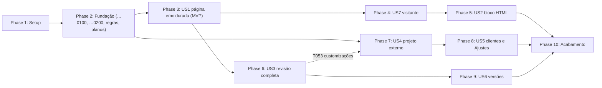

---

description: "Lista de tarefas ordenada por dependências para a funcionalidade 016-html-puro-projeto-externo"
---

# Tasks: HTML puro em página emoldurada e em bloco, projeto externo e configurações por cliente (`016-html-puro-projeto-externo`)

**Input**: documentos em `specs/016-html-puro-projeto-externo/` (`spec.md`, `plan.md`, `research.md`, `research-usabilidade.md`, `data-model.md`, `quickstart.md`, `contracts/` com 9 contratos), `exemplos/orbit-prototipo.html`, ADRs `0005`, `0008`, `0009`, `0010`, `0013` e `0014` (proposta) em `docs/adr/`.

**Prerequisites**: `main` com as migrações até `20261116001800_template_servicos_produtos.sql`; suíte atual com 595 testes passando (Node 24). As migrações novas recebem a versão no PR que as introduz, sempre maior que a última do `main` naquele momento (`scripts/check-migration-order.mjs`); os nomes abaixo são os provisórios do plano.

**Tests**: a constituição (Princípios II e V) exige testes de autorização, projeção pública e publicação. Em cada fase, os testes listados primeiro DEVEM ser escritos antes da implementação e falhar até ela existir. Testes de banco em PGlite (`test/database/`); testes de API com `createApiHandler` + `createMemoryStore` (`workers/api.mjs`).

**Restrições**: custo zero (Workers Free, Supabase Free, sem R2, sem e-mail, sem plano pago, sem contratação automática — ADR 0005); CSP da vitrine continua `script-src 'self'`; moldura nunca com `allow-same-origin`, `allow-top-navigation*` ou `allow-popups*`; nenhum segredo novo em `wrangler.jsonc`; nenhum dado pessoal em URL, log ou snapshot. A autenticação na Cloudflare não está configurada (`BLK-CLOUD-01`): nenhuma tarefa implanta nada nem afirma deploy remoto.

**Organization**: uma fase por história, na ordem de prioridade da spec (US1 P1; US7 e US2 P2; US3 P3; US4 P4; US5 P5; US6 P6). A seção "Dependências" registra a ordem alternativa do plano (US6 antes da US4).

## Format: `[ID] [P?] [Story] Description`

- **[P]**: pode rodar em paralelo (arquivos diferentes, sem dependência de tarefa incompleta)
- **[Story]**: história da spec (`US1` a `US7`); Setup, Fundação e Acabamento não têm rótulo
- Cada tarefa cita os requisitos (`FR-###`, `SC-###`) e os cenários (`USn-m`) que atende

---

## Phase 1: Setup (infraestrutura compartilhada)

**Purpose**: fixtures, configuração pública e listas de dados usadas por várias histórias.

- [ ] T001 [P] Criar as fixtures em `test/fixtures/html-packages/`: `hostil.html` (lê `document.cookie`, `localStorage`, DOM de `parent`, usa `top.location`, `window.open`, `fetch` para a vitrine e para fora, `<script src="https://unpkg.com/…">`, imagem externa, envio de formulário, mensagens `vitrine:navigate` e altura 99999 — SC-003), `altura-variavel.html` (envia `vitrine:resize`, US2-1), `host-proibido.html` (`unpkg.com`, edge case "Host não permitido"), `campo-senha.html` (`<input type="password">`, US3 teste independente); o pacote de 524.289 bytes (edge case "Pacote acima do limite") é gerado em memória dentro dos testes, sem arquivo versionado nem módulo `.mjs` em `test/` (o `node --test` executa todo `.mjs` dessa pasta); o Orbit é lido de `specs/016-html-puro-projeto-externo/exemplos/orbit-prototipo.html`, sem cópia
- [ ] T002 [P] Criar `content/url-shorteners.json` com a lista fechada de encurtadores recusados (FR-034), no formato de `content/payment-link-domains.json`
- [ ] T003 Acrescentar a variável pública `SANDBOX_ORIGIN` (`https://sandbox.inspira.dev.br`) em `vars` de `wrangler.jsonc`, sem rota, DNS nem segredo novo (rota do host fica para `BLK-CLOUD-01`), e trocar a constante `SANDBOX_HOST` de `workers/api.mjs` (l. 129) por leitura de `env.SANDBOX_ORIGIN` no despacho por host (l. 4059), no `src` das molduras e no `frame-src` (research tópico 3)

---

## Phase 2: Foundational (pré-requisitos bloqueantes)

**Purpose**: migrações `…0100` e `…0200` mínima, regras compartilhadas de validação, recurso de plano e loja em memória. Bloqueia todas as histórias.

**⚠️ CRITICAL**: nenhuma história começa antes desta fase.

### Testes da fundação (escrever primeiro)

- [ ] T004 [P] Criar `test/database/html-packages.test.mjs` (PGlite): dono da vitrine A não lê nem altera pacote, versão, revisão ou conteúdo da vitrine B, inclusive por chamada direta às tabelas e RPCs (Princípio II); `private.html_package_contents` sem `grant` para `anon`/`authenticated`; `read_html_version` só devolve conteúdo com `state = 'approved'`, hash igual e `private.site_html_enabled` verdadeiro (FR-007, SC-010); transições só por RPC; `unique (site_id, sha256)` devolve a versão existente (FR-005); gatilho de limite na criação do pacote e na transição `ready → pending_review` de pacote ainda não ativo (FR-058); 5 versões aprovadas por pacote e cotas de 3 MiB por vitrine e 100 MiB global (`HTML_VERSION_LIMIT`, `HTML_STORAGE_QUOTA`, FR-010); pacote `origin = 'operator'` com `html_bespoke` vigente fora do limite (FR-060); `uploads_suspended_at` recusa `HTML_UPLOADS_SUSPENDED` (FR-029); cópia de `custom_components` ativos com o mesmo id e versão `approved` (data-model seção 16)
- [ ] T005 [P] Criar `test/database/client-customizations-notices.test.mjs` (PGlite): só `platform_admin` escreve `client_customizations`; `read_site_customizations` não devolve `internal_note` (Princípio I); `private.customization_in_force` com tolerância de 7 dias em `ends_on` e `ended_at`; índice único parcial de um `kind` vigente por vitrine (FR-046); `panel_notices` `owner` visível só a `owner`/`admin` da vitrine e `operator` só a `platform_admin`, inserção só por função `security definer`, `payload` ≤ 2 KiB; auditoria `customization_*` com `actor_user_id` e valores anterior e novo
- [ ] T006 [P] Criar `test/html-package-rules.test.mjs`: limite de 524.288 bytes medido em UTF-8 (FR-001); relatório em três níveis (FR-002); host fora da lista com linha e coluna e recusa de `<iframe>`, `<frame>`, `<object>`, `<embed>`, `<portal>`, `<base href>`, `http:` e `<script src>` sem `https:` (FR-003); alertas de `top.location`, `parent.location`, `window.open`, `<meta http-equiv="refresh">`, `target="_top"`/`_parent`/`_blank`, senha, `autocomplete="cc-*"`, `<form action>` externo, `fetch`/`XMLHttpRequest`/`WebSocket`/`EventSource`/`sendBeacon` e `localStorage`/`document.cookie` (FR-004); `xmlns` e textos com `http://www.w3.org/2000/svg` ignorados; Orbit sem erros, com os 3 hosts permitidos, 2 formulários e `sendsResize: false` (US1-1); fixtures de T001 com os resultados esperados; varredura linear (nenhuma expressão com retrocesso sobre o arquivo inteiro)
- [ ] T007 [P] Estender `test/plans.test.mjs` e `test/database/plans-subscriptions.test.mjs`: recurso `html_packages` em `essencial`, `profissional` e `equipe` e ausente em `free`; `limits.htmlPackagesPerVitrine` 0/1/3/3 com teto 5, e 0 aceito só neste limite; coluna `public.plans.max_html_packages` igual ao JSON (FR-056, FR-058)

### Implementação da fundação

- [ ] T008 Criar `supabase/migrations/20261121000100_client_customizations_notices.sql` (data-model seções 1, 2 e 15): `public.client_customizations` com `kind` (`external_project`, `html_bespoke`, `other`), vigência, `source_request_id` e `internal_note` ≤ 1000; `private.customization_in_force(site, kind)`; RPC `read_site_customizations(site)` sem `internal_note`; `public.panel_notices` com a lista fechada de `kind`, RLS por `audience` e função `purge_panel_notices` (90 dias); auditoria `customization_created`/`_updated`/`_ended`; RLS habilitada antes de qualquer `grant`, funções `security definer` com `set search_path = ''` (FR-046, FR-030)
- [ ] T009 Criar `supabase/migrations/20261121000200_html_packages.sql` (data-model seções 3 a 7, 13, 14 e 16): `public.plans.max_html_packages` semeada de `content/plans.json`; `public.html_packages`, `public.html_package_versions` (estados da máquina, `report` ≤ 16 KiB, `declaration`, `unique (site_id, sha256)`), `private.html_package_contents` (≤ 524.288 bytes), `public.html_package_reviews`, `public.html_site_controls`, `private.html_preview_grants`, `private.html_storage_quota`; gatilho de limite com `pg_advisory_xact_lock` nos dois pontos; RPCs `submit_html_package_upload`, `submit_html_version`, `decide_html_version`, `withdraw_html_version`, `read_html_version`, `html_version_servable`, `service_read_html_version`, `consume_html_preview_grant`, `list_html_packages`, `private.site_html_enabled`, `private.html_versions_in_use`; funções de retenção `purge_html_package_versions` e `purge_html_preview_grants`; auditoria `html_*`; cópia de `custom_components` (FR-001, FR-005 a FR-010, FR-014, FR-029, FR-056, FR-058, FR-060)
- [ ] T010 [P] Criar `web/assets/html-package-rules.mjs` (precedente `web/assets/quota-rules.mjs`), compartilhado entre painel e Worker: limites, lista de hosts permitidos (`cdn.tailwindcss.com` para scripts, `fonts.googleapis.com` para estilos, `fonts.gstatic.com` para fontes), varredura linear de um passo com linha e coluna e montagem do relatório `errors`/`warnings`/`info` com `formsNotice` (FR-001 a FR-004; research tópico 6)
- [ ] T011 [P] Acrescentar o recurso `html_packages` e o limite `htmlPackagesPerVitrine` em `content/plans.json`; `PLAN_FEATURES` e validador em `src/plans.mjs`; em `src/entitlements.mjs`, derivação do limite pelo `plan_code`, `html_packages` em `PANEL_GATED_FEATURES` (l. 124), `planGateSummary` com `limits.htmlPackages` e `locked.html_packages_limit`, e uma checagem de limite que responde `403 PLAN_FEATURE_REQUIRED` com `feature: "html_packages_limit"`, `limit`, `current` e `requiredPlan` no formato de `assertItemBlocksAllowed` (FR-056, FR-058; research tópico 9)
- [ ] T012 [P] Acrescentar em `src/pricing-page.mjs` o rótulo "Conteúdo HTML próprio, com revisão da equipe", marcado como `IN_PREPARATION` até a entrega e a confirmação dos números por plano (Pendência humana 4 do plano)
- [ ] T013 Criar `src/html-packages.mjs`: estados e rótulos da FR-006, transições permitidas, "Em uso"/"Aprovada, fora de uso" derivados do snapshot publicado, conferência de limite, cota e suspensão, SHA-256 com `crypto.subtle.digest`, e montagem das respostas do proprietário e do operador sem o id do revisor (`byOperator`) (FR-005, FR-006, FR-010; contrato `owner-html-packages-api.md`)
- [ ] T014 Estender `createMemoryStore` em `workers/api.mjs` (l. 1056) com as operações equivalentes às RPCs de T008 e T009 (pacotes, versões, conteúdo, revisões, controles, concessões de prévia, customizações contratadas, avisos), com os mesmos códigos de erro, para que as rotas sejam testadas antes do banco real

**Checkpoint**: migrações aplicam no PGlite, regras e planos testados; as histórias podem começar.

---

## Phase 3: User Story 1 — Proprietário publica o Orbit como página emoldurada (Priority: P1) 🎯 MVP

**Goal**: o proprietário do Essencial envia o Orbit, recebe o relatório, cria a página "Protótipo Orbit", confere a prévia, envia para revisão; um Operador Inspira aprova (ação mínima) e a página publicada aparece emoldurada pelo site da vitrine, servida do host isolado.

**Independent Test**: quickstart, cenários A (passos 1 a 4) e B, com a conta de teste do proprietário numa vitrine do Essencial e outra do Gratuito/Social, em 1280 × 900 e 375 × 812.

### Testes da US1 (escrever primeiro)

- [ ] T015 [P] [US1] Criar `test/html-packages-api.test.mjs` com: `POST /api/sites/:siteId/html-packages` → `201` `ready` com tamanho, SHA-256, hosts e `formsNotice` (US1-1); `has_errors` só com relatório; reenvio idêntico `200 reused: true` (FR-005); `413 HTML_PACKAGE_TOO_LARGE` sem gravar nada; `422 HTML_DECLARATION_REQUIRED` (FR-009); vitrine Gratuita → `403 PLAN_FEATURE_REQUIRED` com `requiredPlan` Essencial, pela rota e por chamada direta (FR-056, US1-7, SC-011); limite na criação e no `…/submit` de pacote ainda não ativo, com nova versão de pacote ativo permitida (FR-058, US1-8, quickstart B3–B4); `409 HTML_STORAGE_QUOTA` (FR-010); editor e leitor `403 FORBIDDEN_ROLE`; vitrine de outra pessoa `404 SITE_NOT_FOUND` (Princípio II); `preview-token` recusado a quem não tem papel na vitrine; `429 HTML_UPLOAD_RATE_LIMITED`; decisão mínima `approve`/`request_changes`/`reject` por `platform_admin` com aviso `owner` e auditoria, e `403 FORBIDDEN_PLATFORM_ADMIN` para os demais (US1-5, US1-6, FR-049)
- [ ] T016 [P] [US1] Criar `test/html-sandbox-embed.test.mjs`: CSP por versão só com os hosts usados; `frame-ancestors` com `PUBLIC_SITE_ORIGIN`, `PORTAL_ORIGIN` e domínios próprios ativos (nunca pendentes); diretiva `sandbox allow-scripts allow-forms` e `form-action 'none'` (FR-011, FR-012); hash divergente, versão não aprovada, vitrine sem recurso e sem `html_bespoke`, vitrine arquivada → "indisponível" ou `404`, nunca conteúdo (FR-007, FR-014, SC-010); revalidação depois de 300 s com `x-vitrine-checked-at`; falha do banco serve o cache ou `502`; token de prévia aceita `pending_review`, recusa vencido (> 120 s), outra versão, reutilizado e `jti` não emitido, e nunca grava cache (Princípio III); cabeçalhos `permissions-policy`, `nosniff`, `x-robots-tag`, `referrer-policy`, `cross-origin-opener-policy`; outros métodos e caminhos → `404` (contrato `sandbox-embed-http.md`)
- [ ] T017 [P] [US1] Criar `test/html-framed-page.test.mjs`: estrutura aceita página `kind: "html_frame"` com `html` válido, dentro do limite de 5 páginas, e recusa `422 RESERVED_PAGE_SLUG` para `item` e `home`; projeção pública com `kind`, `title`, `slug` e `html` sem `showInMenu` e `assertNoPrivateLeakage` (Princípio I); documento com cabeçalho, barra de título com `h1`, botão de contato, moldura com `title` igual ao título e rodapé depois (FR-016); classes de medida das três faixas (FR-017, FR-018); metadados `<title>`, descrição, `og:image` e canônico (FR-022); rota `/<endereço>/<página>`, domínio próprio `/<página>` e `404` para página nativa ou inexistente (FR-015); `/__preview/<siteId>/<página>` com `noindex` e `no-store` (FR-008); publicação com versão não aprovada → `422 HTML_VERSION_NOT_APPROVED` com `targets` e `actions` (edge case "Publicação com versão não aprovada"); `403 PLAN_FEATURE_REQUIRED` só quando a mudança acrescenta HTML; `showInMenu` mantém `pagina:<slug>` no menu do cabeçalho (US1-2)
- [ ] T018 [P] [US1] Reescrever `test/assets-opaque-sandbox.test.mjs` para o host vindo de `SANDBOX_ORIGIN` e a CSP nova, e estender `test/security-rls-csp-audit.test.mjs`: a página da vitrine só ganha `frame-src <SANDBOX_ORIGIN>` quando o documento tem moldura, continua `script-src 'self'`, e nenhuma moldura gerada tem `allow-same-origin`, `allow-top-navigation*` ou `allow-popups*` (FR-011)

### Implementação da US1

- [ ] T019 [US1] Criar `src/html-sandbox.mjs`: CSP por versão, cabeçalhos do host isolado, chave de cache `<SANDBOX_ORIGIN>/embed/<versionId>?v=<sha256>`, regra de revalidação de 300 s, documento estático "Conteúdo indisponível no momento" e token de prévia HMAC com prefixo `html-preview` (`versionId`, `sha256`, `userId`, `jti`, expiração de 120 s) usando o `PREVIEW_HMAC_SECRET` de `src/preview-token.mjs`, nunca registrado em log (FR-011, FR-012, FR-014; research tópicos 1 e 2)
- [ ] T020 [US1] Substituir `handleSandboxPage` (`workers/api.mjs` l. 3839–3864) pela rota `GET|HEAD /embed/:versionId?v=…[&t=…]` no host de `SANDBOX_ORIGIN`: modo público com `caches.default`, `html_version_servable`, `read_html_version` e recálculo do SHA-256; modo prévia com `consume_html_preview_grant` e `service_read_html_version`, `no-store` e sem cache (FR-007, FR-008, FR-014; contrato `sandbox-embed-http.md`)
- [ ] T021 [US1] Implementar em `workers/api.mjs` as rotas do proprietário `GET/POST /api/sites/:siteId/html-packages`, `POST …/:packageId/versions`, `POST …/versions/:versionId/submit` e `POST …/versions/:versionId/preview-token`: `validateMutationOriginAndJson`, papéis `owner`/`admin` para escrita, `requirePlanFeature(…, 'html_packages')` e limite em toda chamada, suspensão, cotas, corpo de até 1 MiB, validação de novo com `web/assets/html-package-rules.mjs`, concessão gravada em `private.html_preview_grants`, limite de 10 envios em 10 minutos, auditoria `html_package_created`, `html_version_uploaded` e `html_version_submitted` (FR-001, FR-002, FR-005, FR-008, FR-009, FR-056, FR-058)
- [ ] T022 [US1] Medir a CPU da validação no servidor com um arquivo de 512 KiB em `wrangler dev --local` e registrar o resultado em `docs/operations-guide.md`; se passar de ~5 ms, aplicar o plano B do research tópico 6 (servidor confere só erros; alertas ficam no navegador e no revisor) em `web/assets/html-package-rules.mjs` (Princípio IV)
- [ ] T023 [US1] Implementar em `workers/api.mjs` a revisão mínima do operador: `GET /api/admin/html-reviews` (pendentes, da mais antiga para a mais nova), `GET /api/admin/html-reviews/:versionId` (relatório e prévia com token em nome do operador) e `POST /api/admin/html-reviews/:versionId/decision` (`approve` com a lista de conferência completa; `request_changes`/`reject` com motivo de 10 a 1000 caracteres), conferindo `isPlatformAdmin` antes de qualquer leitura, gravando `html_package_reviews`, auditoria e aviso `owner` (FR-028, FR-031, FR-049, US1-5, US1-6)
- [ ] T024 [US1] Implementar em `workers/api.mjs` `GET /api/sites/:siteId/notices?unread=1` e `POST /api/sites/:siteId/notices/:id/read`, só com avisos `owner` da vitrine e para quem tem papel nela (FR-030; contrato `owner-html-packages-api.md`, "Avisos")
- [ ] T025 [P] [US1] Estender `src/showcase-structure.mjs`: página `kind: "html_frame"` com `html` (`packageId`, `versionId`, `versionHash`, `heightMode` `viewport` padrão ou `content`, `description` ≤ 160, `showInMenu`), sem seções, dentro do limite de 5 páginas; slugs reservados `item` e `home`; `pagina:<slug>` aceito no tipo `link` de `navigationMenus` (FR-015, FR-020, FR-053; data-model seção 8)
- [ ] T026 [US1] Estender `src/publication-engine.mjs`: `projectShowcaseManifest` publica `kind`, `title`, `slug` e `html` sem `showInMenu`; documento da página emoldurada (cabeçalho, cabeçalho compacto abaixo de 640 px, barra de título com `h1`, descrição a partir de 640 px, botão de contato, moldura sem `loading="lazy"` com `sandbox="allow-scripts allow-forms"`, `referrerpolicy="no-referrer"`, `allow` negando recursos e `title` da página, rodapé); `frame-src <SANDBOX_ORIGIN>` só com moldura; metadados com `shareMetaFor` e JSON-LD da vitrine sem itens (FR-011, FR-012, FR-016, FR-022; contrato `framed-page-route.md`)
- [ ] T027 [US1] Implementar em `workers/api.mjs` e `src/item-page.mjs` a rota pública `/<endereço>/<página>` a partir do snapshot publicado (vitrine pausada antes de tudo; `404` para página nativa ou inexistente), o domínio próprio por `customDomainPath`/`customDomainPublicPaths` (l. 107–117) e a prévia `/__preview/<siteId>/<página>?token=…` com `noindex`, `no-store` e moldura em modo prévia, com `STOREFRONT_CACHE_CONTROL` e `etag` no documento público (FR-008, FR-015)
- [ ] T028 [US1] Estender `assertApprovedWidgets` (`workers/api.mjs` l. 3829) na prévia, no `PUT …/structure` e na publicação: cada página e bloco precisa de `versionId` do `packageId` da própria vitrine, hash igual e estado `approved`, senão `422 HTML_VERSION_NOT_APPROVED` com `targets` e `actions: ["use_last_approved", "hide_content"]`; sem `html_packages` nem `html_bespoke`, `403 PLAN_FEATURE_REQUIRED` só quando a mudança acrescenta HTML (FR-007, SC-010)
- [ ] T029 [P] [US1] Acrescentar em `web/vitrine/vitrine.css` as classes `storefront-frame*` com largura máxima de 1280 px, margens laterais de 24/16/8 px, cantos de 16/12 px e altura "altura visível − cabeçalho − barra de título − margem" com mínimos de 560/480 px, usando os tokens de `DESIGN.md` (FR-017, FR-018, US1-3, US1-4; medidas em `contracts/framed-page-route.md`)
- [ ] T030 [P] [US1] Criar `web/portal/html-packages-panel.mjs` (grupo "Conteúdo HTML"): estado vazio com o que é permitido e "Enviar primeiro pacote"; escolha do arquivo e validação imediata com `web/assets/html-package-rules.mjs`; relatório em três níveis com host e linha, tamanho, impressão digital e aviso de formulários; as duas declarações; lista de versões com o rótulo da FR-006, quem decidiu, quando e o motivo; "Enviar para revisão"; prévia em 1280/375 pedindo token novo a cada abertura; mensagens de limite e de suspensão; estado bloqueado no Gratuito/Social sem ação de envio (FR-001, FR-002, FR-006, FR-009, FR-052, FR-057, US1-1, US1-6, US1-7, US1-8)
- [ ] T031 [P] [US1] Estender `web/portal/plan-gate.mjs` para `html_packages`: selo "Disponível no plano Essencial", explicação do recurso e link para `#plano`, sem contratação automática (FR-057, FR-055)
- [ ] T032 [US1] Estender `web/portal/showcase-structure.js` com "Nova página → Página HTML emoldurada" (título, endereço, descrição, pacote, versão aprovada ou pendente para prévia, "Mostrar no menu", modo de altura com "Altura da tela" como padrão), selo "Aguardando revisão" na prévia, bloqueio no Gratuito/Social e as saídas "Usar a última versão aprovada"/"Ocultar este conteúdo" quando a publicação responde `422 HTML_VERSION_NOT_APPROVED` (FR-015, FR-020, FR-057, US1-2)
- [ ] T033 [P] [US1] Criar `web/portal/admin-html-reviews.mjs` mínimo: lista de pendentes, abrir versão, prévia isolada, "Aprovar" com a lista de conferência e "Pedir ajustes"/"Recusar" com motivo obrigatório (FR-028, US1-5, US1-6)
- [ ] T034 [US1] Ligar em `web/portal/index.html`, `web/portal/portal.js` e `web/portal/portal.css` o contêiner do grupo "Conteúdo HTML" nos Ajustes, a aba "Revisões" em "Administração da plataforma" (só `platform_admin`) e os avisos no Início, carregando os módulos novos sem build (FR-030, US1-5)

**Checkpoint**: cenários A1–A4 e B do quickstart passam; MVP entregável sozinho (sem deploy remoto).

---

## Phase 4: User Story 7 — Visitante usa o conteúdo HTML no celular e no computador (Priority: P2)

**Goal**: o visitante vê marca, menu, contato e rodapé em volta do conteúdo, com carregamento, falha, teclado e celular tratados.

**Independent Test**: quickstart, cenários A4 a A6: página publicada em 1280, 375 e 375 deitado, navegação por teclado, rolagem até o rodapé, hosts externos bloqueados e pacote retirado do ar.

### Testes da US7 (escrever primeiro)

- [ ] T035 [P] [US7] Criar `test/html-frame-controller.test.mjs` (parte de estados): carregando → pronto no evento `load`; sem `load` em 10 s → "O conteúdo interativo não carregou", "Tentar novamente" que recarrega o `src` e reinicia os 10 s, e botão de contato; sem JavaScript a moldura aparece direto; `prefers-reduced-motion` sem animação; nenhuma mensagem enviada à moldura e nada no console (FR-021, US7-1, US7-5)
- [ ] T036 [US7] Estender `test/html-framed-page.test.mjs`: link "Pular conteúdo interativo" para `#depois-do-conteudo`, camada de carregamento com o título, bloco de falha `role="status"`, estado "Conteúdo indisponível no momento" com o botão de contato fora da moldura, regras de `100dvh` com alternativa `100vh`, mínimo de 480 px com o aparelho deitado e nenhuma regra que gere rolagem horizontal entre 320 e 1440 px (FR-019, FR-021, US7-2, US7-4, edge case "Pacote retirado do ar")

### Implementação da US7

- [ ] T037 [US7] Criar `web/assets/html-frame.mjs`: controlador de todas as molduras da página com os estados carregando, pronto e falha (10 s), "Tentar novamente", sem enviar mensagens à moldura e sem registro no console (FR-021, US7-1, US7-5; contrato `postmessage-schema.md`, "Estados de carregamento")
- [ ] T038 [US7] Importar `web/assets/html-frame.mjs` em `web/vitrine/vitrine.js` sem criar entrada de módulo nova, mantendo os limites de `test/storefront-budget.test.mjs` (1 módulo de entrada, 120 KiB gzip) e de `docs/development.md` ("Orçamento da vitrine pública")
- [ ] T039 [US7] Completar `web/vitrine/vitrine.css`: altura com `100dvh` e alternativa `100vh`, mínimo de 480 px com o aparelho deitado, sem rolagem horizontal entre 320 e 1440 px, rolagem até o rodapé pelas margens, pela barra e sobre a moldura, camada de carregamento nas cores da vitrine por baixo da moldura e troca sem animação com `prefers-reduced-motion` (FR-019, US7-3, US7-4; M-02)
- [ ] T040 [US7] Estender `src/publication-engine.mjs` com o link "Pular conteúdo interativo", a âncora `#depois-do-conteudo`, a camada de carregamento com o título, o bloco de falha com "Tentar novamente" e o contato, e o estado "Conteúdo indisponível no momento" com o botão de contato fora da moldura (FR-021, US7-2, edge case "Pacote retirado do ar")

**Checkpoint**: cenários A4–A6 do quickstart passam em 1280, 375 e 375 deitado.

---

## Phase 5: User Story 2 — Bloco HTML dentro de uma página existente (Priority: P2)

**Goal**: inserir até 3 blocos HTML por página, com "Altura do conteúdo" (mensagem `vitrine:resize`) ou "Altura fixa", reaproveitando pacote, validação e revisão da US1.

**Independent Test**: quickstart, cenário D: pacote de altura variável e Orbit como blocos no Início, publicados após aprovação, em 1280 e 375.

### Testes da US2 (escrever primeiro)

- [ ] T041 [P] [US2] Estender `test/html-frame-controller.test.mjs` com as regras de `vitrine:resize`: `event.source === iframe.contentWindow`, `event.origin === "null"`, `type` exato, `height` finito entre 120 e 4000 arredondado, só no modo `content`, balde de 10 mensagens por segundo, diferença menor que 1 px ignorada, mensagens inválidas descartadas sem erro nem console, 320 px sem mensagem (FR-013, FR-024, US2-1; exemplos de `contracts/postmessage-schema.md`)
- [ ] T042 [US2] Estender `test/html-framed-page.test.mjs` com o bloco: `custom_sandbox` com `versionId`, `heightMode` e `title`; `422 HTML_BLOCK_LIMIT` acima de 3 por página dentro do limite de 15 seções (FR-023); `section.storefront-html-block` com `loading="lazy"`, camada de carregamento (FR-026), `min(640px, 75dvh)` no modo fixo (FR-025) e título acessível com o nome do pacote como padrão; `GET …/structure` devolve `htmlPackages` no lugar de `widgets`

### Implementação da US2

- [ ] T043 [US2] Estender a seção `custom_sandbox` em `src/showcase-structure.mjs` (l. 32 e 154–162): `widgetId` passa a ser o `packageId`, mais `versionId`, `heightMode` (`content` padrão ou `fixed`) e `title` ≤ 80; até 3 blocos ativos por página (`HTML_BLOCK_LIMIT`) (FR-023)
- [ ] T044 [US2] Trocar a moldura atual de `src/publication-engine.mjs` (l. 1200–1201) pelo markup do bloco com camada, falha, `loading="lazy"`, `data-height-mode` e altura inicial de 320 px no modo `content` (FR-024, FR-026; contrato `framed-page-route.md`, "Bloco HTML")
- [ ] T045 [US2] Acrescentar em `web/assets/html-frame.mjs` a aceitação de `vitrine:resize` com as regras de T041, também para a página emoldurada em "Altura do conteúdo" (FR-013, FR-020, FR-024)
- [ ] T046 [P] [US2] Acrescentar em `web/vitrine/vitrine.css` os modos do bloco: "Altura do conteúdo" (altura aplicada pelo controlador) e "Altura fixa" `min(640px, 75dvh)`, com a página rolando antes e depois do bloco (FR-025, FR-026, US2-2, US2-3)
- [ ] T047 [US2] Atualizar `GET/PUT /api/sites/:siteId/structure` em `workers/api.mjs`: `htmlPackages` com versões `approved`, `ready` e `pending_review` e o rótulo de cada uma, e os erros `422 INVALID_STRUCTURE`, `HTML_BLOCK_LIMIT` e `RESERVED_PAGE_SLUG` (contrato `owner-html-packages-api.md`, "Estrutura e publicação")
- [ ] T048 [US2] Renomear "Componente aprovado" para "Bloco HTML" em `web/portal/showcase-structure.js` (l. 16) e, com `web/portal/editor.js`, mostrar o cartão do bloco com nome, versão, situação da revisão, modo de altura, miniatura ou prévia e "Ver em tela de celular", mais a escolha do modo de altura e o bloqueio no Gratuito/Social (US2-4, FR-057; U-04)

**Checkpoint**: cenário D do quickstart passa; US1 e US7 continuam passando.

---

## Phase 6: User Story 3 — Operador Inspira revisa a primeira publicação de cada versão (Priority: P3)

**Goal**: fila "Revisões" completa de todos os clientes, comparação com a versão aprovada anterior, retirada do ar, suspensão de envio por reincidência, envio pelo operador sob customização e avisos de cada decisão.

**Independent Test**: quickstart, cenário C: três versões pendentes de clientes diferentes, uma com campo de senha; aprovar, recusar, pedir ajustes e retirar do ar; conferir avisos e auditoria.

### Testes da US3 (escrever primeiro)

- [ ] T049 [P] [US3] Estender `test/html-packages-api.test.mjs`: fila com cursor (`limit` até 50), ordem por espera e campos da FR-027; detalhe com `comparison` e `isFirstVersion` (FR-028, US3-2); `422 REVIEW_REASON_REQUIRED` e `REVIEW_CHECKLIST_INCOMPLETE` (US3-3); `409 HTML_VERSION_STATE` em decisão concorrente; arquivo idêntico já aprovado não volta à fila (US3-4); retirada com motivo, aviso e auditoria (FR-029, US3-5); `PUT /api/admin/sites/:siteId/html-uploads` suspende e retoma, e o dono recebe `403 HTML_UPLOADS_SUSPENDED` (FR-029); envio do operador exige `html_bespoke` vigente (`409 CUSTOMIZATION_NOT_IN_FORCE`), não confere plano nem limite (FR-060), vai direto a `pending_review` e recusa `409 SELF_APPROVAL_NOT_ALLOWED` com mais de um `platform_admin` (FR-048); `POST /api/admin/custom-components` → `410 ENDPOINT_REPLACED`; `support_operator`, patrocinador, proprietário e membro → `403 FORBIDDEN_PLATFORM_ADMIN` em todas as rotas `/api/admin/html-*` (FR-049); auditoria com autor, cliente, vitrine, pacote, versão, decisão, motivo e data (FR-031)
- [ ] T050 [P] [US3] Estender `test/html-sandbox-embed.test.mjs`: depois de "Retirar do ar", acerto de cache com carimbo de mais de 300 s responde "indisponível" e a entrada é apagada (FR-029, SC-006)

### Implementação da US3

- [ ] T051 [US3] Estender `src/html-packages.mjs` com a comparação com a última versão aprovada (`bytesDelta`, hosts e alertas acrescentados e retirados), a lista de conferência, a validação das decisões e o cursor da fila (FR-027, FR-028)
- [ ] T052 [US3] Completar em `workers/api.mjs` as rotas do operador: fila paginada, detalhe com comparação, decisão com as validações de T049, `POST /api/admin/html-versions/:versionId/withdraw` com remoção do cache por melhor esforço, `PUT /api/admin/sites/:siteId/html-uploads`, `POST /api/admin/sites/:siteId/html-packages` e `…/:packageId/versions` com `customizationId`, e `410 ENDPOINT_REPLACED` em `POST /api/admin/custom-components` (l. 4453–4485) (FR-027 a FR-029, FR-031, FR-048, FR-049, FR-060; edge case "Phishing ou abuso")
- [ ] T053 [US3] Implementar em `workers/api.mjs` e `src/admin-clients.mjs` (chave `tenant:<uuid>`/`owner:<uuid>`) `POST /api/admin/clients/:clientKey/customizations` e `PATCH /api/admin/customizations/:id` (editar e encerrar com tolerância de 7 dias), ainda sem tela, para registrar `html_bespoke` (FR-046; contrato `admin-clients-api.md`)
- [ ] T054 [US3] Completar `web/portal/admin-html-reviews.mjs`: fila com cliente, vitrine, pacote, versão, tamanho, hosts, alertas, primeira versão ou atualização e espera (FR-027, US3-1); detalhe com relatório, comparação, prévia alternável 1280/375 sem recarregar e token novo ao reabrir ou em "Tentar novamente", lista de conferência, decisões com motivo, "Retirar do ar" e "Suspender envios" (FR-028, FR-029, US3-2, US3-3, US3-5)
- [ ] T055 [US3] Mostrar em `web/portal/html-packages-panel.mjs` e no Início (`web/portal/portal.js`) os avisos de todas as decisões (`html_version_approved`, `_changes_requested`, `_rejected`, `_withdrawn`, `html_uploads_suspended`) com decisão, motivo e próximo passo, e marcar como lido (FR-030, US3-5)

**Checkpoint**: cenário C do quickstart passa; US1, US2 e US7 continuam passando.

---

## Phase 7: User Story 4 — Operador Inspira configura o projeto externo de um cliente (Priority: P4)

**Goal**: com a customização "Projeto externo" vigente, o operador configura o destino, comprova a posse do domínio, ativa o redirecionamento `302` para a vitrine inteira ou uma página, e o Cron diário mantém a comprovação; o proprietário vê tudo só para leitura.

**Independent Test**: quickstart, cenário G: cliente com e sem customização, comprovação por TXT e por arquivo, destinos inválidos, ativação, suspensão pelo Cron, desativação, restauração, visão do proprietário, auditoria, metadados e Insights.

### Testes da US4 (escrever primeiro)

- [ ] T056 [P] [US4] Criar `test/external-project.test.mjs` com `fetch` simulado: códigos `EXTERNAL_URL_*` para `http://`, credenciais, porta, IPv4/IPv6/`localhost`, encurtador, plataforma, domínio da vitrine, mais de 2048 caracteres e laço em até 5 saltos, com `message` por campo e IDN em punycode (FR-034, FR-035, US4-5, SC-007); comprovação DNS (TXT dividido em partes, `txt_not_found`, `txt_mismatch`, `Status` diferente de 0/3 como erro temporário) e por arquivo (até 2 redirecionamentos no mesmo host, `file_redirected_off_host`, 1 KiB, `file_mismatch`) com 3 repetições de erro temporário (FR-061, FR-062); "Verificar agora" com `429` em 30 s e resposta em até 30 s no total (SC-013); ativação exige comprovação válida e `operatorConfirmed` (`409 OWNERSHIP_NOT_VERIFIED` com o lembrete de 48 h, `422 OPERATOR_CONFIRMATION_REQUIRED`, US4-8, FR-063, SC-012); troca de host vira configuração pendente e o destino anterior continua, troca só de caminho não pede comprovação (US4-10); Cron com orçamento de 30 subrequests, suspensão por posse e por laço, aviso no 3º dia fora do ar sem suspender e desativação automática 7 dias depois do fim da customização (FR-041, FR-064, US4-9); `302` com só `utm_*` (até 100 caracteres), `no-store`, `noindex`, em todos os endereços no alcance "Vitrine inteira" e só na página no alcance "Página da vitrine", antes do cache do domínio próprio e depois da pausa (FR-036, FR-037, US4-2, US4-3); `menu.json` e `vitrine.json` `404` no alcance da vitrine inteira e nenhum canônico para endereço redirecionado (FR-038); item de menu com `target="_blank" rel="noopener noreferrer"` e "(abre em outra aba)" (FR-037); evento `external_redirect` por `GET` e não por `HEAD` (FR-039); últimas 5 configurações e restauração (FR-040, US4-7); leitura do proprietário e da equipe sem motivo nem autor, e `verify` só para `owner`/`admin` (FR-042, US4-6); auditoria de toda alteração e tentativa (FR-043); `403` para quem não é `platform_admin` e `409 CUSTOMIZATION_NOT_IN_FORCE` sem customização (FR-032, FR-049, US4-4); redirecionamento prevalece sobre página com HTML (edge case)
- [ ] T057 [P] [US4] Criar `test/database/external-project-links.test.mjs` (PGlite): RLS de vínculos, configurações, comprovações e tentativas (Princípio II); máquina de estados do data-model seção 9; `public_showcase_overrides` anônima sem ids, motivos, autores nem códigos e `redirect` nulo fora das condições (Princípio I); código único por vitrine e host (FR-061); poda para 5 configurações mais ativa e pendente (FR-040); 30 tentativas por comprovação; `external_redirect` em `private.site_metric_names()` (FR-039)
- [ ] T058 [P] [US4] Ajustar `test/insights-by-origin.test.mjs` (l. 149) e `test/site-metrics-insights.test.mjs` (l. 469), que hoje exigem `site_metric_names()` igual a `ALLOWED_METRIC_EVENT_TYPES`: a lista do banco passa a ser a do navegador mais a lista só do servidor com `external_redirect`, e `/api/metrics` recusa `external_redirect` (FR-039; research tópico 8)

### Implementação da US4

- [ ] T059 [US4] Criar `supabase/migrations/20261121000300_external_project_links.sql` (data-model seções 9 a 12 e 13): `public.external_project_links`, `public.external_project_configs` com gatilho `prune_external_project_configs`, `public.domain_ownership_proofs` com código gerado por gatilho, `private.domain_proof_attempts`, RPCs de operador, `read_external_project(site)`, `external_links_due(max_rows)` e `external_link_record_check(site, result)` só `service_role`, `public.public_showcase_overrides(target_slug)` e `private.site_metric_names()` recriada com `external_redirect`; auditoria `external_link_*` e `ownership_check` (FR-032, FR-033, FR-040, FR-043, FR-061, FR-064)
- [ ] T060 [P] [US4] Extrair a consulta TXT por DNS sobre HTTPS de `src/custom-domains.mjs` (l. 26–51) para uma função compartilhada, sem mudar o comportamento dos domínios próprios (`test/custom-domains-edge-cache.test.mjs` continua passando)
- [ ] T061 [US4] Criar `src/external-project.mjs`: validação sintática do destino com `content/url-shorteners.json` e forma Unicode e punycode (FR-034); acompanhamento de até 5 saltos com `HEAD`/`GET`, detecção de laço, plataforma e domínio da vitrine e disponibilidade (FR-035); comprovação DNS e por arquivo com repetição de erro temporário e mensagens simples com o lembrete de 48 h (FR-061, FR-062); prazo total de 30 s para "Verificar agora" (SC-013); `runExternalProjectChecks` com orçamento de 30 subrequests e fila por `next_check_at` (FR-041, FR-064); montagem do `location` com só `utm_*` (FR-036) (contratos `ownership-verification.md` e `redirect-behaviour.md`)
- [ ] T062 [US4] Acrescentar em `src/portal-validation.mjs` (l. 184) uma lista de métricas só do servidor com `external_redirect`, fora de `ALLOWED_METRIC_EVENT_TYPES`, e gravar o evento pelo Worker com `record_site_metric_batch` em `ctx.waitUntil`, com `source` e `campaign` normalizados como em `web/assets/metrics-source.mjs` (FR-039)
- [ ] T063 [US4] Trocar `public_site_state` por `public_showcase_overrides` em `readPublicSiteState` (`src/site-lifecycle.mjs` l. 274–293), com o mesmo cache de 30 s por isolate e recuo para a função antiga quando a nova responder `404`, devolvendo `paused`, `htmlEnabled` e `redirect` (FR-036, FR-059; research tópico 8)
- [ ] T064 [US4] Aplicar o redirecionamento em `workers/api.mjs`: `302` depois de `respondIfShowcasePaused` e antes do cache de `handleCustomHostname` (l. 3986–3995), em todos os endereços públicos no alcance "Vitrine inteira" e só em `/<endereço>/<pageSlug>` no alcance "Página da vitrine"; `menu.json` e `vitrine.json` `404` com `no-store` no alcance da vitrine inteira; `HEAD` sem métrica; prévia autenticada com a faixa "Projeto externo ativo: visitantes vão para <host>" (FR-036, FR-038, FR-039, US4-2, US4-3)
- [ ] T065 [US4] Receber `redirect` como opção de renderização em `src/publication-engine.mjs` e `src/item-page.mjs`: todo link `pagina:<pageSlug>` (menus e ações do hero) vira o destino com os `utm_*` da página atual; "Nova aba" com `target="_blank" rel="noopener noreferrer"`, ícone e "(abre em outra aba)"; nenhum canônico para o endereço redirecionado (FR-037, FR-038, US4-3)
- [ ] T066 [US4] Implementar em `workers/api.mjs` as rotas do operador `GET/PUT /api/admin/sites/:siteId/external-project`, `POST …/verify`, `…/activate`, `…/deactivate` e `…/restore` com a representação do contrato, auditoria com valores anterior e novo, motivo e autor, e avisos `owner` quando muda o que o visitante vê (FR-032, FR-033, FR-035, FR-040, FR-043, FR-062, FR-063, US4-1, US4-2, US4-7, US4-8, US4-10)
- [ ] T067 [US4] Implementar em `workers/api.mjs` `GET /api/sites/:siteId/external-project` (qualquer papel da equipe; sem `history[].reason`, sem autores, com `contactHint`) e `POST /api/sites/:siteId/external-project/verify` (só `owner`/`admin`; nunca ativa) (FR-042, FR-062, US4-6)
- [ ] T068 [US4] Acrescentar `runExternalProjectChecks` como 4ª tarefa de `scheduled()` (`workers/api.mjs` l. 5856–5864, `Promise.allSettled`): `awaiting_proof` → `ready_to_activate`, suspensão por posse e por laço, aviso no 3º dia fora do ar, desativação 7 dias depois do fim da customização, avisos `owner` e `operator` e auditoria com `summary.source = 'system'` (FR-041, FR-064, US4-9, edge case "Cliente sem a customização contratada, ou contrato encerrado")
- [ ] T069 [US4] Implementar a ficha mínima do cliente: `GET /api/admin/clients/:clientKey` em `workers/api.mjs` e `src/admin-clients.mjs` com os grupos `customizations` e `externalProjects`, e `web/portal/admin-clients.mjs` aberto por `#administracao/clientes/<chave>` com os grupos "Customizações contratadas" (registrar, editar, encerrar; atalho de contratação) e "Projeto externo" (FR-045, FR-046, US4-4)
- [ ] T070 [P] [US4] Criar `web/portal/admin-external-project.mjs`: formulário por vitrine com destino, alcance, página e abertura do menu, erro ao lado do campo e punycode à vista (US4-5); instruções TXT e arquivo com "Copiar" e "Verificar agora" e último resultado (FR-062, US4-1); ativação com a confirmação de posse e motivo (US4-2); desativar e restaurar com as 5 configurações (FR-040, US4-7); configuração pendente durante troca de domínio (US4-10); área desabilitada com "Disponível quando a customização Projeto externo estiver contratada" sem customização (US4-4)
- [ ] T071 [P] [US4] Criar `web/portal/external-project-owner.mjs`: grupo "Domínio e projeto externo" somente leitura com situação, destino, alcance, desde quando, situação e instruções da comprovação, "Copiar", "Verificar agora" para `owner`/`admin` e como pedir mudança à equipe Inspira, sem outro controle de edição (FR-042, US4-6)
- [ ] T072 [P] [US4] Mostrar "Levados ao projeto externo" por dia e por origem em `web/portal/insights-origin.mjs` (FR-039)
- [ ] T073 [US4] Ligar em `web/portal/index.html` e `web/portal/portal.js` o grupo "Domínio e projeto externo" dos Ajustes, a rota da ficha do cliente e os avisos `external_link_*` no Início (FR-042, FR-064)

**Checkpoint**: cenário G do quickstart passa com `fetch` simulado e domínios de teste; nada é implantado.

---

## Phase 8: User Story 5 — Telas de configuração por cliente mais claras (Priority: P5)

**Goal**: lista "Clientes" com busca e filtros, ficha completa por cliente, pedidos e atividade ligados à ficha, e Ajustes do proprietário em grupos recolhíveis.

**Independent Test**: quickstart, cenário H: medir tempo e interações das tarefas fixas antes e depois em 1280 e 375 e conferir estados vazios, de erro e de bloqueio em cada grupo.

### Testes da US5 (escrever primeiro)

- [ ] T074 [P] [US5] Criar `test/admin-clients.test.mjs`: lista com busca por nome, endereço e código `#VI-XXXXXX-XXXX`, filtros `pending_review`, `external_project` e `customization` combinados com E, cursor e `422 INVALID_CLIENT_QUERY` (FR-044, US5-1); ficha com todos os grupos e erro por grupo, `404 CLIENT_NOT_FOUND`, `422 INVALID_CLIENT_KEY`, sem e-mail, telefone ou documento (FR-045, Princípio I); `403 FORBIDDEN_PLATFORM_ADMIN` para quem não é `platform_admin` (FR-049); `customization-requests` e `audit-logs` com `client` e `site` (FR-047); `POST /api/customization-requests` exige `siteId` de vitrine da equipe; `GET /api/admin/overview` com uso de HTML e `databaseAlert` acima de 80% (SC-009)
- [ ] T075 [P] [US5] Criar `test/database/admin-clients.test.mjs` (PGlite): `admin_list_clients` e `admin_read_client` recusam quem não é `platform_admin`, não projetam dados pessoais e paginam de forma estável; `read_platform_overview` com uso de pacotes HTML (FR-044, FR-045, FR-049, SC-009)
- [ ] T076 [P] [US5] Estender `test/admin-platform-ui.test.mjs` (aba "Clientes" primeiro e "Revisões" logo depois, `#administracao/clientes` conferindo a permissão antes de ler o endereço) e criar `test/settings-groups.test.mjs` (título "Ajustes", nove grupos recolhidos com resumo e selo, salvamento independente com "Salvo"/"Alterações não salvas"/erro, foco no primeiro erro, carregando/vazio/erro com "Tentar novamente"/bloqueado pelo plano) (FR-050, FR-051, FR-055, US5-3 a US5-5)

### Implementação da US5

- [ ] T077 [US5] Criar `supabase/migrations/20261121000400_admin_clients.sql`: `admin_list_clients(search, filter, after, page_size)` com cursor por nome normalizado e id (25 por página, até 50), `admin_read_client(client_key)` com os grupos da ficha e `read_platform_overview` com uso de HTML, começando com `FORBIDDEN_PLATFORM_ADMIN` para quem não é `platform_admin` (FR-044, FR-045, FR-049, SC-009)
- [ ] T078 [US5] Completar `src/admin-clients.mjs`: filtros, cursor, busca pelo código com `normalizeMilaRelayCode` e confirmação com `buildMilaRelayCode` (`web/assets/mila-relay.mjs` l. 25–49) e projeção da ficha (FR-044, FR-045)
- [ ] T079 [US5] Implementar em `workers/api.mjs` `GET /api/admin/clients`, a ficha completa com erro por grupo, os campos novos de `GET /api/admin/overview`, `client` e `site` em `GET /api/admin/customization-requests` e `GET /api/admin/audit-logs` (com `actor` sem id pessoal) e `siteId` obrigatório em `POST /api/customization-requests` (FR-044, FR-045, FR-047, FR-049, SC-009; U-02, U-16)
- [ ] T080 [US5] Completar `web/portal/admin-clients.mjs`: lista com busca e filtros, cada linha levando à ficha; grupos Resumo, Vitrines, Customizações contratadas, Conteúdo HTML, Projeto externo, Domínios e Histórico, cada um com situação, estado vazio com ação e erro com "Tentar novamente" (FR-044, FR-045, FR-055, US5-1, US5-2, SC-005)
- [ ] T081 [US5] Pôr a aba "Clientes" primeiro em "Administração da plataforma" (`web/portal/index.html` l. 385–391), com "Revisões" logo depois, e as rotas `#administracao/clientes` e `#administracao/clientes/<chave>` em `web/portal/portal.js`, conferindo a permissão antes de ler o endereço (FR-044, US5-1; U-14)
- [ ] T082 [US5] Mostrar cliente e vitrine com link para a ficha nos pedidos de customização, na atividade recente e nas revisões, e o alerta de uso do banco acima de 80% na Visão geral, em `web/portal/platform-cms.js` e `web/portal/admin-html-reviews.mjs` (FR-047, SC-009; U-02)
- [ ] T083 [US5] Exigir a escolha da vitrine no formulário de pedido de customização do proprietário (`web/portal/index.html` l. 854 e `web/portal/portal.js` l. 1374) e deixar de preencher `storefrontType` por padrão (FR-047; U-16)
- [ ] T084 [P] [US5] Criar `web/portal/settings-groups.mjs`: grupo recolhível com título, resumo de uma linha, selo de situação ("Configurado", "Incompleto", "Aguardando revisão", "Disponível no plano X"), selo do plano, salvamento próprio, erro ao lado do campo com foco no primeiro erro e estados carregando, vazio, erro com "Tentar novamente" e bloqueado (FR-050, FR-051, FR-055, US5-4, US5-5), com os tokens do portal de `DESIGN.md`
- [ ] T085 [US5] Aplicar `web/portal/settings-groups.mjs` aos nove grupos da US5-3 em `web/portal/index.html`, `web/portal/portal.js` e `web/portal/portal.css`, com o título do painel "Ajustes" e a lista recolhida cabendo em até 2 telas em 375 px (FR-050, US5-3, SC-008; U-05, U-09)
- [ ] T086 [US5] Em `web/portal/editor.js` e `web/portal/showcase-structure.js`, mostrar as seções recolhidas com resumo e abrir uma por vez (FR-051; U-06) e trocar o destino de link de menu por uma lista (página, seção, conversa no WhatsApp, endereço externo com "abrir em nova aba"); o endereço externo é validado no servidor em `src/showcase-structure.mjs` com a mesma validação sintática de `src/external-project.mjs` e o erro aparece ao lado do campo (FR-053; U-07)
- [ ] T087 [US5] Em `web/portal/portal.css` e `web/portal/portal.js`, dar ao formulário de configuração largura suficiente em 1280 px e permitir recolher a prévia ao vivo (FR-054; U-08)
- [ ] T088 [US5] Medir antes e depois, em 1280 e 375, tempo e interações para "encontrar o cliente X e ver se tem revisão pendente" (meta de 3 interações e 30 s, SC-005), "mudar o horário de funcionamento" e "achar onde enviar um pacote HTML" (meta de 9 em 10 na primeira tentativa, SC-008), e registrar no PR de entrega, fora do repositório (quickstart H1, "Evidência")

**Checkpoint**: cenário H do quickstart passa; US1 a US4 e US7 continuam passando.

---

## Phase 9: User Story 6 — Proprietário substitui e reverte uma versão do pacote (Priority: P6)

**Goal**: nova versão passa pela revisão sem tirar a anterior do ar; "Voltar para esta versão" em uma ação; exclusão impedida quando em uso; retenção automática.

**Independent Test**: quickstart, cenário E: versão 1 publicada, versão 2 enviada, aprovada e publicada, volta para a 1 e tentativa de excluir pacote em uso.

### Testes da US6 (escrever primeiro)

- [ ] T089 [P] [US6] Estender `test/html-packages-api.test.mjs`: versão 1 continua no snapshot com a 2 em `pending_review` (US6-1); publicar a 2 deixa a 1 "Aprovada, fora de uso" (US6-2); `POST …/rollback` cria nova publicação a partir do snapshot atual, atualiza o rascunho, não pede revisão e audita `html_version_rolled_back`, com `409 HTML_VERSION_STATE` e `409 HTML_PACKAGE_NOT_PUBLISHED` (US6-3, SC-006); `DELETE` de pacote em uso → `409 HTML_PACKAGE_IN_USE` com `usages`, fora de uso exige `{ "confirm": true }`; `DELETE` de versão fora de uso (US6-4)
- [ ] T090 [P] [US6] Estender `test/database/html-packages.test.mjs` com a retenção: conteúdo de `rejected`/`changes_requested` apagado 30 dias depois da decisão com metadados e revisão mantidos, metadados de `has_errors` apagados em 30 dias, concessões de prévia apagadas 1 h depois de vencer e avisos lidos apagados em 90 dias (FR-010; data-model seção 14)

### Implementação da US6

- [ ] T091 [US6] Implementar em `workers/api.mjs` `POST /api/sites/:siteId/html-packages/:packageId/rollback` (mesma rotina e invalidação de cache do `rollback` de publicações, l. 5341–5357, com `assertNoPrivateLeakage`), `DELETE …/html-packages/:packageId` e `DELETE …/versions/:versionId` (US6-3, US6-4, FR-007)
- [ ] T092 [US6] Chamar `purge_html_package_versions`, `purge_html_preview_grants` e `purge_panel_notices` em `scheduled()` de `workers/api.mjs`, dentro do orçamento de subrequests do Cron (FR-010)
- [ ] T093 [US6] Completar `web/portal/html-packages-panel.mjs`: histórico com todas as versões e a situação de cada uma, "Voltar para esta versão", exclusão com confirmação e, em uso, a lista de onde o pacote é usado (FR-052, US6-1 a US6-4)

**Checkpoint**: cenário E do quickstart passa; todas as histórias continuam passando.

---

## Phase 10: Polish & Cross-Cutting Concerns

**Purpose**: perda do plano, textos legais, documentação, aceite completo e verificações finais.

- [ ] T094 [P] Estender `test/html-framed-page.test.mjs` e `test/subscription-lifecycle.test.mjs` com a perda do recurso: depois da tolerância de 7 dias, página emoldurada fora do menu e com `302` para `/<endereço>` (`no-store`), blocos HTML ocultos para visitantes, pacotes e versões aprovadas preservados e de volta sem nova revisão quando o plano voltar, e acima do novo limite os pacotes em uso continuam sem aceitar pacote novo (FR-059; edge case "Plano rebaixado ou suspenso")
- [ ] T095 Implementar a perda do recurso em `src/billing/lifecycle.mjs`, `src/site-lifecycle.mjs` (`htmlEnabled` de `public_showcase_overrides`) e `workers/api.mjs` (rota da página e renderização dos blocos), com efeito em até 5 minutos (FR-059)
- [ ] T096 [P] Escrever em `web/privacidade/index.html` e `web/termos/index.html` a seção sobre conteúdo enviado pelo proprietário e os hosts de terceiros `cdn.tailwindcss.com`, `fonts.googleapis.com` e `fonts.gstatic.com`, marcada para revisão humana antes de liberar o recurso (spec, dependência 5; Pendência humana 3 do plano)
- [ ] T097 [P] Atualizar `docs/architecture.md`, `docs/operations-guide.md` (cotas de 3 MiB e 100 MiB, alerta de 80% do banco, orçamento de 30 subrequests do Cron, DoH sem SLA, como medir o SC-004 pelos registros `html_version_submitted` e `html_version_*` de decisão, rota pendente do host isolado em `BLK-CLOUD-01`) e `supabase/README.md` (migrações `…0100` a `…0400`) (Princípio IV, SC-004, SC-009)
- [ ] T098 [P] Atualizar `CONTEXT.md` (Pacote HTML, Versão do pacote, Revisão, Página HTML emoldurada, Bloco HTML, Vínculo de projeto externo, Comprovação de posse do domínio, Customização contratada) e `DESIGN.md` (página emoldurada, bloco HTML e grupos recolhíveis dos Ajustes)
- [ ] T099 Remover a seleção antiga de "Componentes Personalizados" que restar em `web/portal/showcase-structure.js` e `web/portal/editor.js` depois de T048, mantendo `read_sandbox_bundle` até a migração posterior que remove a rota antiga (data-model seção 16)
- [ ] T100 Executar o pacote hostil aprovado em navegador real com `npx --yes wrangler@4.158.0 dev --local --var SANDBOX_ORIGIN:http://sandbox.localhost:8787` (ou com `/api/*` interceptado sobre `createMemoryStore`) e conferir que 100% das tentativas são bloqueadas ou ignoradas (SC-003; quickstart F)
- [ ] T101 Executar `npm test`, `npm run build` e `npx --yes wrangler@4.158.0 deploy --dry-run` (sem publicar nada) e corrigir regressões; a contagem de testes cresce a partir de 595
- [ ] T102 Executar o aceite completo do quickstart (cenários A a H) em 1280 × 900 e 375 × 812, cronometrando o SC-001 (menos de 5 minutos do envio ao pedido de revisão), conferindo as medidas do SC-002 e o efeito em até 5 minutos do SC-006, com capturas no armazenamento do projeto, fora do repositório, sem afirmar deploy remoto

---

## Dependencies & Execution Order

### Phase Dependencies

- **Setup (Phase 1)**: sem dependências.
- **Foundational (Phase 2)**: depende do Setup; bloqueia todas as histórias.
- **US1 (Phase 3)**: depende da Fundação. É o MVP.
- **US7 (Phase 4)** e **US2 (Phase 5)**: dependem da US1 (documento, moldura e host isolado). US7 e US2 compartilham `web/assets/html-frame.mjs`, `web/vitrine/vitrine.css` e `src/publication-engine.mjs`; fazer US7 antes de US2 evita conflitos nesses arquivos.
- **US3 (Phase 6)**: depende da US1 (revisão mínima, avisos). Pode correr junto com US7/US2.
- **US4 (Phase 7)**: depende da Fundação (migração `…0100`, avisos) e de T053 (API de customizações). Não toca as tabelas de pacotes e pode correr em paralelo às fases 4 a 6 (frente D do plano).
- **US5 (Phase 8)**: depende da ficha mínima da US4 (T069), que completa; o grupo "Conteúdo HTML" da ficha precisa da US1.
- **US6 (Phase 9)**: depende de US1 e US3. O plano a adianta para logo depois da US3 por ser pequena; essa ordem é permitida, porque US6 não depende de US4 nem de US5.
- **Polish (Phase 10)**: depois das histórias desejadas; T094/T095 dependem de US1 e US2; T096 a T098 podem começar a qualquer momento.

### User Story Dependencies



### Within Each User Story

- Testes primeiro, falhando; depois migração, módulos `src/` e `web/assets/`, rotas em `workers/api.mjs`, painel em `web/portal/`.
- `workers/api.mjs` concentra rotas de quase todas as histórias: tarefas nele dentro da mesma fase são sequenciais.
- Cada checkpoint roda `npm test` inteiro.

### Parallel Opportunities

- Setup: T001 e T002.
- Fundação: testes T004 a T007 juntos; depois T010, T011 e T012 em paralelo com as migrações T008 → T009.
- US1: testes T015 a T018 juntos; T025, T029, T030, T031 e T033 em paralelo enquanto T019 → T020 → T021 → T023 avançam em `workers/api.mjs`.
- US7: T035 em paralelo com T036.
- US2: T041 em paralelo com T042; T046 em paralelo com T043/T044.
- US3: T049 e T050 juntos.
- US4: T056, T057 e T058 juntos; T060 em paralelo com T059; T070, T071 e T072 em paralelo depois das rotas.
- US5: T074, T075 e T076 juntos; T084 em paralelo com T077 a T079.
- US6: T089 e T090 juntos.
- Entre histórias: US4 (frente D) em paralelo com US7, US2 e US3; US3 em paralelo com US7/US2.

---

## Parallel Example: User Story 1

```bash
# Testes da US1 juntos (todos devem falhar antes da implementação):
Task: "T015 test/html-packages-api.test.mjs"
Task: "T016 test/html-sandbox-embed.test.mjs"
Task: "T017 test/html-framed-page.test.mjs"
Task: "T018 test/assets-opaque-sandbox.test.mjs + test/security-rls-csp-audit.test.mjs"

# Arquivos independentes da US1 enquanto as rotas avançam:
Task: "T025 src/showcase-structure.mjs (kind html_frame)"
Task: "T029 web/vitrine/vitrine.css (medidas da moldura)"
Task: "T030 web/portal/html-packages-panel.mjs"
Task: "T031 web/portal/plan-gate.mjs"
Task: "T033 web/portal/admin-html-reviews.mjs (mínimo)"
```

## Parallel Example: User Story 4

```bash
Task: "T056 test/external-project.test.mjs"
Task: "T057 test/database/external-project-links.test.mjs"
Task: "T058 test/insights-by-origin.test.mjs + test/site-metrics-insights.test.mjs"
# Depois das rotas T066/T067:
Task: "T070 web/portal/admin-external-project.mjs"
Task: "T071 web/portal/external-project-owner.mjs"
Task: "T072 web/portal/insights-origin.mjs"
```

---

## Implementation Strategy

### MVP First (US1)

1. Phase 1 (Setup) e Phase 2 (Fundação).
2. Phase 3 (US1): envio com relatório, página emoldurada com rota própria, prévia com token, revisão mínima, host isolado com CSP e cache, publicação que recusa versão não aprovada, bloqueio por plano.
3. **Parar e validar**: cenários A1–A4 e B do quickstart com o Orbit; `npm test`, `npm run build` e `wrangler deploy --dry-run`. Nada é implantado enquanto `BLK-CLOUD-01` estiver aberto.

### Incremental Delivery

1. Fundação + US1 → MVP.
2. US7 + US2 (P2) → estados, `vitrine:resize`, bloco HTML.
3. US3 (P3) → fila completa, retirada, envio do operador.
4. US6 (P6, pode vir aqui pela ordem do plano) → substituir, voltar e excluir versões.
5. US4 (P4) → projeto externo, comprovação, Cron e `302`, com a ficha mínima.
6. US5 (P5) → Clientes completo e Ajustes em grupos.
7. Acabamento → perda do plano, textos legais, documentação, aceite completo.

### Parallel Team Strategy

Seguindo as frentes do plano: A (banco: T008, T009, T059, T077), B (host isolado: T019, T020), C (APIs de pacotes e revisão), D (projeto externo: Phase 7), E (publicação e vitrine), F (painel do proprietário), G (painel do operador), H (aceite: T100, T102) e I (documentação: T096 a T098) podem andar em paralelo depois da Fundação, respeitando os arquivos compartilhados acima.

---

## Notes

- Pendências humanas que nenhuma tarefa resolve: rota, DNS e certificado de `sandbox.inspira.dev.br` e autenticação na Cloudflare (`BLK-CLOUD-01`); duas contas de Operador Inspira com `platform_admin` (`BLK-HITL-72`); revisão humana de privacidade e termos; confirmação dos números de pacotes por plano (0/1/3/3, teto 5); ratificação da ADR 0014 (proposta).
- O SC-004 (90% das versões decididas em 2 dias úteis, mediana de 10 minutos por revisão) é uma meta operacional: as tarefas entregam os dados (`submittedAt`, `waitingSeconds`, auditoria) e o roteiro de medição (T097), não a meta.
- Toda funcionalidade fica descrita como planejada até o aceite; nenhuma tarefa afirma deploy remoto.
- Commit por tarefa ou grupo lógico; cada migração com a versão maior que a última do `main` no PR que a introduz.
