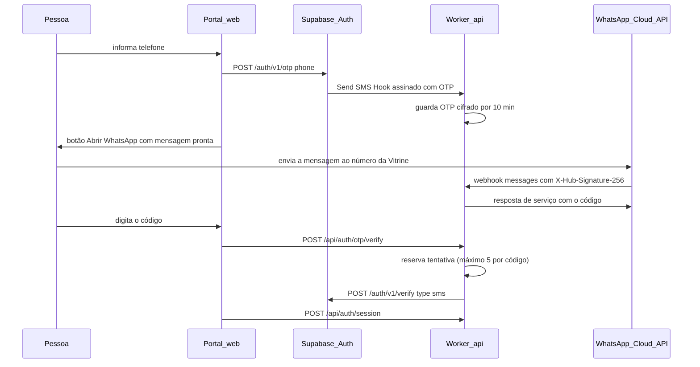

# Implementation Plan: Login múltiplo no painel

**Branch**: `cursor/login-multiplo-whatsapp-564b` | **Date**: 2026-11-22 | **Spec**: [spec.md](spec.md)

**Input**: Especificação em `specs/017-login-multiplo/spec.md`. Decisão proposta em [ADR 0015](../../docs/adr/0015-login-multiplo-whatsapp.md).

## Summary

Trocar o botão único "Entrar com Google" por uma tela de entrada minimalista com quatro métodos: Google, e-mail e senha, telefone e senha e código pelo WhatsApp. Todos usam o Supabase Auth e terminam no `POST /api/auth/session` atual, então a autorização e o isolamento entre vitrines não mudam. O código por telefone é gerado pelo Supabase, chega ao Worker pelo Send SMS Hook, fica cifrado por até 10 minutos e é entregue como resposta gratuita quando a pessoa manda uma mensagem pronta ao número da Vitrine no WhatsApp.



## Decisões propostas (revisar no PR)

A análise Spec Kit de 2026-11-22 apontou oito achados altos; as respostas estão em [research.md](research.md), seção "Decisões de segurança propostas" (S1 a S8), e entram nos requisitos FR-004, FR-009, FR-010, FR-013 e FR-016 a FR-019 e no SC-003. Em resumo: provedores Email e Phone desligados em produção até T045, com os passos humanos num projeto Supabase de teste (S1); valores propostos para os limites do Supabase Auth (S2); `wa_id` cifrado e nenhum dado de telefone em texto puro (S3); teste estático de acessibilidade (S4); verificação do código pelo Worker com contador de erros (S5); *Confirm email* ligado e teste de pré-sequestro de conta (S6); `429` do hook no limite (S7); prazo total de 4 s no hook e `ctx.waitUntil` no webhook (S8).

## Technical Context

**Language/Version**: JavaScript ES2022 (módulos `.mjs`), HTML e CSS sem framework; SQL do Postgres 15 (Supabase).

**Primary Dependencies**: Supabase Auth (GoTrue) pela API HTTP, Cloudflare Workers (WebCrypto para HMAC e AES-GCM), WhatsApp Cloud API (Graph API), Cloudflare Turnstile. Nenhuma dependência npm nova.

**Storage**: Supabase Postgres, tabelas novas em `private` (ver [data-model.md](data-model.md)); usuários e identidades no esquema `auth`, administrados pelo Supabase.

**Testing**: `node --test` (`npm test`), PGlite para migrações e permissões, `fetch` simulado para Supabase e Graph API, capturas 1280 e 375 px para a tela.

**Target Platform**: Cloudflare Workers Free com Static Assets; navegadores atuais em computador e celular.

**Project Type**: aplicação web (Worker único `workers/api.mjs` + front-end estático em `web/`).

**Performance Goals**: hook responde em até 4 s (prazo total, S8); webhook responde à Meta logo depois de validar a assinatura e entrega o código em `ctx.waitUntil` em até 8 s, dentro dos 10 s após a mensagem da pessoa.

**Constraints**: custo zero (ADR 0005); limite de CPU do Workers Free por requisição; CSP restrita do `/portal/`; nenhum dado pessoal em log.

**Scale/Scope**: piloto de até 10 vitrines; dezenas de pessoas no painel.

## Constitution Check

| Princípio | Situação |
|---|---|
| I. Administração privada e publicação pública | Passa. Nada muda nos artefatos publicados; telas e tabelas novas são só do painel. |
| II. Isolamento entre vitrines | Passa. A sessão continua validada no servidor e a propriedade segue pelo `user.id`; testes de isolamento existentes continuam obrigatórios para cada método. |
| III. Credenciais apenas no servidor | Passa com cuidado. Seis segredos novos só por `wrangler secret put`, com chaves derivadas por HKDF (S3); `GET /api/auth/config` testado contra vazamento; hook e webhook assinados; telefone, `wa_id` e código nunca em texto puro nas tabelas (FR-009). |
| IV. Custo e condições verificáveis | Passa com pendências. Preços da Meta, cotas do SMTP, limites do Supabase Auth (S2) e disponibilidade de hooks e de um projeto de teste no Free documentados em [research.md](research.md) como "a reconferir"; métodos ficam desligados até os passos humanos. |
| V. Entregas verificáveis | Passa. Cada história tem teste independente; segurança do hook e do webhook com testes de contrato. |
| Restrição "Login inicial será Google" | **Exige emenda** 0.2.0 da constituição (proposta nesta entrega) e o ADR 0015. Enquanto a emenda for proposta, os provedores Email e Phone ficam desligados no projeto de produção e os passos humanos rodam num projeto de teste (FR-017, S1); `test/auth-methods-off.test.mjs` impede ligar `AUTH_METHODS` antes de T045. |

## Project Structure

### Documentation (this feature)

```text
specs/017-login-multiplo/
├── spec.md
├── plan.md
├── research.md
├── data-model.md
├── quickstart.md
├── contracts/
│   ├── auth-config.md
│   ├── portal-auth-flows.md
│   ├── send-sms-hook.md
│   └── whatsapp-webhook.md
├── checklists/
│   └── requirements.md
└── tasks.md
```

### Source Code (repository root)

```text
web/portal/
├── index.html            # nova #auth-section (US1)
├── portal.css            # estilos da tela de entrada (US1)
├── portal.js             # integra auth-form.mjs, PKCE para e-mail (US1, US2)
├── auth-form.mjs         # novo: modos, validação, chamadas ao Supabase (US1-US4)
├── auth-identifier.mjs   # novo: detectar e normalizar e-mail ou telefone (US1, US3)
└── phone-mask.mjs        # reaproveitado

src/auth/
├── phone.mjs             # novo: forma canônica BR com nono dígito (R4)
├── standard-webhooks.mjs # novo: verificação do Send SMS Hook
├── otp-outbox.mjs        # novo: chaves HKDF, cifra AES-GCM e chamadas às funções private.*
├── otp-verify.mjs        # novo: POST /api/auth/otp/verify com contador de erros (S5)
└── whatsapp.mjs          # novo: verificação do webhook e envio pela Graph API com prazo

workers/api.mjs           # rotas /api/auth/hooks/send-sms, /api/whatsapp/webhook e /api/auth/otp/verify; /api/auth/config ampliado; limpeza no scheduled()
wrangler.jsonc            # variáveis não secretas novas
web/_headers              # CSP do /portal/ com Turnstile (US5)
supabase/migrations/20261122000100_auth_otp_outbox.sql

test/
├── auth-form.test.mjs
├── auth-a11y-static.test.mjs
├── auth-phone.test.mjs
├── auth-send-sms-hook.test.mjs
├── auth-otp-verify.test.mjs
├── whatsapp-webhook.test.mjs
├── auth-otp-outbox-db.test.mjs
├── auth-methods-off.test.mjs
└── auth-config.test.mjs
```

**Structure Decision**: o projeto já é um Worker único com módulos em `src/` e front-end em `web/`; os módulos novos de autenticação ficam em `src/auth/` para não crescer ainda mais `workers/api.mjs`, que só registra as rotas.

## Entrega em PRs

Cada PR corresponde a uma issue de `docs/backlog/login-multiplo/` e pode ir para `main` com o método desligado em `AUTH_METHODS`:

1. Tela de entrada (US1) com Google na fileira nova e `authMethods` lido do servidor.
2. E-mail e senha (US2).
3. Ponte WhatsApp no Worker (base da US3 e US4): migração, hook, webhook e verificação do código pelo Worker.
4. Entrar com código pelo WhatsApp (US3, tela).
5. Telefone e senha (US4).
6. Proteção contra abuso (US5).
7. Provedores sociais configuráveis.
8. Testes de ponta a ponta e documentação de operação.

## Complexity Tracking

| Ponto | Por que é necessário | Alternativa mais simples recusada |
|---|---|---|
| Duas tabelas privadas e um hook só para entregar o código | Entregar sem custo exige esperar a mensagem da pessoa; o código precisa ficar guardado até lá | Enviar modelo de autenticação na hora: cobrado por mensagem |
| Emenda da constituição | O texto atual fixa o Google como login inicial | Manter só o Google: é o problema que motivou o pedido |
| Rota `POST /api/auth/otp/verify` no Worker | O FR-010 exige contar erros por telefone, e a verificação direta do navegador ao Supabase não passa pelo Worker | Confiar só no limite por IP do Supabase: não cumpre o FR-010 (risco residual em research S5) |
| Projeto Supabase de teste separado | Testar hook, SMTP e vínculo de contas sem ligar provedores em produção antes da ratificação | Ligar direto em produção: põe o método no ar com a emenda ainda proposta (S1) |
