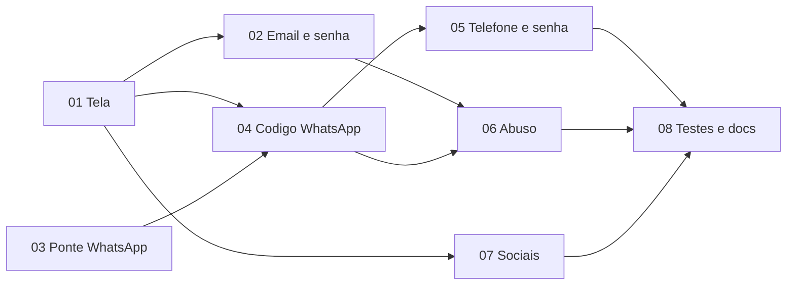

# Tasks: Login múltiplo no painel

**Input**: `specs/017-login-multiplo/` (spec, plan, research, data-model, contracts)

**Tests**: obrigatórios para hook, webhook, permissões das tabelas privadas, `GET /api/auth/config` e ausência de dados pessoais em logs (Princípios II, III e V). A tela tem testes de módulo e capturas 1280 e 375 px.

**Issues**: cada fase corresponde a um arquivo de `docs/backlog/login-multiplo/` (indicado entre colchetes no título) e a um PR.

## Format: `[ID] [P?] [Story] Description`

- **[P]**: pode rodar em paralelo (arquivos diferentes, sem dependência).
- **[Story]**: história da `spec.md` (US1 a US5).

---

## Phase 1: Setup (planejamento, este PR)

- [x] T001 Criar `specs/017-login-multiplo/` com spec, plan, research, data-model, contracts, quickstart, checklist e tasks.
- [x] T002 Propor o ADR `docs/adr/0015-login-multiplo-whatsapp.md` e a emenda 0.2.0 de `.specify/memory/constitution.md`.
- [x] T003 Atualizar `docs/roadmap.md`, `AGENTS.md` e `.specify/feature.json`.
- [x] T004 Escrever o backlog `docs/backlog/login-multiplo/01..08-*.md` e o subagente `.cursor/agents/login-multiplo-whatsapp.md`.

---

## Phase 2: Foundational (bloqueia US3 e US4) [03-ponte-whatsapp-worker]

**Purpose**: entregar o código do Supabase pelo WhatsApp sem custo.

- [ ] T005 [P] Criar `supabase/migrations/20261122000100_auth_otp_outbox.sql` com `private.auth_otp_outbox`, `private.whatsapp_service_windows`, `private.auth_hook_events` e as funções `store_auth_otp`, `take_auth_otp`, `touch_whatsapp_window` e `purge_auth_otp` (data-model.md).
- [ ] T006 [P] Teste em PGlite `test/auth-otp-outbox-db.test.mjs`: `anon` e `authenticated` sem acesso; `take_auth_otp` entrega uma vez; limite de 5 por hora; expirados ignorados.
- [ ] T007 [P] `src/auth/phone.mjs`: normalizar para E.164 e forma canônica com nono dígito; HMAC com `AUTH_PHONE_PEPPER`. Teste `test/auth-phone.test.mjs`.
- [ ] T008 [P] `src/auth/standard-webhooks.mjs`: verificar `webhook-id`, `webhook-timestamp` (300 s) e `webhook-signature` em tempo constante.
- [ ] T009 `src/auth/otp-outbox.mjs`: cifrar e decifrar com AES-GCM (`AUTH_OTP_ENC_KEY`) e chamar as funções `private.*` com `SUPABASE_SERVICE_ROLE_KEY` (depende de T005, T007).
- [ ] T010 `src/auth/whatsapp.mjs`: verificar `X-Hub-Signature-256`, desafio `hub.verify_token` e enviar texto pela Graph API com tempo limite de 3 s (nunca `template`).
- [ ] T011 Rotas em `workers/api.mjs`: `POST /api/auth/hooks/send-sms` (contracts/send-sms-hook.md) e `GET`/`POST /api/whatsapp/webhook` (contracts/whatsapp-webhook.md) (depende de T008 a T010).
- [ ] T012 Chamar `private.purge_auth_otp()` no `scheduled()` existente de `workers/api.mjs`.
- [ ] T013 Testes de contrato `test/auth-send-sms-hook.test.mjs` e `test/whatsapp-webhook.test.mjs`, com `fetch` simulado para Supabase e Graph API, cobrindo todos os casos listados nos contratos.
- [ ] T014 Variáveis não secretas em `wrangler.jsonc` (`WHATSAPP_PHONE_NUMBER_ID`, `WHATSAPP_DISPLAY_NUMBER`, `WHATSAPP_GRAPH_VERSION`, `AUTH_METHODS`) com valores vazios por padrão.

**Checkpoint**: hook e webhook funcionam com testes simulados; o método continua desligado.

---

## Phase 3: User Story 1 - Tela de entrada minimalista (P1) [01-tela-de-entrada]

**Goal**: nova `#auth-section` com Google na fileira de botões redondos.

**Independent Test**: `/portal/` sem sessão em 1280 e 375 px, teclado e leitor de tela; entrar com Google.

- [ ] T015 [P] [US1] `web/portal/auth-identifier.mjs`: detectar e-mail ou telefone e aplicar a máscara de `phone-mask.mjs`. Teste em `test/auth-form.test.mjs`.
- [ ] T016 [US1] Reescrever `#auth-section` em `web/portal/index.html`: campos, "Esqueceu sua senha?", "Entrar", divisor "ou entrar com", fileira de botões redondos e "Não tem uma conta? Cadastre-se" (spec US1, cenário 1).
- [ ] T017 [US1] Estilos em `web/portal/portal.css` com tokens do `DESIGN.md` (research R9), tema claro e escuro, alvos de 44 px e botões sociais de 56 px.
- [ ] T018 [US1] `web/portal/auth-form.mjs`: modos "Entrar" e "Criar conta", validação no navegador, foco no primeiro erro e região `aria-live`; montar a fileira a partir de `socialProviders` e `authMethods`.
- [ ] T019 [US1] Ampliar `GET /api/auth/config` em `workers/api.mjs` (contracts/auth-config.md) e teste `test/auth-config.test.mjs`, incluindo a ausência de segredos.
- [ ] T020 [US1] Integrar `auth-form.mjs` em `web/portal/portal.js` mantendo `startGoogleLogin()` e o `id="google-login-button"` (usado por `portal.js`), e rodar `test/portal-api-contract.test.mjs` para garantir que o PKCE do Google não mudou.
- [ ] T021 [US1] Capturas 1280 e 375 px (claro e escuro) anexadas ao PR.

---

## Phase 4: User Story 2 - E-mail e senha (P2) [02-email-e-senha]

**Independent Test**: criar conta, confirmar, entrar, recuperar a senha (precisa de BLK-SMTP-01 para o teste real).

- [ ] T022 [US2] Cadastro por e-mail com PKCE e `redirect_to=/portal/?fluxo=confirmar` em `web/portal/auth-form.mjs` (contracts/portal-auth-flows.md).
- [ ] T023 [US2] Entrada com `grant_type=password` e mensagens neutras (FR-011).
- [ ] T024 [US2] "Esqueceu sua senha?" por e-mail e formulário "Definir nova senha" com `PUT /auth/v1/user`; generalizar `exchangePkceCode()` em `web/portal/portal.js` para ler `fluxo`.
- [ ] T025 [US2] Testes com `fetch` simulado: cadastro, e-mail existente com a mesma resposta, senha errada, recuperação e uso único do link.
- [ ] T026 [US2] Documentar BLK-SMTP-01 e os modelos de e-mail em português em `docs/supabase-provisioning.md`.

---

## Phase 5: User Story 3 - Código pelo WhatsApp (P3) [04-entrar-com-codigo-whatsapp]

**Independent Test**: entrar com um telefone novo pelo código (precisa de BLK-WA-01 e BLK-HOOK-01 para o teste real).

- [ ] T027 [US3] Modo "Entrar com código pelo WhatsApp" em `web/portal/auth-form.mjs`: telefone, `POST /auth/v1/otp`, botão "Abrir WhatsApp" com `wa.me` e mensagem pronta, campo de 6 dígitos (`inputmode="numeric"`, `autocomplete="one-time-code"`).
- [ ] T028 [US3] Verificação com `POST /auth/v1/verify` e sessão por `POST /api/auth/session`; reenvio após 60 s com contagem anunciada.
- [ ] T029 [US3] Estados de erro: código errado, vencido, limite atingido, WhatsApp indisponível (spec, Edge Cases).
- [ ] T030 [US3] Teste de ponta a ponta simulado: pedido de código, hook, webhook, verificação e sessão, em `test/whatsapp-webhook.test.mjs` ou arquivo próprio.

---

## Phase 6: User Story 4 - Telefone e senha (P4) [05-telefone-e-senha]

- [ ] T031 [US4] Cadastro com `phone` e `password` e confirmação pelo passo "Abrir WhatsApp" da US3.
- [ ] T032 [US4] Entrada com telefone e senha (`grant_type=password`).
- [ ] T033 [US4] Recuperação por código e "Definir nova senha".
- [ ] T034 [US4] Testes com `fetch` simulado para os três fluxos.

---

## Phase 7: User Story 5 - Proteção contra abuso (P5) [06-protecao-contra-abuso]

- [ ] T035 [US5] Turnstile no `web/portal/auth-form.mjs` (carregar o script só quando `turnstileSiteKey` existir) e envio de `captcha_token`.
- [ ] T036 [US5] CSP do `/portal/` em `web/_headers` e em `workers/api.mjs` com `https://challenges.cloudflare.com` em `script-src` e `frame-src`; ajustar `test/security-rls-csp-audit.test.mjs`.
- [ ] T037 [US5] Teste que procura e-mail, telefone, código e segredos nos logs capturados, no bundle e em `dist/`.
- [ ] T038 [US5] Documentar BLK-TURNSTILE-01 e os limites do Supabase Auth recomendados para o piloto.

---

## Phase 8: Provedores sociais configuráveis [07-provedores-sociais]

- [ ] T039 [P] `AUTH_SOCIAL_PROVIDERS` com lista permitida (`google`, `facebook`, `x`) e ícones SVG locais para cada um em `web/portal/index.html`.
- [ ] T040 [P] Generalizar `startGoogleLogin()` para `startOAuthLogin(provider)` mantendo o nome antigo como atalho.
- [ ] T041 Registrar Facebook e X como "depois" e Apple e TikTok como fora de escopo em `docs/instagram/login-meta.md` e no ADR 0015.

---

## Phase 9: Polish [08-testes-e-documentacao]

- [ ] T042 Atualizar `docs/operations-guide.md`, `docs/supabase-provisioning.md` e `docs/google-auth-setup.md` com os novos métodos e passos humanos.
- [ ] T043 Teste de isolamento com contas criadas por métodos diferentes (Princípio II), em `test/e2e-full-journey.test.mjs`.
- [ ] T044 Rodar `specs/017-login-multiplo/quickstart.md` e registrar a evidência.
- [ ] T045 Ratificação do ADR 0015 e da constituição 0.2.0 pelo Lino; só então ligar os métodos em `AUTH_METHODS` de produção.

---

## Dependencies & Execution Order

- 01 e 03 podem começar juntos.
- Passos humanos: 02 precisa de BLK-SMTP-01; 03, 04 e 05 precisam de BLK-WA-01 e BLK-HOOK-01 só para o teste real; 06 precisa de BLK-TURNSTILE-01.
- Todo PR entra com o método desligado; ligar em produção depende de T045.
