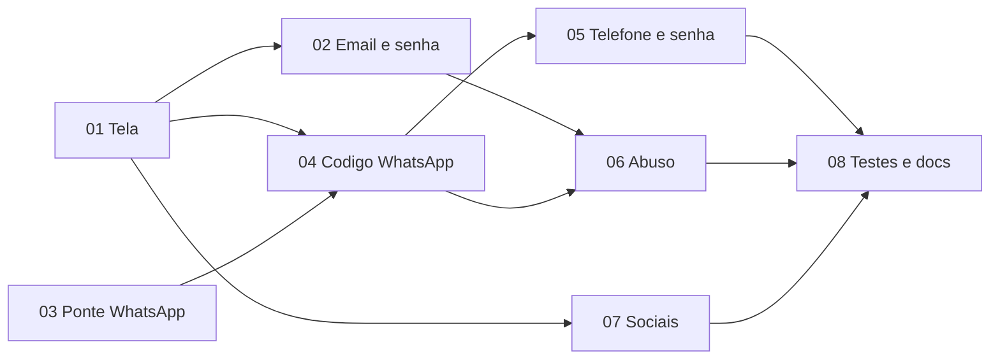

# Tasks: Login múltiplo no painel

**Input**: `specs/017-login-multiplo/` (spec, plan, research, data-model, contracts)

**Tests**: obrigatórios para hook, webhook, `POST /api/auth/otp/verify`, permissões das tabelas privadas, `GET /api/auth/config`, `AUTH_METHODS` vazio no `wrangler.jsonc` versionado e ausência de dados pessoais em logs e tabelas (Princípios II, III e V). A tela tem testes de módulo, o teste estático de acessibilidade e capturas 1280 e 375 px.

**Decisões propostas**: as tarefas T046 a T055 e os ajustes em T005, T006, T009 a T011, T013, T026, T028, T029, T031, T033, T038, T044 e T045 vêm das decisões S1 a S8 de `research.md` ("Decisões de segurança propostas"), a revisar no PR.

**Issues**: cada fase corresponde a um arquivo de `docs/backlog/login-multiplo/` (indicado entre colchetes no título) e a um PR.

## Format: `[ID] [P?] [Story] Description`

- **[P]**: pode rodar em paralelo (arquivos diferentes, sem dependência).
- **[Story]**: história da `spec.md` (US1 a US5).

---

## Phase 1: Setup (planejamento, este PR)

- [x] T001 Criar `specs/017-login-multiplo/` com spec, plan, research, data-model, contracts, quickstart, checklist e tasks.
- [x] T002 Propor o ADR `docs/adr/0015-login-multiplo-whatsapp.md` e a emenda 0.2.0 de `.specify/memory/constitution.md`.
- [x] T003 Atualizar `docs/roadmap.md`, `AGENTS.md` e `.specify/feature.json`.
- [x] T004 Escrever o backlog `docs/backlog/login-multiplo/00..08-*.md` (épico e 8 issues) e o subagente `.cursor/agents/login-multiplo-whatsapp.md`.

---

## Phase 2: Foundational (bloqueia US3 e US4) [03-ponte-whatsapp-worker]

**Purpose**: entregar o código do Supabase pelo WhatsApp sem custo.

- [ ] T046 Passo humano BLK-AUTH-01: registrar em `docs/supabase-provisioning.md` o estado atual de *Providers* (Email, Phone, Google), *Confirm email*, *Allow new users to sign up*, *Hooks* e *Rate Limits* do projeto de produção `qawlpsrfewosxsfgmmpm`; deixar Email e Phone desligados até T045 (FR-017) e conferir que o Google continua funcionando. Registrar também a criação do projeto de teste (BLK-SBTEST-01). Bloqueia BLK-SMTP-01, BLK-HOOK-01, BLK-RATE-01 e BLK-TURNSTILE-01. *Decisão proposta (revisar no PR; research S1)*.
- [ ] T005 [P] Criar `supabase/migrations/20261122000100_auth_otp_outbox.sql` com `private.auth_otp_outbox` (com `failed_attempts`), `private.whatsapp_service_windows` (com `wa_id_ciphertext`, `wa_id_iv` e `last_message_id` como HMAC), `private.auth_hook_events` e as funções `store_auth_otp`, `take_auth_otp`, `touch_whatsapp_window`, `reserve_otp_attempt`, `finish_otp_attempt` e `purge_auth_otp` (data-model.md).
- [ ] T006 [P] Teste em PGlite `test/auth-otp-outbox-db.test.mjs`: `anon` e `authenticated` sem acesso; `take_auth_otp` entrega uma vez; limite de 5 por hora sem substituir o código pendente; expirados ignorados; `reserve_otp_attempt` não passa de 5, inclusive com chamadas simultâneas, e `store_auth_otp` zera o contador.
- [ ] T007 [P] `src/auth/phone.mjs`: normalizar para E.164 e forma canônica com nono dígito; HMAC com `AUTH_PHONE_PEPPER`. Teste `test/auth-phone.test.mjs`.
- [ ] T008 [P] `src/auth/standard-webhooks.mjs`: verificar `webhook-id`, `webhook-timestamp` (300 s) e `webhook-signature` em tempo constante.
- [ ] T009 `src/auth/otp-outbox.mjs`: derivar as chaves com HKDF-SHA256 (data-model.md, "Chaves derivadas"), cifrar e decifrar o código e o `wa_id` com AES-GCM (dados associados com o `phone_hash`), calcular o HMAC do `messages[].id` e chamar as funções `private.*` com `SUPABASE_SERVICE_ROLE_KEY` (depende de T005, T007).
- [ ] T010 `src/auth/whatsapp.mjs`: verificar `X-Hub-Signature-256`, desafio `hub.verify_token` e enviar texto pela Graph API com o tempo limite calculado a partir do prazo de quem chama (no máximo 3 s por tentativa; T051) (nunca `template`).
- [ ] T011 Rotas em `workers/api.mjs`: `POST /api/auth/hooks/send-sms` (contracts/send-sms-hook.md, inclusive o `429` no limite) e `GET`/`POST /api/whatsapp/webhook` (contracts/whatsapp-webhook.md) (depende de T008 a T010).
- [ ] T012 Chamar `private.purge_auth_otp()` no `scheduled()` existente de `workers/api.mjs`.
- [ ] T013 Testes de contrato `test/auth-send-sms-hook.test.mjs` e `test/whatsapp-webhook.test.mjs`, com `fetch` simulado para Supabase e Graph API, cobrindo todos os casos listados nos contratos (inclusive o `429` sem `retry-after` no sexto pedido).
- [ ] T014 Variáveis não secretas em `wrangler.jsonc` (`WHATSAPP_PHONE_NUMBER_ID`, `WHATSAPP_DISPLAY_NUMBER`, `WHATSAPP_GRAPH_VERSION`, `AUTH_METHODS`) com valores vazios por padrão.
- [ ] T047 [P] Teste `test/auth-methods-off.test.mjs`: enquanto `.specify/memory/constitution.md` disser "0.2.0 (proposta)", `vars.AUTH_METHODS` do `wrangler.jsonc` versionado fica vazio ou ausente, e nenhum `env.*` liga métodos com o `SUPABASE_URL` de produção (FR-017; contracts/auth-config.md). Pode entrar antes de T014.
- [ ] T048 Teste sem texto puro em `test/auth-otp-outbox-db.test.mjs`: gravar pelo hook e pelo webhook (PGlite e `fetch` simulado) com telefone, `wa_id`, `wamid` e código conhecidos e conferir que nenhum desses valores aparece em nenhuma coluna das três tabelas (FR-009; depende de T009, T011). *Decisão proposta (revisar no PR; research S3)*.
- [ ] T049 `src/auth/otp-verify.mjs` e rota `POST /api/auth/otp/verify` em `workers/api.mjs` (contracts/portal-auth-flows.md): validar origem e corpo, reservar tentativa, repassar a `/auth/v1/verify` com `type: "sms"` e encerrar ou contar a tentativa (FR-010; depende de T005, T007, T009). *Decisão proposta (revisar no PR; research S5)*.
- [ ] T050 Testes de contrato `test/auth-otp-verify.test.mjs`, com `fetch` simulado para o Supabase, cobrindo a lista do contrato (quinto erro com `429`, sexto sem chamar o Supabase, pedidos simultâneos, falha do Supabase sem contar tentativa, nada em log) (depende de T049).
- [ ] T051 Prazos do hook e do webhook (FR-013): prazo total de 4 s no hook, compartilhado entre gravação e envio, com nova tentativa só se restar pelo menos 1 s; no webhook, resposta `200` antes do processamento, que roda em `ctx.waitUntil` com prazo de 8 s. Testes com relógio e `fetch` lentos simulados em `test/auth-send-sms-hook.test.mjs` e `test/whatsapp-webhook.test.mjs` (depende de T010, T011). *Decisão proposta (revisar no PR; research S8)*.

**Checkpoint**: hook, webhook e verificação pelo Worker funcionam com testes simulados; o método continua desligado e `AUTH_METHODS` vazio está protegido por teste.

---

## Phase 3: User Story 1 - Tela de entrada minimalista (P1) [01-tela-de-entrada]

**Goal**: nova `#auth-section` com Google na fileira de botões redondos.

**Independent Test**: `/portal/` sem sessão em 1280 e 375 px, teclado e leitor de tela; entrar com Google.

- [ ] T015 [P] [US1] `web/portal/auth-identifier.mjs`: detectar e-mail ou telefone e aplicar a máscara de `phone-mask.mjs`. Teste em `test/auth-form.test.mjs`.
- [ ] T016 [US1] Reescrever `#auth-section` em `web/portal/index.html`: campos, "Esqueceu sua senha?", "Entrar", divisor "ou entrar com", fileira de botões redondos e "Não tem uma conta? Cadastre-se" (spec US1, cenário 1).
- [ ] T017 [US1] Estilos em `web/portal/portal.css` com tokens do `DESIGN.md` (research R9), tema claro e escuro, alvos de 44 px e botões sociais de 56 px.
- [ ] T018 [US1] `web/portal/auth-form.mjs`: modos "Entrar" e "Criar conta", validação no navegador, foco no primeiro erro e região `aria-live`; montar a fileira a partir de `socialProviders` e `authMethods`.
- [ ] T019 [US1] Ampliar `GET /api/auth/config` em `workers/api.mjs` (contracts/auth-config.md) e teste `test/auth-config.test.mjs`, incluindo a ausência de segredos.
- [ ] T020 [US1] Integrar `auth-form.mjs` em `web/portal/portal.js` mantendo `startGoogleLogin()` e o `id="google-login-button"` (usado por `portal.js`), e rodar `test/portal-api-contract.test.mjs` para garantir que o PKCE do Google não mudou.
- [ ] T021 [US1] Capturas 1280 e 375 px (claro e escuro) anexadas ao PR.
- [ ] T052 [P] [US1] Teste estático de acessibilidade `test/auth-a11y-static.test.mjs` (`node:test`, sem dependência nova) sobre `#auth-section` de `web/portal/index.html`, com todos os modos no HTML alternados por `hidden`: rótulos associados, `type`, `autocomplete` e `inputmode` corretos, `aria-live` nas regiões de erro e de estado, nome acessível em botões e links e nenhum `tabindex` positivo (SC-003; depende de T016). *Decisão proposta (revisar no PR; research S4)*.

---

## Phase 4: User Story 2 - E-mail e senha (P2) [02-email-e-senha]

**Independent Test**: criar conta, confirmar, entrar, recuperar a senha (precisa de BLK-SBTEST-01 e BLK-SMTP-01, com *Confirm email* ligado, para o teste real).

- [ ] T022 [US2] Cadastro por e-mail com PKCE e `redirect_to=/portal/?fluxo=confirmar` em `web/portal/auth-form.mjs` (contracts/portal-auth-flows.md).
- [ ] T023 [US2] Entrada com `grant_type=password` e mensagens neutras (FR-011).
- [ ] T024 [US2] "Esqueceu sua senha?" por e-mail e formulário "Definir nova senha" com `PUT /auth/v1/user`; generalizar `exchangePkceCode()` em `web/portal/portal.js` para ler `fluxo`.
- [ ] T025 [US2] Testes com `fetch` simulado: cadastro, e-mail existente com a mesma resposta, senha errada, recuperação e uso único do link.
- [ ] T026 [US2] Documentar BLK-SMTP-01 (com *Confirm email* ligado e execução no projeto de teste antes de T045) e os modelos de e-mail em português em `docs/supabase-provisioning.md`.
- [ ] T053 [US2] Testes com `fetch` simulado em `test/auth-form.test.mjs` para a US2, cenários 6 e 7: cadastro sem confirmação não cria sessão nem chama `POST /api/auth/session`; entrada com senha recusada por e-mail não confirmado mostra a mensagem neutra; o retorno do Google segue o PKCE atual (depende de T022, T023). *Decisão proposta (revisar no PR; research S6)*.
- [ ] T054 [US2] Verificar no projeto de teste o vínculo com Google e o pré-sequestro de conta (quickstart, seção 3, item 2) e registrar o comportamento observado do Supabase no PR e em `docs/supabase-provisioning.md`; se a senha de quem não confirmou o e-mail continuar utilizável, manter `emailPassword` desligado e reabrir a decisão (FR-019; depende de T046, BLK-SBTEST-01, BLK-SMTP-01 e T022 a T024).

---

## Phase 5: User Story 3 - Código pelo WhatsApp (P3) [04-entrar-com-codigo-whatsapp]

**Independent Test**: entrar com um telefone novo pelo código (precisa de BLK-SBTEST-01, BLK-WA-01 e BLK-HOOK-01 para o teste real).

- [ ] T027 [US3] Modo "Entrar com código pelo WhatsApp" em `web/portal/auth-form.mjs`: telefone, `POST /auth/v1/otp`, botão "Abrir WhatsApp" com `wa.me` e mensagem pronta, campo de 6 dígitos (`inputmode="numeric"`, `autocomplete="one-time-code"`).
- [ ] T028 [US3] Verificação só por `POST /api/auth/otp/verify` do Worker (nunca `/auth/v1/verify` direto) e sessão por `POST /api/auth/session`; reenvio após 60 s com contagem anunciada (depende de T049).
- [ ] T029 [US3] Estados de erro: código errado, vencido, quinto erro ("Muitas tentativas. Peça um novo código."), limite de pedidos atingido (`429` do hook repassado pelo Supabase vira "Muitas tentativas. Tente de novo em alguns minutos."), WhatsApp indisponível (spec, Edge Cases; contracts/portal-auth-flows.md).
- [ ] T030 [US3] Teste de ponta a ponta simulado: pedido de código, hook, webhook, verificação e sessão, em `test/whatsapp-webhook.test.mjs` ou arquivo próprio.

---

## Phase 6: User Story 4 - Telefone e senha (P4) [05-telefone-e-senha]

- [ ] T031 [US4] Cadastro com `phone` e `password` e confirmação pelo passo "Abrir WhatsApp" da US3, com o código confirmado por `POST /api/auth/otp/verify`.
- [ ] T032 [US4] Entrada com telefone e senha (`grant_type=password`).
- [ ] T033 [US4] Recuperação por código (`POST /api/auth/otp/verify`) e "Definir nova senha".
- [ ] T034 [US4] Testes com `fetch` simulado para os três fluxos.

---

## Phase 7: User Story 5 - Proteção contra abuso (P5) [06-protecao-contra-abuso]

- [ ] T035 [US5] Turnstile no `web/portal/auth-form.mjs` (carregar o script só quando `turnstileSiteKey` existir) e envio de `captcha_token`.
- [ ] T036 [US5] CSP do `/portal/` em `web/_headers` e em `workers/api.mjs` com `https://challenges.cloudflare.com` em `script-src` e `frame-src`; ajustar `test/security-rls-csp-audit.test.mjs`.
- [ ] T037 [US5] Teste que procura e-mail, telefone, código e segredos nos logs capturados, no bundle e em `dist/`.
- [ ] T038 [US5] Documentar BLK-TURNSTILE-01 e os limites do Supabase Auth propostos para o piloto (FR-018; research S2) em `docs/supabase-provisioning.md`.
- [ ] T055 [US5] Passo humano BLK-RATE-01: confirmar os valores de FR-018, aplicá-los no projeto de teste (em produção, só em T045), conferir no painel e pelo roteiro do quickstart (seção 3, itens 5 e 6) e registrar valores e rotas contadas em `docs/supabase-provisioning.md` (depende de T046, BLK-SBTEST-01 e T038). *Decisão proposta (revisar no PR; research S2)*.

---

## Phase 8: Provedores sociais configuráveis [07-provedores-sociais]

- [ ] T039 [P] `AUTH_SOCIAL_PROVIDERS` com lista permitida (`google`, `facebook`, `x`) e ícones SVG locais para cada um em `web/portal/index.html`.
- [ ] T040 [P] Generalizar `startGoogleLogin()` para `startOAuthLogin(provider)` mantendo o nome antigo como atalho.
- [ ] T041 Registrar Facebook e X como "depois" e Apple e TikTok como fora de escopo em `docs/instagram/login-meta.md` e no ADR 0015.

---

## Phase 9: Polish [08-testes-e-documentacao]

- [ ] T042 Atualizar `docs/operations-guide.md`, `docs/supabase-provisioning.md` e `docs/google-auth-setup.md` com os novos métodos e passos humanos.
- [ ] T043 Teste de isolamento com contas criadas por métodos diferentes (Princípio II), em `test/e2e-full-journey.test.mjs`.
- [ ] T044 Rodar `specs/017-login-multiplo/quickstart.md` no projeto de teste e registrar a evidência, inclusive o estado dos provedores de produção (BLK-AUTH-01) e os comportamentos do Supabase a reconferir (research, "Pendências com valores propostos").
- [ ] T045 Ratificação do ADR 0015 e da constituição 0.2.0 pelo Lino, com revisão das decisões propostas S1 a S8 (research); só então repetir BLK-SMTP-01, BLK-HOOK-01, BLK-RATE-01 e BLK-TURNSTILE-01 no projeto de produção, apontar o webhook da Meta para produção e ligar os métodos em `AUTH_METHODS` de produção (ajustando T047).

---

## Dependencies & Execution Order

- 01 e 03 podem começar juntos.
- Passos humanos: T046 (BLK-AUTH-01) e BLK-SBTEST-01 vêm antes de todos os outros; 02 precisa de BLK-SMTP-01; 03, 04 e 05 precisam de BLK-WA-01 e BLK-HOOK-01 só para o teste real; 06 precisa de BLK-TURNSTILE-01 e BLK-RATE-01 (T055). Antes de T045, todos rodam no projeto Supabase de teste (FR-017).
- Na fase 2, T049 depende de T005, T007 e T009; T050 de T049; T051 de T010 e T011; T048 de T009 e T011. Na fase 5, T028 depende de T049.
- Todo PR entra com o método desligado; ligar em produção depende de T045, e T047 falha se `AUTH_METHODS` for ligado antes.

## Cobertura dos requisitos alterados

| Requisito | Tarefas |
|---|---|
| FR-004 (código por telefone confirmado pelo Worker) | T028, T031, T033, T049 |
| FR-009 (nada em texto puro; retenção) | T005, T009, T012, T048 |
| FR-010 (5 por hora; 5 erros pelo Worker) | T005, T006, T028, T049, T050 |
| FR-013 (prazos do hook e do webhook) | T010, T011, T013, T051 |
| FR-016 e FR-017 (`AUTH_METHODS` e provedores desligados em produção) | T014, T019, T045, T046, T047 |
| FR-018 (limites do Supabase Auth) | T038, T055 |
| FR-019 (*Confirm email* e pré-sequestro) | T026, T053, T054 |
| SC-003 (teste estático de acessibilidade) | T052 |
| US3, cenário 7 (`429` do hook) | T011, T013, T029 |
| US5, cenários 5 e 6 | T046, T055, T044 |
