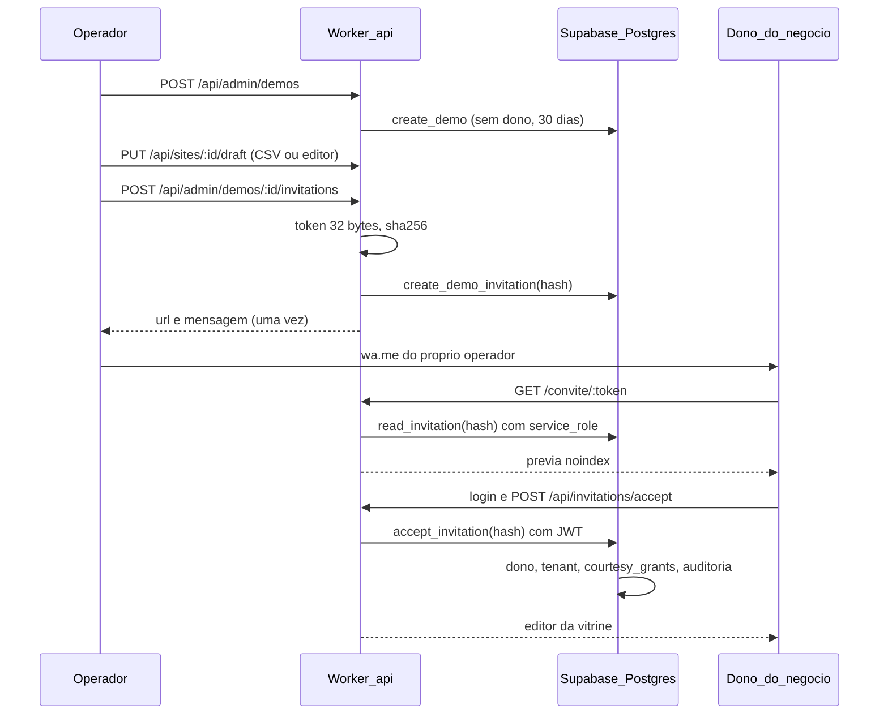

# Implementation Plan: Convite de demonstração e equipe da vitrine

**Branch**: `cursor/spec-018-convite-demonstracao-a7fe` | **Date**: 2026-11-26 | **Spec**: [spec.md](spec.md)

**Input**: Especificação em `specs/018-convite-demonstracao/spec.md`. Decisão proposta em [ADR 0016](../../docs/adr/0016-convite-demonstracao-e-cortesia.md).

## Summary

Generalizar a demonstração do Linktree para qualquer vitrine montada pela equipe Inspira (à mão ou por planilha), trocar o convite por UUID por um link de uso único que funciona para quem ainda não tem conta, mostrar a vitrine numa prévia `noindex` sem login, e, no aceite, entregar a propriedade com 3 meses de Profissional em cortesia. A mesma infraestrutura de convite dá à proprietária a aba "Equipe", com convites por link para administrador, funcionário (`editor`) e somente leitura. Um papel novo, `growth_operator`, permite delegar a prospecção sem abrir o resto da administração.



## Technical Context

**Language/Version**: JavaScript ES2022 (módulos `.mjs`), HTML e CSS sem framework; SQL do Postgres 15 (Supabase).

**Primary Dependencies**: Supabase Postgres e Auth pela API HTTP; Cloudflare Workers (WebCrypto para o token e o SHA-256). Nenhuma dependência npm nova.

**Storage**: Supabase Postgres; tabelas novas em `private` e colunas novas em `public.sites` ([data-model.md](data-model.md)). Fotos no armazenamento atual (ADR 0011).

**Testing**: `node --test` (`npm test`), PGlite para migração e permissões, `fetch` simulado para o Supabase, capturas 1280 e 375 px.

**Target Platform**: Cloudflare Workers Free com Static Assets; navegadores atuais em computador e celular.

**Project Type**: aplicação web (Worker único `workers/api.mjs` + front-end estático em `web/`).

**Performance Goals**: página do convite com o mesmo custo da prévia atual (uma leitura do rascunho e uma compilação); aceite numa única chamada ao banco.

**Constraints**: custo zero (ADR 0005); nenhuma mensagem enviada pela plataforma; CSP restrita do painel e da vitrine; token e número do negócio fora de logs e tabelas.

**Scale/Scope**: piloto de até 10 vitrines; dezenas de demonstrações por mês.

## Constitution Check

| Princípio | Situação |
|---|---|
| I. Administração privada e publicação pública | Passa. A demonstração continua sem publicação até o aceite (gatilho `publications_block_demo`); a prévia do convite usa a projeção pública de `compilePublicStorefront`, é gerada na hora, `noindex` e `no-store`, e nunca vira artefato publicado. |
| II. Isolamento entre vitrines | Passa com testes obrigatórios. O `growth_operator` só alcança vitrines sem dono; o convite de equipe dá acesso a uma vitrine só; testes de PGlite e de contrato por chamada direta (data-model, "Testes de banco"). |
| III. Credenciais apenas no servidor | Passa. Token aleatório de 256 bits mostrado uma vez e guardado só como hash; sem segredo novo (o SHA-256 não usa chave); `no-referrer` e teste de log sem token. |
| IV. Custo e condições verificáveis | Passa. Nenhum serviço novo; envio pelo `wa.me` de quem gera o convite; regras da Meta e LGPD registradas como "a reconferir" em [research.md](research.md) (R4, R5). |
| V. Entregas verificáveis | Passa. Cada história tem teste independente; autorização, projeção da prévia e bloqueio de publicação com testes. |
| Restrições de entrega ("Equipe é por vitrine"; planos sem contratação automática) | Passa. A cortesia não gera cobrança nem contratação; no fim, volta ao Gratuito (ADR 0013, sem apagar nada). |

## Project Structure

### Documentation (this feature)

```text
specs/018-convite-demonstracao/
├── spec.md
├── plan.md
├── research.md
├── data-model.md
├── quickstart.md
├── contracts/
│   ├── demo-admin.md
│   ├── invitation-flow.md
│   └── team-invitations.md
├── checklists/
│   └── requirements.md
└── tasks.md
```

### Source Code (repository root)

```text
supabase/migrations/20261126000100_site_invitations_courtesy.sql  # tabelas, políticas e funções (data-model.md)

src/
├── invitation-token.mjs     # novo: gerar token, sha256, validar formato
├── demo-invitations.mjs     # novo: rotas de operador, convite, aceite e recusa
├── team-invitations.mjs     # novo: rotas de equipe
├── linktree-import.mjs      # permissão do growth_operator e limpeza geral
└── entitlements.mjs         # leitura dos direitos com cortesia (sem mudança de regra)

workers/api.mjs              # registra as rotas; /convite/:token e /portal/convite; scheduled() chama purge_expired_demos

web/portal/
├── demo-admin.mjs           # novo: "Demonstrações" (lista, criar, prorrogar, convite, wa.me)
├── invitation-accept.mjs    # novo: confirmação "Ficar com a vitrine" e "Entrar na equipe"
├── team-panel.mjs           # novo: aba "Equipe"
├── team-panel.css
├── billing-notice.mjs       # avisos de fim da cortesia
├── platform-cms.js          # rótulos de auditoria novos
├── portal.js                # integra as telas e esconde ações por papel
└── editor.js                # escolha dos itens ativos ao publicar acima do limite (FR-017)

test/
├── database/site-invitations.test.mjs
├── demo-invitations.test.mjs
├── invitation-flow.test.mjs
└── team-invitations.test.mjs
```

**Structure Decision**: seguir o padrão do Linktree (`src/linktree-import.mjs` com `matchRoute` e `handleRoute`, registrado em `workers/api.mjs`), um módulo por área, para não crescer ainda mais `workers/api.mjs`.

## Entrega em PRs

Cada PR corresponde a uma issue de `docs/backlog/convite-demonstracao/`:

1. Migração e funções do banco, com os testes de PGlite (base de tudo).
2. Papel de captação e área "Demonstrações" do operador (depende de 1).
3. Convite do dono e prévia sem login (depende de 1 e 2).
4. Aceite com cortesia e recusa (depende de 3).
5. Fim da cortesia e escolha dos itens ao publicar (depende de 4).
6. Aba "Equipe" com convites por link (depende de 1 e do fluxo de aceite de 4).
7. Testes de isolamento de ponta a ponta e guia de operação (fecha o épico).

## Complexity Tracking

| Ponto | Por que é necessário | Alternativa mais simples recusada |
|---|---|---|
| Tabela de convites com hash | Revogar, uso único e prazo exigem estado no servidor | Token HMAC sem tabela (como `preview-token.mjs`): não revoga nem garante uso único |
| Cortesia fora de `subscriptions` | `billing_attach_checkout` recusa contratar com assinatura ativa e, ao aceitar, deixa a linha `pending` (research R6) | Assinatura `manual` marcada como cortesia: bloquearia a contratação durante a cortesia |
| Papel `growth_operator` | Delegar prospecção sem acesso a cobrança, CMS e vitrines de clientes | Usar `platform_admin` para todos: acesso amplo demais |
| Prévia sem sessão | O dono do negócio ainda não tem conta | Exigir conta antes de ver: perde o efeito do convite |
