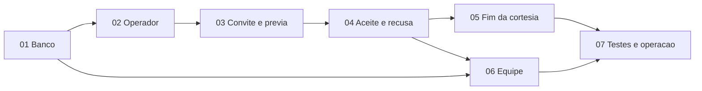

# Tasks: Convite de demonstração e equipe da vitrine

**Input**: `specs/018-convite-demonstracao/` (spec, plan, research, data-model, contracts)

**Tests**: obrigatórios para permissões no banco, rotas de operador, página do convite, aceite, recusa, cortesia, direitos e papéis da equipe, e ausência do token e do número do negócio em logs e tabelas (Princípios I, II, III e V). As telas têm testes de módulo e capturas 1280 e 375 px.

**Issues**: cada fase corresponde a um arquivo de `docs/backlog/convite-demonstracao/` (indicado entre colchetes no título) e a um PR.

## Format: `[ID] [P?] [Story] Description`

- **[P]**: pode rodar em paralelo (arquivos diferentes, sem dependência).
- **[Story]**: história da `spec.md` (US1 a US6).

---

## Phase 1: Setup (planejamento, este PR)

- [x] T001 Criar `specs/018-convite-demonstracao/` com spec, plan, research, data-model, contracts, quickstart, checklist e tasks.
- [x] T002 Propor o ADR `docs/adr/0016-convite-demonstracao-e-cortesia.md`.
- [x] T003 Atualizar `docs/roadmap.md`, `AGENTS.md`, `.specify/feature.json` e `CONTEXT.md`.
- [x] T004 Escrever o backlog `docs/backlog/convite-demonstracao/00..07-*.md` (épico e 7 issues).

---

## Phase 2: Foundational (bloqueia todas as histórias) [01-banco-convites-e-cortesia]

**Purpose**: tabelas, políticas e funções do banco, com testes de PGlite.

- [ ] T005 Criar `supabase/migrations/20261126000100_site_invitations_courtesy.sql`: papel `growth_operator`, colunas `demo_created_by` e `demo_created_at`, restrição de `demo_source`, `private.site_invitations`, `private.courtesy_grants`, `private.can_manage_demos()` e as políticas de `sites`, `drafts` e `assets` para demonstrações sem dono (data-model.md).
- [ ] T006 Na mesma migração, as funções de demonstração (`create_demo`, `extend_demo`, `delete_demo`, `list_demos`, `create_demo_invitation`, `revoke_invitation`) e a mudança de `import_linktree_demo` para `can_manage_demos()` (FR-001 a FR-005, FR-008).
- [ ] T007 Na mesma migração, `private.read_invitation`, `public.accept_invitation` e `private.decline_demo_invitation`, com `for update` no aceite e o erro único `INVITATION_UNAVAILABLE` (FR-010, FR-012, FR-013).
- [ ] T008 Na mesma migração, `create_team_invitation` e `list_site_team` (FR-018, FR-019, FR-021).
- [ ] T009 Na mesma migração, `private.site_entitlements` com a cortesia, `read_courtesy_notices`, o ajuste de `billing_apply_event` (`ended_at`), `purge_expired_demos`, `grant_growth_operator`, `revoke_growth_operator` e `grant_courtesy` (FR-014 a FR-016, FR-022).
- [ ] T010 Teste `test/database/site-invitations.test.mjs` com todos os casos de data-model.md, "Testes de banco" (depende de T005 a T009).
- [ ] T011 [P] Conferir em `test/database/linktree-demo.test.mjs` e `test/database/plans-subscriptions.test.mjs` que o comportamento atual continua (Linktree, assinatura paga, tolerância).

**Checkpoint**: migração aplicada no PGlite; isolamento e cortesia comprovados sem nenhuma rota nova.

---

## Phase 3: User Story 6 e 1 - Papel de captação e área do operador (P1/P3) [02-papel-captacao-e-demonstracoes]

**Goal**: o operador cria, edita, prorroga e apaga demonstrações; o administrador concede o papel.

**Independent Test**: spec US1 e US6.

- [ ] T012 [P] `src/invitation-token.mjs`: token de 32 bytes base64url, `sha256` em hexadecimal, validação de formato (`^[A-Za-z0-9_-]{43}$`). Teste em `test/demo-invitations.test.mjs`.
- [ ] T013 [US1] `src/demo-invitations.mjs`: rotas `GET`/`POST /api/admin/demos`, `POST /api/admin/demos/:id/extend` e `DELETE /api/admin/demos/:id` (contracts/demo-admin.md); registrar em `workers/api.mjs` com a verificação `isDemoOperator` no lugar de `isPlatformAdmin` só nessas rotas.
- [ ] T014 [US1] Abrir as rotas `draft`, `structure` e `assets` de `/api/sites/:id/*` para o operador só em demonstração sem dono; `publish` segue recusando (FR-002, FR-004).
- [ ] T015 [US1] Permitir `POST /api/admin/linktree-demos` ao `growth_operator` em `src/linktree-import.mjs` (FR-003).
- [ ] T016 [US6] Rotas `GET`/`POST`/`DELETE /api/admin/operators` (contracts/demo-admin.md, "Operadores de captação") (FR-022).
- [ ] T017 [US1] `web/portal/demo-admin.mjs`: lista com situação e prazo, "Nova demonstração", "Prorrogar", "Apagar demonstração" e abrir no editor com a faixa "Demonstração: não publicada" e sem "Publicar".
- [ ] T018 [US6] Tela "Operadores" em "Administração da plataforma", só para `platform_admin`; o `growth_operator` vê só "Demonstrações".
- [ ] T019 [US1] Rótulos das ações de auditoria novas em `web/portal/platform-cms.js`.
- [ ] T020 [US1] Testes de contrato das rotas do operador (contracts/demo-admin.md, "Testes de contrato"), inclusive `403` para `support_operator` e `sponsor`.
- [ ] T021 [US1] Capturas 1280 e 375 px de "Demonstrações", claro e escuro.

---

## Phase 4: User Story 2 e 3 (parte 1) - Convite do dono e prévia sem login (P1) [03-convite-do-dono-e-previa]

**Goal**: gerar o convite, montar o `wa.me` e abrir a prévia sem conta.

**Independent Test**: spec US2 e US3, cenários 1, 2 e 7.

- [ ] T022 [US2] Rotas `POST /api/admin/demos/:id/invitations` e `DELETE /api/admin/demos/:id/invitations/:invitationId`; o token só na resposta (FR-006 a FR-008).
- [ ] T023 [US2] Em `web/portal/demo-admin.mjs`: "Gerar convite", "Copiar link", campo do número do negócio (não enviado ao servidor), texto editável e "Abrir no WhatsApp" com `https://wa.me/<número>?text=` (FR-024); "Revogar".
- [ ] T024 [US3] Rota `GET /convite/:token` em `workers/api.mjs`: `read_invitation` com `SUPABASE_SERVICE_ROLE_KEY`, compilação com os direitos do Profissional, invólucro com a faixa e os botões, cabeçalhos de contracts/invitation-flow.md (FR-009).
- [ ] T025 [US3] Página única "Este convite não está mais disponível" e limitador por IP com `createLeadRateLimiter` (FR-010; research R10).
- [ ] T026 [US3] `POST /portal/convite`: guardar o token em `sessionStorage` pela página de destino e redirecionar para `/portal/#convite` sem o token na URL (FR-011).
- [ ] T027 [US3] Testes de contrato de contracts/invitation-flow.md para a página: respostas idênticas nos seis casos, cabeçalhos, `assertNoPrivateLeakage`, `/<slug>` em `404`, nada de token em `console.*`.
- [ ] T028 [US3] Capturas 1280 e 375 px da página do convite, claro e escuro.

---

## Phase 5: User Story 3 (parte 2) - Aceite com cortesia e recusa (P1) [04-aceite-cortesia-e-recusa]

**Goal**: a pessoa fica com a vitrine e ganha 3 meses de Profissional, ou recusa e tudo é apagado.

**Independent Test**: spec US3, cenários 3 a 6 e 8.

- [ ] T029 [US3] Rotas `POST /api/invitations/lookup`, `POST /api/invitations/accept` e `POST /api/invitations/decline` (contracts/invitation-flow.md).
- [ ] T030 [US3] `web/portal/invitation-accept.mjs`: ler o token do `sessionStorage`, pedir login se preciso (métodos ligados), mostrar "Ficar com a vitrine {nome}" com a cortesia ou o aviso de cortesia já usada, aceitar, apagar o token e abrir o editor com "Revise e publique quando quiser".
- [ ] T031 [US3] Confirmação dupla de "Não tenho interesse" na página do convite e mensagem "Pronto, apagamos a demonstração" (FR-013).
- [ ] T032 [US3] Selo "Profissional (cortesia até dd/mm/aaaa)" na tela "Plano e cobrança" (`web/portal/billing-panel.mjs`).
- [ ] T033 [US3] Testes: aceite sem sessão `401`, corrida entre dois aceites, recusa sem `confirm` `400`, recusa apaga fotos do armazenamento (research R12), auditoria sem dados de quem recusou.

---

## Phase 6: User Story 4 - Fim da cortesia (P2) [05-fim-da-cortesia]

**Goal**: avisos antes do fim e volta ao Gratuito sem perder nada.

**Independent Test**: spec US4.

- [ ] T034 [US4] Chamar `purge_expired_demos` no `scheduled()` de `workers/api.mjs` no lugar de `purgeExpiredLinktreeDemos` (o Linktree passa a ser só uma origem).
- [ ] T035 [US4] Avisos de 15 e 3 dias em `web/portal/billing-notice.mjs` a partir de `read_courtesy_notices` (FR-016).
- [ ] T036 [US4] Em `web/portal/editor.js`, ao publicar com mais itens ativos que o plano, abrir a escolha dos itens que ficam ativos, com os primeiros já marcados; ocultar os demais sem apagar (FR-017).
- [ ] T037 [US4] Testes: direitos com cortesia vigente, vencida, com assinatura pendente e paga confirmada; `courtesy.ended` gravado uma vez; publicação acima do limite continua `422` no servidor; blocos existentes mantidos.

---

## Phase 7: User Story 5 - Equipe da vitrine por link (P2) [06-equipe-da-vitrine]

**Goal**: aba "Equipe" com convites por link e papéis visíveis.

**Independent Test**: spec US5.

- [ ] T038 [US5] `src/team-invitations.mjs`: `GET /api/sites/:id/team`, `POST` e `DELETE /api/sites/:id/invitations` (contracts/team-invitations.md).
- [ ] T039 [US5] Aceite do convite `team` pelo mesmo `POST /api/invitations/accept` e mensagem "Você entrou na equipe como {papel}" (FR-019).
- [ ] T040 [US5] `web/portal/team-panel.mjs` e `team-panel.css`: membros por nome, papel em português, convites pendentes, "Convidar pessoa" (papéis conforme quem convida), mudar papel e remover.
- [ ] T041 [US5] Em `web/portal/portal.js`, esconder ações que o papel não pode fazer (publicar, configurações, equipe, cobrança, arquivar) e trocar o selo "Colaborador" pelo nome do papel.
- [ ] T042 [US5] Testes de contracts/team-invitations.md, conferindo cada linha da tabela de permissões por chamada direta; corrigir no mesmo PR qualquer rota que divirja.
- [ ] T043 [US5] Capturas 1280 e 375 px da aba "Equipe", claro e escuro.

---

## Phase 8: Polish [07-testes-e-operacao]

- [ ] T044 Teste de ponta a ponta em `test/e2e-full-journey.test.mjs`: operador cria, convida, dono aceita e publica, convida funcionário, funcionário edita e não publica; outra conta não vê nada (Princípio II).
- [ ] T045 Guia de operação em `docs/aquisicao/convite-demonstracao.md`: como montar a demonstração pela planilha, texto do convite, como responder a "NÃO", prazos, LGPD e fotos (research R4 e R5).
- [ ] T046 Rodar `specs/018-convite-demonstracao/quickstart.md` no Supabase de teste e registrar a evidência no PR.
- [ ] T047 Ratificação do ADR 0016 pelo Lino; só então aplicar a migração em produção e conceder `growth_operator` a alguém.

---

## Dependencies & Execution Order

- 01 vem antes de tudo; 06 pode começar a parte de banco e tela junto com 03, mas o aceite depende de 04.
- Nada vai para produção antes de T047.

## Cobertura dos requisitos

| Requisito | Tarefas |
|---|---|
| FR-001 a FR-003 (quem opera demonstrações) | T005, T006, T013 a T016, T020 |
| FR-004 e FR-005 (sem publicação; prazos) | T006, T014, T034 |
| FR-006 a FR-011 (token, prévia, respostas iguais, sem vazamento) | T007, T012, T022, T024 a T027 |
| FR-012 a FR-014 (aceite, recusa, cortesia) | T007, T009, T029 a T033 |
| FR-015 a FR-017 (fim da cortesia e itens) | T009, T034 a T037 |
| FR-018 a FR-021 (equipe) | T008, T038 a T042 |
| FR-022 e FR-023 (operadores e auditoria) | T009, T016, T018, T019 |
| FR-024 (sem envio e sem número gravado) | T023, T027 |
| SC-007 (taxa de aceite) | T006, T017 |
