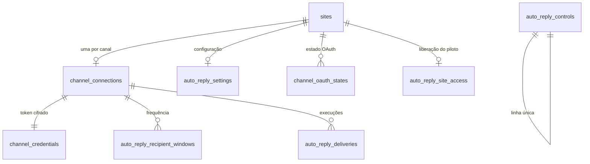

# Data Model: AutoResposta

Migração: [`supabase/migrations/20261126001000_auto_reply.sql`](../../supabase/migrations/20261126001000_auto_reply.sql). Todas as tabelas ficam em `private`, com RLS ligada e sem grants para `anon` e `authenticated`; o acesso é só por funções `security definer` com `search_path = ''`.

## Tabelas

| Tabela | Campos principais | Restrições | Retenção e exclusão |
| --- | --- | --- | --- |
| `auto_reply_controls` | `enabled`, `instagram_enabled`, `updated_by` | Linha única (`id = true`); padrão tudo desligado | Permanente |
| `auto_reply_site_access` | `site_id`, `allowed` | PK `site_id`; cascata ao apagar a vitrine | Enquanto a vitrine existir |
| `channel_connections` | `site_id`, `provider`, `provider_account_id`, `provider_business_id`, `username`, `display_name`, `status` (`connected`, `reconnect_required`, `suspended`), `status_reason`, `scopes`, `webhook_subscribed`, `connected_by`, `connected_at`, `last_verified_at`, `expires_at`, `last_event_at` | `UNIQUE (site_id, provider)`; `UNIQUE (provider, provider_account_id)` (RN-009); `provider in ('instagram')` | Apagada na desconexão (a linha some; o histórico fica na auditoria) |
| `channel_credentials` | `connection_id`, `token_ciphertext` (`v1.<iv>.<cifra>`), `token_type`, `expires_at`, `refreshed_at`, `key_version` | PK = conexão; cascata | Apagada com a conexão |
| `auto_reply_settings` | `site_id`, `enabled`, `message` (≤ 1000 bytes, sem caracteres de controle), `frequency` (`once`, `daily`, `weekly`), `version`, `enabled_at`, `last_sent_at`, `updated_by` | PK `site_id`; versão para concorrência otimista | Enquanto a vitrine existir; desligada em desconexão, suspensão ou reconexão necessária |
| `auto_reply_deliveries` | `provider`, `provider_event_id`, `site_id`, `connection_id`, `recipient_hash`, `status` (`processing`, `sent`, `skipped`, `failed`, `uncertain`, `cancelled`), `reason`, `error_code`, `attempts`, `provider_message_id`, `correlation_id`, datas | `UNIQUE (provider, provider_event_id)` (RN-005); índice parcial em `processing` | 90 dias (Cron); `connection_id` vira nulo ao desconectar |
| `auto_reply_recipient_windows` | `connection_id`, `recipient_hash`, `last_sent_at` | PK composta; cascata | Apagada na desconexão; janelas de 24 h e 7 dias vencidas há mais de 37 dias saem no Cron; "uma vez por contato" fica enquanto a conexão existir |
| `data_deletion_requests` (migração `20261126002000`) | `code_hash` (SHA-256 do código de confirmação), `provider`, `status` (`completed`, `pending_review`), `connections_removed`, `received_at`, `completed_at` | PK `code_hash` | 365 dias (Cron) |
| `channel_oauth_states` | `nonce_hash` (SHA-256), `site_id`, `user_id`, `provider`, `purpose`, `expires_at`, `consumed_at` | PK `nonce_hash`; prazo de 60 a 900 s | Apagado 1 dia depois de vencer |

**Dados que não existem em lugar nenhum**: texto das mensagens, anexos, nome ou foto do consumidor, identificador do consumidor em claro (`recipient_hash` é HMAC da conexão com chave derivada de `AUTO_REPLY_ENCRYPTION_KEY`), token em claro, código OAuth, `state` em claro.

## Funções

| Função | Quem chama | O que faz |
| --- | --- | --- |
| `read_auto_reply(site)` | equipe da vitrine (JWT) | Estado sem token |
| `save_auto_reply_settings(site, enabled, message, frequency, expected_version)` | dono e admin (JWT) | Salva com versão; ligar exige controles, liberação, conexão com `instagram_manage_messages` e vitrine publicada; auditoria |
| `service_create_channel_oauth_state` / `service_consume_channel_oauth_state` | Worker (`service_role`) | Estado de uso único |
| `service_save_channel_connection` | Worker | Conexão e credencial; recusa conta em outra vitrine (`CHANNEL_ACCOUNT_IN_USE`) e troca de conta (`CHANNEL_ACCOUNT_MISMATCH`); auditoria com o autor |
| `service_channel_credential` | Worker | Credencial para desconectar |
| `service_disconnect_channel` | Worker | Cancela pendentes, apaga conexão, credencial e janelas, desliga e audita |
| `service_auto_reply_target(provider, account)` | Worker | Contexto do envio (controles, liberação, publicação, domínios, configuração, credencial) |
| `service_claim_auto_reply_event` | Worker | Idempotência: devolve o id só na primeira chegada |
| `service_claim_recipient_window` / `service_release_recipient_window` | Worker | Vaga de frequência atômica e liberação |
| `service_finish_auto_reply_delivery` | Worker | Situação final; atualiza `last_sent_at` |
| `service_mark_channel_connection` | Worker | `reconnect_required`/`suspended` e desliga |
| `service_touch_channel_connection` / `service_find_channel_connection` | Worker | Verificação periódica e callbacks da Meta |
| `service_auto_reply_maintenance` | Cron | Presas → `uncertain`, retenção, janelas, estados e lista de tokens a verificar (até 5) |
| `service_auto_reply_credentials_to_rotate` / `service_rotate_channel_credential` | Worker e Cron | Lote com versão antiga e troca condicional (só se a cifra não mudou) |
| `service_record_data_deletion` / `service_read_data_deletion` | Worker | Pedido de exclusão e página de acompanhamento |
| `admin_read_auto_reply`, `admin_set_auto_reply_controls`, `admin_set_auto_reply_site_access`, `admin_suspend_channel_connection` | `platform_admin` (JWT) | Administração, métricas agregadas de 7 dias, auditoria |

## Concorrência

- Duas mensagens simultâneas do mesmo consumidor: a primeira insere a janela; a segunda cai no `on conflict do nothing` e recebe `claimed: false`.
- Duas abas salvando: `for update` + `expected_version`; a mais antiga recebe `AUTO_REPLY_VERSION_CONFLICT`.
- Reconexão concorrente: `for update` na conexão da vitrine e restrições únicas.

## Rollback

A migração só cria objetos novos. Reverter = remover as rotas (o Worker sem as tabelas responde `503 AUTO_REPLY_UNAVAILABLE`) e, se preciso, `drop` das tabelas e funções listadas acima. Nada existente é alterado.

## Testes de banco

`test/database/auto-reply.test.mjs` (PGlite): tabelas fechadas para `anon`/`authenticated`; funções `service_*` negadas a usuários; leitura sem token para a equipe; editor e outra vitrine não alteram; ativação exige tudo pronto; conflito de versão; limite de 1000 bytes; conta em outra vitrine e troca de conta recusadas; `state` de uso único e com prazo; idempotência; frequência atômica e liberável; token inválido desliga; desconexão apaga credencial e janelas e cancela pendentes; administração só para `platform_admin`; manutenção.
