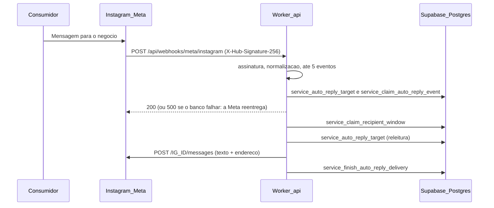

# Implementation Plan: AutoResposta

**Branch**: `cursor/autoresposta-instagram-d306` | **Date**: 2026-11-26 | **Spec**: [spec.md](spec.md)

**Input**: Especificação em `specs/019-autoresposta/spec.md`. Decisão proposta em [ADR 0017](../../docs/adr/0017-autoresposta-canais-sociais.md). Pesquisa em [research.md](research.md).

## Summary

O proprietário conecta a conta profissional do Instagram pelo login unificado da Meta (configuração própria com `instagram_basic` + `instagram_manage_messages`), escreve a mensagem e liga a resposta automática. O Worker recebe o webhook `messages` assinado, grava o evento (idempotência no banco), responde `200` e processa em `ctx.waitUntil`: regras, vaga de frequência atômica, endereço resolvido na hora, releitura do estado e envio por `POST /<IG_ID>/messages`, com até 3 tentativas para falhas transitórias e "inconclusivo" sem reenvio quando o resultado é incerto. O Cron horário marca execuções presas como inconclusivas, aplica a retenção e verifica tokens em lote pequeno. O `platform_admin` liga a funcionalidade, libera vitrines e suspende conexões.



## Technical Context

**Language/Version**: JavaScript ES2022 (módulos `.mjs`), HTML e CSS sem framework; SQL do Postgres 15 (Supabase).

**Primary Dependencies**: WebCrypto (HMAC-SHA256, AES-GCM, HKDF), Graph API da Meta `v27.0` por `fetch`, Supabase pela API HTTP. Nenhuma dependência npm nova.

**Storage**: Supabase Postgres, tabelas novas em `private` ([data-model.md](data-model.md)); token cifrado pelo Worker.

**Testing**: `node --test` (`npm test`); PGlite para a migração e permissões; Meta simulada (adaptador falso e `fetch` simulado) e fixtures no formato oficial dos webhooks; capturas 1280 e 375 px do painel.

**Target Platform**: Cloudflare Workers Free com Static Assets e Cron `17 * * * *`; navegadores atuais.

**Project Type**: aplicação web (Worker único `workers/api.mjs` + front-end estático em `web/`).

**Performance Goals**: webhook responde em menos de 1 s com até 5 eventos elegíveis; até 12 tentativas de reclamação por requisição para caber em 50 subrequisições do plano gratuito.

**Constraints**: custo zero (ADR 0005); nenhum envio a consumidor real em teste; token e segredos só no servidor; CSP do painel (`img-src 'self'`); nada de conteúdo de conversa no banco ou em logs.

**Scale/Scope**: piloto de até 10 vitrines; estimativas para 100 e 1.000 em `docs/integrations/auto-reply/cost-analysis.md`.

## Constitution Check

| Princípio | Situação |
|---|---|
| I. Administração privada e publicação pública | Passa. Nada da AutoResposta entra no snapshot público; o endereço é lido das tabelas existentes e só sai na mensagem ao consumidor. |
| II. Isolamento entre vitrines | Passa com testes. Tabelas em `private` sem grants; funções de usuário checam `has_site_role`; funções `service_*` só para `service_role`; testes de PGlite (outra vitrine, editor, anônimo) e de rota (404 para quem não é da equipe). Uma conta social por vitrine (restrição única). |
| III. Credenciais apenas no servidor | Passa. Token cifrado com AES-GCM (dados associados: vitrine, canal e conta); `META_APP_SECRET`, `AUTO_REPLY_ENCRYPTION_KEY` e `META_WEBHOOK_VERIFY_TOKEN` só em `wrangler secret`; teste de logs sem token, segredo, código, texto ou identificador do consumidor. |
| IV. Custo e condições verificáveis | Passa. Limites da Meta, do Workers Free e do Supabase Free registrados em research R8 e no estudo de custos; dependências externas (Revisão do app, Verificação da empresa, app Live) listadas como pendentes. |
| V. Entregas verificáveis | Passa. CT-001 a CT-030 do briefing cobertos por testes automatizados com Meta simulada; mocks declarados como não evidência de produção. |
| Delivery Constraints (Workers Free, sem plano pago) | Passa. Sem fila paga; `ctx.waitUntil` + Cron existente; reentrega da Meta (36 h) como garantia quando o banco falha. |

## Project Structure

### Documentation (this feature)

```text
specs/019-autoresposta/
├── spec.md
├── plan.md
├── research.md
├── data-model.md
├── quickstart.md
├── contracts/
│   ├── panel-api.md
│   ├── meta-endpoints.md
│   └── admin-api.md
├── checklists/
│   └── requirements.md
└── tasks.md

docs/integrations/auto-reply/    # guias operacionais (README é o índice)
docs/backlog/autoresposta/       # épico e issues
docs/adr/0017-autoresposta-canais-sociais.md
```

### Source Code (repository root)

```text
supabase/migrations/20261126001000_auto_reply.sql   # tabelas, funções e grants

src/auto-reply/
├── crypto.mjs              # AES-GCM/HKDF, hash do consumidor, HMAC, comparação constante
├── public-url.mjs          # endereço público no envio
├── rules.mjs               # regras centrais (sem nada do Instagram)
├── instagram-webhook.mjs   # challenge, assinatura, normalização
├── instagram-adapter.mjs   # login, troca, debug_token, contas, assinatura, envio, erros
├── processor.mjs           # processamento de um evento reclamado
├── store.mjs               # adaptadores PostgREST e memória
└── routes.mjs              # rotas do painel, OAuth, webhook, callbacks Meta, admin, Cron

web/assets/auto-reply-message.mjs   # mensagem, variáveis, limite (servidor e painel)
web/portal/auto-reply-panel.mjs     # seção "Resposta automática" na aba Canais
web/portal/auto-reply-panel.css
workers/api.mjs                     # registra rotas, adaptadores e o Cron

test/
├── database/auto-reply.test.mjs
├── auto-reply.test.mjs
├── auto-reply-panel.test.mjs
└── fixtures/meta-instagram-webhooks.mjs
```

**Structure Decision**: um módulo por responsabilidade em `src/auto-reply/`, como `src/billing/`, para não crescer `workers/api.mjs` (só 3 imports e um bloco de roteamento). O provedor fica atrás de um adaptador com `sendText` e classificação de erros; as regras centrais (`rules.mjs`, `public-url.mjs`, `auto-reply-message.mjs`) não conhecem o Instagram (US6).

## Entrega em PRs

Este PR entrega a especificação, o plano, o código do MVP com Meta simulada e a documentação operacional. Os passos seguintes, em ordem, estão em `docs/backlog/autoresposta/`:

1. Ratificar o ADR 0017 e reconferir LGPD e o aviso de automação com o jurídico.
2. Configuração Meta da AutoResposta no console (passos humanos, `meta-setup.md`).
3. Aplicar a migração em staging, configurar segredos e rodar o piloto interno com contas do Coletivo (testadores).
4. Homologação, Revisão do app (`instagram_manage_messages` e `instagram_basic` com Acesso avançado), Verificação da empresa e modo Live.
5. Liberação controlada por vitrine.

## Complexity Tracking

| Ponto | Por que é necessário | Alternativa mais simples recusada |
|---|---|---|
| Tabela de execuções com restrição única | Idempotência entre isolates e reentregas da Meta | Cache em memória do isolate: não sobrevive a reentregas em outro isolate |
| Janela de frequência separada das execuções | Reserva atômica antes do envio e liberação em falha | Contar execuções `sent` recentes: corrida entre mensagens simultâneas |
| Releitura do estado antes do envio | Desligar barra eventos em processamento (RN-010) | Confiar no estado lido ao receber: envia depois de desligado |
| Estado OAuth no banco | Uso único e vínculo com pessoa e vitrine | `state` HMAC sem tabela: não garante uso único |
| Interruptores no banco | Desligamento de emergência sem deploy | Variável de ambiente: exige novo deploy, que não está configurado |
